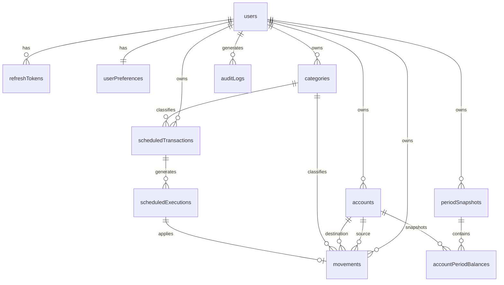

# Peco Backend — Development Plan

> Living document. It will be refined step by step until it is detailed enough to
> start implementation. Every refinement round must update the **Decision Log**
> and the **Refinement Roadmap** sections.

## 0. Document control

| Field        | Value                                                                                                                                                                                              |
| ------------ | -------------------------------------------------------------------------------------------------------------------------------------------------------------------------------------------------- |
| Status       | Draft v1.53 — EP-06 in progress: US-100/101/102/103/104/105/US-201/US-202/US-203/US-204/US-205/US-206/US-207/US-208/US-209/US-301/US-302/US-303/US-304/US-305/US-306/US-401/US-402/US-501/US-502/US-503/US-504/US-505/US-506/US-507/US-508/US-509/US-510/US-511/US-601/US-602/US-603/US-604 done; US-403 deliberately skipped; v1 releases the API, the web app follows in phase 2 |
| Last updated | 2026-11-23                                                                                                                                                                                         |
| Owner        | Backend team                                                                                                                                                                                       |
| Reviewers    | Product / Frontend                                                                                                                                                                                 |
| Target stack | Nx 24 monorepo: Angular 22 web app + NestJS/TypeORM/MySQL 8 API + shared TypeScript libs                                                                                                           |
| Related docs | `AGENTS.md`, `README.md`                                                                                                                                                                           |

### How to use this document

1. Read sections 1–4 to align on context, scope and assumptions.
2. Review sections 5–11 for the domain model, architecture (including the Nx
   workspace of 6.5–6.9), API surface, ledger rules, scheduling and periods.
3. Use sections 12–14 for background jobs, non-functional requirements and
   testing; section 15 records that no migration happens in v1.
4. Use section 16 for effort, section 17 for risks and section 21 for the
   implementable backlog; section 20 tracks which step is current (Step 9 is the
   Nx migration).
5. Record every accepted change in the **Decision Log** (section 19) and keep the
   session handoff (section 22) current.

---

## 1. Purpose

Peco is currently a **local-first PWA**: all business data lives in
`localStorage`, and the domain logic runs in Angular signal stores. This plan
defines the backend that will persist that data, enforce its invariants, run the
time-based processes (scheduled transactions and period closing) and expose the
reporting endpoints required by the current UI.

The backend is **not** a plain CRUD. It must absorb:

- A transactional ledger with materialized balances.
- A recurrence engine with idempotent auto-application.
- An immutable monthly period-closing process.
- Aggregated reporting over live and frozen data.
- A clean, versioned schema that replaces the current local persistence.

Both applications live in **one Nx workspace** (6.5): the existing Angular PWA
moves to `apps/web`, the new service is `apps/api`, and the code they share lives
in `libs/shared/*`. The conversion is the first implementation step (Step 9,
section 20) and happens before any API code is written.

---

## 2. Current state of the application

### 2.1 Snapshot

| Metric      | Value                                                                   |
| ----------- | ----------------------------------------------------------------------- |
| Framework   | Angular 22 (standalone, signals, PWA)                                   |
| State       | `@ngrx/signals` signal stores                                           |
| Persistence | `localStorage` (`peco.*` keys)                                          |
| Backend     | None                                                                    |
| Auth        | None                                                                    |
| Repository  | Single Angular CLI app at the repo root (to become an Nx monorepo, 6.5) |
| Source size | ~11.6k LOC TypeScript, ~4.7k LOC HTML, ~6.9k LOC tests                  |
| Tests       | Vitest                                                                  |

### 2.2 Functional domains

| Domain                       | Main entry point                                    | Backend needed | Complexity    |
| ---------------------------- | --------------------------------------------------- | -------------- | ------------- |
| Dashboard                    | `features/dashboard`                                | Yes            | Medium        |
| Movements                    | `features/movements` + `MovementsStore`             | Yes            | **Very high** |
| Accounts                     | `features/accounts` + `AccountsStore`               | Yes            | Medium-high   |
| Scheduled transactions       | `features/scheduled` + `ScheduledTransactionsStore` | Yes            | **Very high** |
| Periods & snapshots          | `GlobalPeriodStore`, `PeriodSnapshotsStore`         | Yes            | **Very high** |
| Categories                   | `CatalogStore`                                      | Yes            | Medium        |
| User preferences             | `UserPreferencesStore`                              | Yes            | Low           |
| Backup / data lifecycle      | `DataBackupService`                                 | Yes            | Medium        |
| Changelog                    | `ChangelogApiService` (static JSON)                 | No             | None          |
| Theme / PWA / service worker | Client-side                                         | No             | None          |

### 2.3 Persisted data (current keys)

| Key                           | Content                                                    |
| ----------------------------- | ---------------------------------------------------------- |
| `peco.accounts`               | Financial accounts                                         |
| `peco.movements`              | Movements (income, expense, transfer, reversals, canceled) |
| `peco.catalog.categories`     | Categories (root, system, user)                            |
| `peco.scheduled-transactions` | Recurring schedules                                        |
| `peco.period-snapshots`       | Closed monthly snapshots                                   |
| `peco.user-preferences`       | Consolidated preferences                                   |
| `peco.schema-version`         | Amount schema version (cents)                              |

---

## 3. Scope

### 3.1 In scope (v1)

- Multi-user authentication and account isolation.
- CRUD for accounts, categories, movements and scheduled transactions.
- Transactional balance updates and reversal flow.
- Recurrence engine with cron-based auto-application.
- Monthly period closing with immutable snapshots.
- Reporting endpoints for the existing dashboard and charts.
- User preferences.
- User data export as a single JSON document (D73).
- Audit trail for financial mutations.

### 3.2 Out of scope (v1)

- **Backup export/import/reset.** The feature existed to sync devices; the
  database replaces it and the frontend feature is being removed (D20).
- **Frontend refactor to consume the API.** It is **phase 2**, with its own
  plan and its own estimate (~80–140 h, D69). Until it ships, the web app keeps
  reading `localStorage` and the backend is consumed only by tests and tooling.
- Real offline-first synchronization (local queue, delta sync, conflict resolution).
  The web app keeps the PWA shell cached and requires connectivity for data; no
  API response is cached (D72).
- Bank integrations / Open Banking.
- Push notifications and transactional email beyond password reset.
- Multi-currency, shared accounts, advanced roles, SSO/2FA.
- Native mobile apps, BI tooling, backend i18n.
- Changelog, theme and PWA concerns (remain client-side).

> **Q15 (decided: start fresh).** Existing `localStorage` users are not
> migrated. The export/import feature is removed as-is and may return in a
> future version; every registered user starts from zero.

---

## 4. Assumptions & constraints

### 4.1 Assumptions

| #   | Assumption                                                                    | Impact if false                               |
| --- | ----------------------------------------------------------------------------- | --------------------------------------------- |
| A1  | Multi-user SaaS with email/password auth (**confirmed**)                      | Single-user reduces ~50–70 h                  |
| A2  | One tenant per user; no shared accounts                                       | Sharing adds authorization complexity         |
| A3  | Money is always stored as integer cents (`BIGINT`)                            | Changing later is a costly migration          |
| A4  | MySQL 8, InnoDB, `utf8mb4`                                                    | Other engines change locking strategy         |
| A5  | One backend instance or horizontally scaled behind a shared DB                | Cron needs distributed locking                |
| A6  | Existing `localStorage` users start from zero (Q15 = B); no importer is built | Existing history stays only in the old client |
| A7  | Periods are calendar months, resolved in **UTC** (no per-user timezone in v1) | Fiscal periods would change closing logic     |
| A8  | Movement amounts are positive magnitudes; direction comes from `type`         | Signed amounts would change the ledger        |

Every assumption above is an input to the estimate of section 16; the ones marked
**confirmed** were validated with the product owner.

### 4.2 Constraints

These are fixed by the environment rather than by preference. Changing one
invalidates part of the design and part of the estimate, so each row records the
consequence instead of leaving it implicit.

| Constraint                                                       | Why it is fixed                                                             | Consequence for the design                                                                           |
| ---------------------------------------------------------------- | --------------------------------------------------------------------------- | ---------------------------------------------------------------------------------------------------- |
| Node.js LTS + npm, one lockfile (D67)                            | The workspace already uses npm and the team is one person                   | No pnpm/yarn; `npm ci` is the only install path                                                      |
| MySQL 8 InnoDB `utf8mb4` is the only datastore (A4)              | Managed MySQL is cheap and the locking rules of 9.4 depend on InnoDB        | No Redis and no message broker: locks use `GET_LOCK`/`jobLocks` and jobs run in-process (section 12) |
| TypeORM with migrations, `synchronize: false`                    | A live schema must never be mutated at boot                                 | Every schema change ships as a reviewed migration (US-103)                                           |
| Timestamps as `VARCHAR(24)` UTC strings (D8)                     | The client already speaks ISO-8601 and the API must not translate timezones | No `@CreateDateColumn`/`@UpdateDateColumn`; one transformer writes them                              |
| Money as integer cents in `BIGINT` (A3, D26)                     | Floating point cannot be reconciled                                         | Conversion only at the form boundary; no decimal column exists                                       |
| `publicId` only at the boundary (Q13, D28)                       | Internal ids must never leak or be guessable                                | Every route resolves `publicId → id`; a miss is `404`                                                |
| Periods and calendar dates in UTC (A7)                           | One clock for jobs, closing and snapshots                                   | A user's local month boundary can differ from the API's; recorded as a v1 limitation in 13.3         |
| No external integrations in v1 (F2 rule)                         | There is no provider contract yet                                           | Email, Nx Cloud, error tracking and alert delivery stay behind an interface or in the platform       |
| One API container plus one MySQL; horizontal scale optional (A5) | There is no traffic forecast                                                | Jobs must stay safe under N replicas (section 12)                                                    |
| One full-time developer at 30 productive h/week (D66)            | Team size                                                                   | Scope is fixed and dates float (16.4)                                                                |
| The web app keeps shipping during the migration (6.9)            | Users are on the current PWA                                                | The Nx move happens on its own branch with a parity gate                                             |

---

## 5. Domain model

### 5.1 Bounded contexts

| Context        | Responsibility                                      |
| -------------- | --------------------------------------------------- |
| Identity       | Users, credentials, sessions                        |
| Ledger         | Accounts, movements, balances, reversals            |
| Catalog        | Categories and their rules                          |
| Scheduling     | Recurring transactions and occurrence execution     |
| Periods        | Monthly closing, snapshots and frozen reads         |
| Reporting      | Aggregations, series, distributions and projections |
| Preferences    | Per-user UI/behavior settings                       |
| Data lifecycle | Audit trail and soft delete                         |

### 5.2 Core entities

All entities extend `BaseEntity` (see 7.2): numeric `id` for internal use, UUID
`publicId` for the API. CRUD tables add `createdAt`/`updatedAt`/`deletedAt` as
UTC ISO-8601 strings; catalog/reference tables carry no timestamps.

| Entity                 | Key fields                                                                                                                                                                                                                                           | Notes                                                                                                                 |
| ---------------------- | ---------------------------------------------------------------------------------------------------------------------------------------------------------------------------------------------------------------------------------------------------- | --------------------------------------------------------------------------------------------------------------------- |
| `User`                 | id, email, passwordHash, name                                                                                                                                                                                                                        | Tenant root                                                                                                           |
| `Account`              | id, userId, name, type, initialBalance, currentBalance, includeInTotal, targetGoal, creditLimit, color, icon, pinToHome, isRoot, note, version                                                                                                       | Root invariant; `currentBalance = initialBalance + Σ movement impacts`                                                |
| `Category`             | id, userId?, name, displayName, icon, color, applyType, isRoot, isSystem                                                                                                                                                                             | `name` is the normalized slug and the uniqueness key; `displayName` is UI-only                                        |
| `Movement`             | id, userId, accountId, targetAccountId?, categoryId, type, amount, date, note, reversalId?, replacesMovementId?, isReversal, isReversed, isCanceled, scheduledTransactionId?, version                                                                | Ledger entry; `date` is a UTC timestamp                                                                               |
| `ScheduledTransaction` | id, userId, name, estimatedAmount, type, categoryId, sourceAccountId, destinationAccountId?, frequency, interval, anchorDate, nextContemplatedDate, nextExecutionDate, autoApply, active, totalOccurrences?, completedOccurrences, endDate?, version | Recurrence definition; `anchorDate`/`nextContemplatedDate` are contemplated, `nextExecutionDate` is applied (D51/D56) |
| `ScheduledExecution`   | id, scheduledTransactionId, contemplatedDate, occurrenceDate, movementId?, status, reason?, attempts                                                                                                                                                 | One row per occurrence; keeps the contemplated and the applied date                                                   |
| `PeriodSnapshot`       | id, userId, period `YYYY-MM`, startDate, endDate, global totals, accountBalances                                                                                                                                                                     | Immutable                                                                                                             |
| `AccountPeriodBalance` | snapshotId, accountId, frozen labels, includeInTotal, initial/final balance, counters                                                                                                                                                                | Embedded breakdown                                                                                                    |
| `UserPreferences`      | userId, theme, pwaBannerDismissedAt, hideBalance, hideReversal                                                                                                                                                                                       | 1:1 with user                                                                                                         |
| `AuditLog`             | id, userId, entity, entityId, action, before, after                                                                                                                                                                                                  | Financial traceability                                                                                                |

### 5.3 Business invariants (must be enforced server-side)

1. **Integer cents.** All monetary fields are integer cents; no decimals in
   storage or arithmetic.
2. **Positive magnitudes.** Movement and scheduled amounts are positive; the
   direction is derived from `type`.
3. **Negative balances are credit-only.** Only `CREDIT` accounts may hold a
   negative balance. Other types are clamped to `0`.
4. **Exactly one root account per user.** It is created at registration and
   cannot be deleted.
5. **Balance consistency.** Creating, editing, reverting or deleting a movement
   must update every affected account balance atomically.
6. **Transfers are double-entry.** The source loses and the destination gains
   the same amount.
7. **Reversal rules.** A reversal mirrors the original type and accounts, links
   via `reversalId`, marks the original as `isReversed` and the contra entry as
   `isReversal`. Both rows are immutable afterwards, and canceled movements
   cannot be reverted or edited.
8. **Canceled movements do not affect balances or snapshots.**
9. **Closed periods are immutable.** No movement writes are allowed inside a
   closed period. Snapshots are never recomputed, and closing serializes with
   ledger writes on the `users` row (11.9).
10. **Sequential closing.** Every month between the earliest activity and the
    previous month is closed in order; each snapshot anchors its
    `initialBalance` to the previous snapshot's `finalBalance` and cross-checks
    it against the ledger formula (11.4).
11. **Category deletion reassigns.** Movements and schedules are moved to the
    root category; system and root categories cannot be deleted or edited.
12. **Account deletion with balance.** A transfer to a destination account is
    created before the account is removed.
13. **Scheduled occurrences are applied once.** An occurrence cannot be applied
    twice, even across retries or multiple instances.
14. **UTC everywhere.** "Today" and "current month" are resolved in UTC for due
    detection and closing; there is no per-user timezone in v1.
15. **Movement date is a timestamp.** `movements.date` stores the exact UTC
    moment; period membership is derived from its date part.
16. **A type change replaces the movement.** `PATCH` never mutates `type`: it
    soft-deletes the original (reverting its balance impact) and creates a new
    row linked through `replacesMovementId` (D46/D47).
17. **Month-end schedules follow the business day.** When the anchor is the last
    day of its own month and the computed day is a Saturday or Sunday, the
    occurrence is applied on the previous business day (Friday). The
    contemplated date is stored next to the applied one (D56).
18. **Snapshots are gross; availability is derived.** `globalFinalBalance` sums
    every account, while `availableBalance` and `liabilitiesBalance` are
    computed from the frozen `accountType` and `includeInTotal` (11.6).

### 5.4 State machines

**Movement lifecycle**

```
CREATED ──edit──► EDITED
   │                 │
   ├──revert──► REVERSED (original flagged + reversal movement created)
   └──cancel──► CANCELED (no balance impact)
```

**Scheduled occurrence**

```
DUE ──execute──► APPLIED ──► both next dates advanced
 │
 ├──closed period──► SKIPPED (PERIOD_CLOSED) ──► advanced
 ├──cancel────────► SKIPPED (USER_CANCELLED + canceled movement) ──► advanced
 └──ledger error──► FAILED ──► retried (max 3) ──► schedule paused
```

**Period**

```
OPEN (current/future) ──close──► CLOSED (immutable snapshot)
```

---

## 6. Architecture

### 6.1 Stack

| Layer         | Choice                                                                   |
| ------------- | ------------------------------------------------------------------------ |
| Repository    | Nx 24 integrated monorepo, npm, one root `package.json` + lockfile (6.5) |
| Web app       | Angular 22 PWA, existing code moved to `apps/web` (6.6)                  |
| Shared code   | `libs/shared/contracts` and `libs/shared/utils`, framework-free (6.7)    |
| Runtime       | Node.js LTS                                                              |
| Framework     | NestJS (modular monolith)                                                |
| ORM           | TypeORM with migrations (`synchronize: false`)                           |
| Database      | MySQL 8 (InnoDB, `utf8mb4`)                                              |
| Validation    | `class-validator` + `class-transformer`                                  |
| Auth          | JWT access + refresh, `argon2` password hashing                          |
| Scheduling    | `@nestjs/schedule` + DB-based distributed lock                           |
| Docs          | Swagger / OpenAPI                                                        |
| Testing       | Jest + Supertest + Testcontainers (MySQL)                                |
| Observability | Structured logs, health checks, metrics endpoint                         |

### 6.2 API module layout (`apps/api/src`)

```
apps/api/src/
  common/        # filters, interceptors, guards, pagination, money, idempotency
  config/        # env validation, typeorm, jwt, throttler
  database/      # data-source, migrations, seeders
  modules/
    auth/
    users/
    accounts/
    categories/
    movements/
    scheduled-transactions/
    periods/
    reports/
    preferences/
    audit/
  jobs/          # auto-apply, period closing, reconciliation
```

### 6.3 Cross-cutting concerns

- Global `ValidationPipe` with `whitelist` and `forbidNonWhitelisted`.
- Global exception filter with a stable error envelope.
- Request-scoped logging with correlation id.
- `@nestjs/throttler` on auth endpoints.
- Idempotency keys on financial writes.
- Soft delete + audit for accounts and movements.
- Explicit DB transactions for every balance mutation.
- **camelCase schema:** keep TypeORM's default naming strategy (property name =
  column name). Do **not** install `typeorm-naming-strategies` or any
  snake_case converter.
- **DTO-only responses:** controllers return mapped DTOs, never entities, so the
  numeric `id` cannot leak.

### 6.4 Session & token policy (D22)

| Token         | Lifetime       | Notes                                                                |
| ------------- | -------------- | -------------------------------------------------------------------- |
| Access token  | **15 minutes** | JWT with the user's `publicId` as `sub`; stateless verification      |
| Refresh token | **30 minutes** | Stored hashed (SHA-256) in `refreshTokens`; rotated on every refresh |

- Every refresh revokes the old row and issues a new token pair.
- Reuse of a revoked refresh token is treated as theft: the whole token family
  is revoked and the user must log in again.
- Consequence: after 30 minutes of inactivity the user re-authenticates. This is
  intentional (small window for a stolen refresh token).
- A cleanup job deletes expired and revoked rows.

### 6.5 Workspace layout (Nx monorepo)

**Decision (D67).** One Nx **integrated** monorepo holds the existing Angular
PWA, the new API and the code both share. Nx orchestrates tasks and enforces
boundaries; each framework keeps its own build pipeline (`@angular/build`, Nest
CLI). Nothing here changes runtime behaviour: the web app keeps shipping the same
PWA.

| Why Nx                        | Effect here                                                                                 |
| ----------------------------- | ------------------------------------------------------------------------------------------- |
| One workspace, one lockfile   | `npm ci` installs once for both apps                                                        |
| Project graph + `nx affected` | CI rebuilds and retests only what a PR touched                                              |
| Module boundaries             | `apps/web` cannot import `apps/api` by accident                                             |
| Generators                    | New modules, libraries and apps follow the same conventions                                 |
| Local task cache              | `nx test api` is instant when its inputs did not change                                     |
| Nx Cloud                      | **Not used in v1** — external integration, deferred to the end-of-v1 pass (same rule as F2) |

Alternatives rejected: npm workspaces alone (no task graph, no boundary linting),
Turborepo (no generators, no module boundaries) and a plain folder split (no
orchestration, so CI would rebuild everything on every push).

```
peco/
  apps/
    web/                  # existing Angular 22 PWA (was the repo root)
    api/                  # NestJS service (6.2)
  libs/
    shared/
      contracts/          # wire types: DTOs, error codes, envelope (no value sets)
      enums/              # single source of truth for every domain value set
      utils/              # money, dates and other pure helpers
  tools/
    scripts/              # test-data generator and local helpers
  docs/                   # this plan
  nx.json
  tsconfig.base.json
  package.json            # single manifest and single lockfile
```

| Path                    | Project name | Type        | Tags                       |
| ----------------------- | ------------ | ----------- | -------------------------- |
| `apps/web`              | `web`        | application | `type:app`, `scope:web`    |
| `apps/api`              | `api`        | application | `type:app`, `scope:api`    |
| `libs/shared/contracts` | `contracts`  | library     | `type:lib`, `scope:shared` |
| `libs/shared/enums`     | `enums`      | library     | `type:lib`, `scope:shared` |
| `libs/shared/utils`     | `utils`      | library     | `type:lib`, `scope:shared` |

**Workspace rules.**

1. One root `package.json` and one committed `package-lock.json`; no nested
   manifests and no npm workspaces.
2. An app never imports another app. Anything two projects need moves to
   `libs/shared/*`.
3. `libs/shared/*` never imports from an app and never imports Angular or Nest
   APIs, so both sides can consume it.
4. `enums` owns every fixed domain value set and is the only place a value is
   declared; `contracts` derives its wire types from those enums with
   `StringEnumValues` and never restates the literals. The Nest DTO classes
   `implement` the contract interfaces and the web app maps them into its own
   `core/models`. Field names and error `code`s are declared once.
5. Tags are enforced by `@nx/enforce-module-boundaries` (6.8); a violation fails
   lint, not review.

### 6.6 Web app migration (existing Angular PWA)

The move is mechanical but touches every path, so it runs on its own branch, one
commit per step, and closes with the parity checklist of 6.9.

| Step | Command / action                                                                         | Result                                                                                                                                                                  |
| ---- | ---------------------------------------------------------------------------------------- | ----------------------------------------------------------------------------------------------------------------------------------------------------------------------- |
| 1    | `npx nx@24.0.6 init --interactive=false --nxCloud=false`                                 | Adds `nx.json`, installs `nx` + `@nx/angular` and detects the Angular CLI workspace                                                                                     |
| 2    | `npx nx g @nx/workspace:convert-to-monorepo`                                             | Moves the root project to `apps/peco` and renames the root manifest to `@peco/source`                                                                                   |
| 3    | `npx nx g @nx/workspace:move --project=peco --destination=apps/web --newProjectName=web` | Final project name `web`, root `apps/web`                                                                                                                               |
| 4    | Update `tsconfig.base.json` paths                                                        | `@core/*`, `@shared/*`, `@features/*` resolve to `apps/web/src/...`                                                                                                     |
| 5    | Move workspace files                                                                     | `ngsw-config.json`, `public/`, `.postcssrc.json` and `src/assets` end up inside `apps/web`; `docs/`, `.husky/`, `.commitlintrc.json` and `.prettierrc` stay at the root |
| 6    | Re-point scripts                                                                         | Root scripts become `nx serve web`, `nx build web`, `nx test web`; `npm start` stays as an alias                                                                        |
| 7    | Verify                                                                                   | The checklist of 6.9 passes on a clean clone                                                                                                                            |

**Breakage checklist.** These are the usual failure points and each one is
verified explicitly:

- **Path aliases:** the root `tsconfig.json` points at `./src/...`; after the move
  every alias must resolve from `apps/web` and `tsc` must stay clean.
- **PWA:** `ngsw-config.json`, `manifest.webmanifest`, icons and `_redirects`
  keep their output paths, so the installed app still updates and works offline.
- **Tailwind v4:** `.postcssrc.json` and `styles.css` keep resolving and the
  production budgets of `angular.json` still apply.
- **Vitest:** `test-setup.ts` and the `@angular/build:unit-test` target keep
  working under `nx test web`.
- **`scripts/test-data.js`:** moves to `tools/scripts` and keeps its npm script.

> Step 2 names the moved project `peco` (from `angular.json`) and step 3 renames
> it to `web`, so the workspace reads `apps/web` and `apps/api`. The `@peco`
> npm scope comes from the renamed root manifest, which is why the shared
> libraries import as `@peco/contracts` and `@peco/utils`.

### 6.7 API app and shared libraries

| Command                                                                                                  | Result                                                                          |
| -------------------------------------------------------------------------------------------------------- | ------------------------------------------------------------------------------- |
| `npx nx g @nx/nest:app api --directory=apps/api`                                                         | NestJS app in `apps/api` with its own `project.json`, Jest config and `main.ts` |
| `npx nx g @nx/js:lib contracts --directory=libs/shared/contracts --bundler=none --unitTestRunner=vitest` | Framework-free TypeScript library                                               |
| `npx nx g @nx/js:lib enums --directory=libs/shared/enums --bundler=none --unitTestRunner=vitest`         | Framework-free enum registry library                                            |
| `npx nx g @nx/js:lib utils --directory=libs/shared/utils --bundler=none --unitTestRunner=vitest`         | Framework-free TypeScript library                                               |

- Import paths: `@peco/contracts`, `@peco/enums` and `@peco/utils`.
- `enums` is the single source of truth for domain value sets (7.1). Every member
  is built with `stringEnumValue(value)`, whose `toString()` returns the literal
  type instead of `string`, so `Enum.MEMBER.toString()` stays assignable to the
  derived contract types and keeps discriminated unions narrow.
- `contracts` holds `AuthResponse`, `AccountResponse`, `MovementResponse`,
  `PeriodSnapshotResponse`, the wire types derived from the `enums` registries,
  the `code` union of 8.3 and the `ApiSingleSuccess<T>` / `ApiListSuccess<T, M>` /
  `ApiError` envelope types. No
  Nest and no Angular imports.
- `utils` holds the pure helpers both sides need: cents conversion and
  formatting, UTC date helpers and `movementBalanceImpact` — the same math the
  web app already uses, so the API and the UI cannot drift.
- The API keeps its `class-validator` DTO classes in `apps/api` and they
  `implement` the `contracts` interfaces. The web app maps `contracts` into
  `core/models`, so the AGENTS.md naming rules stay valid inside `apps/web`.
- Any helper that both apps need but is not a wire type goes to `utils`; it is
  never duplicated in an app.

### 6.8 CI, caching and developer workflow

| Concern           | Decision                                                                                           |
| ----------------- | -------------------------------------------------------------------------------------------------- |
| Package manager   | npm (already in use), single root manifest + committed `package-lock.json`                         |
| Task runner       | `nx` 24.x pinned; upgrades only through `nx migrate`                                               |
| Local cache       | `.nx/cache`, git-ignored; `nx reset` clears it                                                     |
| Remote cache      | **Deferred** — Nx Cloud is an external integration (F2 rule)                                       |
| CI                | `.github/workflows/ci.yml`: `npm ci`, then `npx nx affected -t lint test build --base=origin/main` |
| Hooks             | Husky keeps `commit-msg` (commitlint) and `pre-commit` (affected lint)                             |
| Module boundaries | `@nx/enforce-module-boundaries` with the tags of 6.5                                               |
| Formatting        | `nx format:check` in CI; Prettier config stays at the root                                         |

- `package-lock.json` is currently git-ignored; it must be committed before the
  first CI run, otherwise neither the install nor the cache key is reproducible.
- `nx graph` is the reference for dependency questions; an app-to-app cycle is a
  lint error, not a review comment.

### 6.9 Migration acceptance criteria

The migration is done when, on a clean clone:

1. `npm ci && npx nx build web` produces the same entry points, budgets and PWA
   output as the current build.
2. `npx nx test web` runs the existing suite with the same results as today.
3. `npx nx serve web` and `npx nx serve api` run side by side on different ports.
4. `npx nx build api` compiles the Nest skeleton and `GET /health` answers.
5. `npx nx affected -t lint test build` is green on a PR that only touches
   `libs/shared/utils`.
6. `npx nx graph` shows `web → shared`, `api → shared` and no app-to-app edge.
7. `npx nx format:check` is green and no file imports another app.
8. The repository has one `package.json`, one lockfile and no `src/` left at the
   root.

**Rollback.** The migration lives on its own branch; if the checklist fails the
branch is discarded and the workspace is untouched — no data, schema or API
contract is involved.

---

## 7. Data model

### 7.1 Enums

| Enum                       | Values                                                |
| -------------------------- | ----------------------------------------------------- |
| `AccountType`              | `CASH`, `DEBIT`, `CREDIT`, `SAVINGS`                  |
| `MovementType`             | `INCOME`, `EXPENSE`, `TRANSFER`                       |
| `CategoryApplyType`        | `INCOME`, `EXPENSE`, `BOTH`, `TRANSFER`               |
| `RecurrenceFrequency`      | `DAILY`, `WEEKLY`, `FORTNIGHTLY`, `MONTHLY`, `YEARLY` |
| `ScheduledTransactionType` | `INCOME`, `EXPENSE`, `TRANSFER`                       |
| `AppTheme`                 | `light`, `dark`, `system`                             |
| `ScheduledExecutionStatus` | `APPLIED`, `SKIPPED`, `FAILED`                        |

**Shared registry (D83).** Every value set above lives in `libs/shared/enums`
(`AccountTypeEnum`, `MovementTypeEnum`, `CategoryApplyTypeEnum`,
`RecurrenceFrequencyEnum`, `ScheduledTransactionTypeEnum`, `AppThemeEnum`,
`ScheduledExecutionStatusEnum`), together with `ApiErrorCodeEnum`, the internal
`RefreshRotationStatusEnum` and the `stringEnumValue` helper. Contract types
derive from the registries with `StringEnumValues`; app code consumes
`Enum.MEMBER.toString()` and never repeats a literal.

### 7.2 Base entity & timestamp conventions

**Naming:** every table property and column is **camelCase**. No `snake_case`
anywhere in the schema, entities, DTOs or JSON payloads.

**`BaseEntity` — inherited by every table**

| Property   | Column type                      | Notes                                                                                                                                                                    |
| ---------- | -------------------------------- | ------------------------------------------------------------------------------------------------------------------------------------------------------------------------ |
| `id`       | `BIGINT UNSIGNED AUTO_INCREMENT` | Internal primary key. **Never exposed** by the API.                                                                                                                      |
| `publicId` | `CHAR(36)`                       | UUID v4, **globally unique**, generated by the application with `crypto.randomUUID()` before insert. Stored as `ascii` / `ascii_bin`. The only identifier the API knows. |

**`TimestampedEntity extends BaseEntity` — tables with a lifecycle but no delete**

| Property    | Column type            | Set on           |
| ----------- | ---------------------- | ---------------- |
| `createdAt` | `VARCHAR(24) NOT NULL` | `POST` (insert)  |
| `updatedAt` | `VARCHAR(24) NOT NULL` | `PATCH` / update |

**`SoftDeletableEntity extends TimestampedEntity` — CRUD tables**

| Property    | Column type            | Set on           |
| ----------- | ---------------------- | ---------------- |
| `createdAt` | `VARCHAR(24) NOT NULL` | `POST` (insert)  |
| `updatedAt` | `VARCHAR(24) NOT NULL` | `PATCH` / update |
| `deletedAt` | `VARCHAR(24) NULL`     | soft delete      |

Rules:

- **Timestamps are UTC strings**, format `YYYY-MM-DDTHH:mm:ss.sssZ` (24 chars),
  e.g. `2026-11-12T15:04:05.123Z`.
- **No database-generated timestamps.** Do not use `CURRENT_TIMESTAMP`,
  `ON UPDATE`, or `NOW()`; the application writes the value so tests, jobs,
  jobs and backfills all share one clock.
- **One writer per field:** `createdAt` is written only on insert, `updatedAt`
  only on update, `deletedAt` only on soft delete. No other code path touches
  them.
- **Entities expose `string`**, not `Date`. A TypeORM transformer
  (`stringTransformer`) is the only place that serializes/deserializes.
- **Sortable:** ISO-8601 UTC sorts lexicographically, so `ORDER BY createdAt`
  and range filters work on the `VARCHAR` column. Avoid `DATE()`/`MONTH()` SQL
  functions on these columns; filter by string range instead.
- **`deletedAt` is the soft-delete marker**; every read goes through a base
  repository that adds `deletedAt IS NULL` unless `withDeleted` is requested.
- **TypeORM mapping:** do **not** use `@CreateDateColumn`, `@UpdateDateColumn`
  or `@DeleteDateColumn` (they hand back `Date` objects and rely on DB
  defaults). Use plain `@Column({ type: 'varchar', length: 24 })` with the UTC
  string transformer, set the values in a shared `BaseSubscriber`
  (`beforeInsert` / `beforeUpdate`) and implement soft delete as an explicit
  `deletedAt = nowUtcString()` update.
- **Reference/catalog tables extend `BaseEntity` only** (no timestamps), because
  they are seeded and never mutated by the user.

**Table classification**

| Table                                                                | Base                  | Timestamps                                                                              |
| -------------------------------------------------------------------- | --------------------- | --------------------------------------------------------------------------------------- |
| `users`                                                              | `SoftDeletableEntity` | `createdAt`, `updatedAt`, `deletedAt`                                                   |
| `accounts`                                                           | `SoftDeletableEntity` | `createdAt`, `updatedAt`, `deletedAt`                                                   |
| `categories`                                                         | `SoftDeletableEntity` | `createdAt`, `updatedAt`, `deletedAt`                                                   |
| `movements`                                                          | `SoftDeletableEntity` | `createdAt`, `updatedAt`, `deletedAt`                                                   |
| `scheduledTransactions`                                              | `SoftDeletableEntity` | `createdAt`, `updatedAt`, `deletedAt`                                                   |
| `userPreferences`                                                    | `SoftDeletableEntity` | `createdAt`, `updatedAt`, `deletedAt` (D87: deleted with its `users` owner)             |
| `refreshTokens`                                                      | `TimestampedEntity`   | `createdAt`, `updatedAt` (`revokedAt` is the invalidation marker)                       |
| `passwordResetTokens`                                                | `TimestampedEntity`   | `createdAt`, `updatedAt` (`usedAt` is the consumption/supersession marker)              |
| `periodSnapshots`                                                    | `BaseEntity`          | `createdAt` only (immutable once written)                                               |
| `scheduledExecutions`                                                | `BaseEntity`          | `createdAt` only (append-only idempotency ledger)                                       |
| `accountPeriodBalances`                                              | `BaseEntity`          | none (generated with the parent snapshot, never mutated)                                |
| `auditLogs`                                                          | `BaseEntity`          | `createdAt` only (append-only)                                                          |
| `idempotencyKeys`                                                    | `TimestampedEntity`   | `createdAt`, `updatedAt` (rows are hard-deleted by the cleanup job, never soft-deleted) |
| Future reference catalogs (currencies, icon catalog, account types…) | `BaseEntity`          | none                                                                                    |

**Identifier flow (Q13)**

```
client  ──publicId──►  controller/DTO
                          │  resolvePublicId() → internal numeric id
                          ▼
                     service + repository  ── id (FK, joins, WHERE) ──►  MySQL
                          │  serialize → publicId only
                          ▼
client  ◄──publicId──  response DTO
```

- **Inbound:** every request body, query param and path param carries
  `publicId` only. The service resolves it to the internal `id` once, before
  querying.
- **Internal:** foreign keys, joins and indexes use the numeric `id`. Tenant
  isolation uses the internal numeric `userId` resolved from the JWT `sub`
  (which is the user's `publicId`).
- **Outbound:** response DTOs are built explicitly from `publicId`; the numeric
  `id` never leaves the service layer. A `ClassSerializerInterceptor` plus DTO
  mapping (no entity returned directly) enforces this.
- **Unresolvable or foreign `publicId`** returns `404 NOT_FOUND` — never
  `403` — so existence is not leaked across tenants.
- **UUID generation & storage (M2):** generated in the application with
  `crypto.randomUUID()` (never by MySQL), stored as
  `CHAR(36) CHARACTER SET ascii COLLATE ascii_bin`; `BINARY(16)` remains a
  documented future optimization.
- **Global uniqueness (M3):** `publicId` is unique across the whole table, not
  per user. Lookups still always add `userId`, so a cross-tenant read is
  impossible even in the unlikely event of a collision.

### 7.3 Tables

Every table below also includes the `BaseEntity` columns (`id`, `publicId`) and,
when applicable, the timestamps listed in 7.2.

| Table                   | Columns                                                                                                                                                                                                                                                                                                      | Constraints                                                                                                               |
| ----------------------- | ------------------------------------------------------------------------------------------------------------------------------------------------------------------------------------------------------------------------------------------------------------------------------------------------------------ | ------------------------------------------------------------------------------------------------------------------------- |
| `users`                 | `email`, `passwordHash`, `name`, `lastActiveAt` (`VARCHAR(24)` UTC, nullable)                                                                                                                                                                                                                                | unique `email`; index `(lastActiveAt)` for the inactive-user filter (D58)                                                 |
| `refreshTokens`         | `userId`, `tokenHash`, `expiresAt`, `revokedAt`                                                                                                                                                                                                                                                              | FK `userId`; index `(userId, expiresAt)`                                                                                  |
| `passwordResetTokens`   | `userId`, `tokenHash`, `expiresAt`, `usedAt`                                                                                                                                                                                                                                                                 | FK `userId`; unique `tokenHash`; index `(userId, expiresAt)`                                                              |
| `accounts`              | `userId`, `name`, `type`, `initialBalance`, `currentBalance`, `includeInTotal`, `targetGoal`, `creditLimit`, `color`, `icon`, `pinToHome`, `isRoot`, `note`, `version`                                                                                                                                       | FK `userId`; index `(userId, deletedAt)`; one root per user (service + generated column)                                  |
| `categories`            | `userId` (nullable), `name`, `displayName`, `icon`, `color`, `applyType`, `isRoot`, `isSystem`, `activeName` (generated), `ownerKey` (generated)                                                                                                                                                             | FK `userId`; unique `(ownerKey, activeName)`; system rows have `userId = NULL` and `ownerKey = 0`                         |
| `movements`             | `userId`, `accountId`, `targetAccountId`, `categoryId`, `type`, `amount`, `date` (`VARCHAR(24)` UTC), `note`, `reversalId`, `replacesMovementId`, `isReversal`, `isReversed`, `isCanceled`, `scheduledTransactionId`, `version`                                                                              | FKs; indexes `(userId, date)`, `(userId, accountId, date)`, `(userId, targetAccountId, date)`, `(scheduledTransactionId)` |
| `scheduledTransactions` | `userId`, `name`, `estimatedAmount`, `type`, `categoryId`, `sourceAccountId`, `destinationAccountId`, `frequency`, `interval`, `anchorDate` (`DATE`), `nextContemplatedDate` (`DATE`), `nextExecutionDate` (`DATE`), `autoApply`, `active`, `totalOccurrences`, `completedOccurrences`, `endDate`, `version` | FKs; index `(userId, active, nextExecutionDate)`                                                                          |
| `scheduledExecutions`   | `scheduledTransactionId`, `contemplatedDate` (`DATE`), `occurrenceDate` (`DATE`, applied), `movementId` (nullable), `status`, `reason` (nullable), `attempts`                                                                                                                                                | unique `(scheduledTransactionId, contemplatedDate)`; index `(scheduledTransactionId, occurrenceDate)`                     |
| `periodSnapshots`       | `userId`, `period` (`CHAR(7)`), `startDate`, `endDate`, `globalInitialBalance`, `globalFinalBalance`, `totalInflows`, `totalOutflows`, `totalTransfers`, `totalTransactionsCount`                                                                                                                            | unique `(userId, period)`                                                                                                 |
| `accountPeriodBalances` | `snapshotId`, `accountId`, `accountName`, `accountType`, `color`, `icon`, `includeInTotal`, `initialBalance`, `finalBalance`, `totalTransactions`, `totalInflows`, `totalOutflows`, `totalTransfers`                                                                                                         | unique `(snapshotId, accountId)`                                                                                          |
| `userPreferences`       | `userId`, `theme`, `pwaBannerDismissedAt`, `hideBalance`, `hideReversal`                                                                                                                                                                                                                                     | unique `userId` (1:1 with `users`)                                                                                        |
| `auditLogs`             | `userId`, `entity`, `entityId`, `action`, `before`, `after`                                                                                                                                                                                                                                                  | index `(userId, entity, entityId)`, `(userId, createdAt)`                                                                 |
| `idempotencyKeys`       | `userId`, `key`, `endpoint`, `requestHash`, `responseStatus`, `responseBody`, `expiresAt`                                                                                                                                                                                                                    | unique `(userId, key)`; index `(expiresAt)` for cleanup                                                                   |

> `auditLogs.entityId` stores the affected row's `publicId` (not the numeric
> `id`), so the log stays meaningful even if rows are purged or re-imported.

> `accountPeriodBalances` copies `accountName`, `accountType`, `color`,
> `icon` and `includeInTotal` from the account at closing time (Q16). Frozen
> labels let closed-period reports render without joining the (possibly
> soft-deleted) account row, and the frozen `includeInTotal` reproduces the
> dashboard split of the live path (11.6).

> `categories.name` is the normalized slug (lowercase, accent-stripped) and the
> uniqueness key via `activeName` + `ownerKey`; `displayName` preserves the
> user's casing and accents for the UI only.

### 7.4 Indexes & constraint notes

- **Category names are reusable after deletion (M4).** A plain
  `unique(userId, name)` would keep the deleted row blocking the name, so the
  index is built over a generated column:
  `activeName = IF(deletedAt IS NULL, name, NULL)`. MySQL ignores `NULL`s, so
  several deleted rows may share a name while only one active row can hold it.
- **System categories need an owner key (D64).** `unique(userId, activeName)`
  cannot protect the global rows, because MySQL treats every `NULL` as distinct.
  A second generated column `ownerKey = COALESCE(userId, 0)` (stored) plus
  `unique(ownerKey, activeName)` gives one namespace per user and exactly one
  namespace for the system catalog, while still allowing many deleted rows.
- **Category names are normalized (supersedes M5/D12).** `name` is the
  normalized slug (lowercase, accent-stripped) and is the uniqueness key;
  `displayName` keeps the user's casing and accents for display only. Two
  categories whose display names normalize to the same slug are duplicates
  (`Comida` = `comida` = `cómida`). Emails also use their normalized lowercase
  form (below).
- **Email is reserved forever (Q14).** `unique(email)` includes soft-deleted
  rows; that is the intended behavior. `email` is stored lowercased and trimmed
  before insert/compare.
- **Root account:** exactly one `isRoot = true` per user, enforced with a
  generated column (`rootKey = IF(isRoot AND deletedAt IS NULL, userId, NULL)`)
  plus a unique index. The service also validates it inside the transaction.
- **System categories:** rows with `userId = NULL` are global. Their name
  uniqueness is enforced by the seeder and service, not by the composite unique
  index (MySQL allows multiple `NULL`s).
- **Optimistic locking (M11/D32):** `accounts.version`, `movements.version` and
  `scheduledTransactions.version` start at `0` and increment on every write
  that changes the row. Updates run as
  `UPDATE ... SET ..., version = version + 1 WHERE id = ? AND version = ?`;
  zero affected rows means a concurrent change, so the transaction retries
  (bounded, e.g. 3 attempts) or returns `409 VERSION_CONFLICT`. Balance
  mutations always run inside a transaction with `SELECT ... FOR UPDATE`.
- **Movements:** `date` is a `VARCHAR(24)` UTC timestamp, so the composite
  indexes still cover period filtering (`date >= start AND date < nextMonth`)
  and account detail. Group by day with `SUBSTRING(date, 1, 10)`. Add
  `(userId, scheduledTransactionId)` if scheduled history queries become hot.
- **Snapshots:** `unique(userId, period)` makes period closing idempotent at the
  database level.
- **Executions:** `unique(scheduledTransactionId, contemplatedDate)` is the
  primary idempotency guard for auto-apply; one row per grid slot (M20).
  `contemplatedDate` is the date the grid produced and `occurrenceDate` is the
  date actually applied (clamped and moved to the previous business day when
  needed, D56). `status` is `APPLIED`, `SKIPPED` or `FAILED`; `reason` stores
  `PERIOD_CLOSED`, `USER_CANCELLED` or `INACTIVE_USER` (D58) on skipped rows and
  the error `code` on failed ones; `attempts` counts failed tries (max 3). A
  failed row may transition to `APPLIED` on retry, or to `SKIPPED` /
  `PERIOD_CLOSED` when the month closed first (D61); those are the only allowed
  mutations.
- **Recurrence anchor (D51/D56):** `scheduledTransactions.anchorDate` is a
  `DATE` that stores the first **contemplated** occurrence.
  `nextContemplatedDate` is the next grid date and `nextExecutionDate` is its
  **applied** date (clamped and moved to the previous business day), so
  month-end clamping never drifts and the business-day rule is applied exactly
  once.
- **Idempotency keys (M12):** `unique(userId, key)` with `expiresAt` (24 h by
  default, configurable up to 7 days) and a cleanup job that deletes expired
  rows. A replay with the same key returns the stored `responseBody` instead of
  re-executing the write.
- **Password reset tokens (D85):** `usedAt` is stamped when a token is consumed
  or when a later request supersedes it, so only the newest token of a user can
  be used. The raw token never reaches storage: lookups use the unique SHA-256
  `tokenHash`, and `(userId, expiresAt)` supports expiration cleanup.
- **Index column order:** tenant column (`userId`) always first; then the
  selective/filter column; then the sort column.

### 7.5 Money, enums & column conventions

- Monetary columns: signed `BIGINT` storing **integer cents** (M6).
- **Column names drop the `Cents` suffix (D26):** `amount`, `currentBalance`,
  `initialBalance`, `finalBalance`, `estimatedAmount`, `targetGoal`,
  `creditLimit`, `globalInitialBalance`, `totalInflows`… The unit is always
  cents, never dollars.
- `currentBalance` and snapshot balances may be negative (credit accounts hold
  an outstanding debt).
- Magnitudes (`amount`, `estimatedAmount`, `targetGoal`, `creditLimit`) must be
  `>= 0`; the service validates it. The columns are signed too, so a bug cannot
  silently wrap around.
- **Single currency in v1 (M18):** no `currency` column; the app works in one
  currency. Adding multi-currency later is an explicit, separate migration.
- **Enums live in code, `VARCHAR` in the table (M7):** the shared enum registry
  in `@peco/enums` is the source of truth and `Enum.MEMBER.toString()` produces
  the value used in queries; the column is `VARCHAR(20)` with a service-level
  validator (no MySQL `ENUM`, no `CHECK`).
- **Optional values are `NULL` (M8):** `note`, `color`, `icon`, `endDate` and
  similar are nullable; booleans and counters have explicit defaults
  (`false` / `0`). Never use `''` to mean "empty".
- **Audit timestamps** (`createdAt`, `updatedAt`, `deletedAt`, `expiresAt`,
  `revokedAt`, `pwaBannerDismissedAt`): UTC ISO-8601 strings (7.2).
- **Domain dates** (`periodSnapshots.startDate/endDate`,
  `scheduledTransactions.anchorDate/nextContemplatedDate/nextExecutionDate/endDate`,
  `scheduledExecutions.contemplatedDate/occurrenceDate`): `DATE` (`YYYY-MM-DD`),
  because they are calendar dates in UTC and must not shift with a timezone
  conversion.
- **`movements.date` is a timestamp (D34):** `VARCHAR(24)` UTC ISO-8601
  (`2026-11-12T15:04:05.123Z`), like the audit timestamps. It stores the exact
  moment; the period and the calendar day are derived from its date part.
- Period keys: `CHAR(7)` in `YYYY-MM` format.
- **Everything runs in UTC (D27).** There is no per-user `timezone` column;
  "today", "current month" and period boundaries are resolved in UTC.

**Column limits (M9)**

| Column                              | Type           | Notes                                                   |
| ----------------------------------- | -------------- | ------------------------------------------------------- |
| `name`, `displayName`               | `VARCHAR(80)`  | `name` is the normalized slug; `displayName` is UI-only |
| `note`                              | `VARCHAR(500)` | nullable                                                |
| `color`                             | `CHAR(7)`      | `#RRGGBB`                                               |
| `icon`                              | `VARCHAR(40)`  | icon key                                                |
| `email`                             | `VARCHAR(254)` | stored lowercase, unique                                |
| `period`                            | `CHAR(7)`      | `YYYY-MM`                                               |
| `tokenHash`                         | `CHAR(64)`     | SHA-256 hex                                             |
| `key` (idempotency)                 | `VARCHAR(128)` | client-provided                                         |
| `publicId`                          | `CHAR(36)`     | `ascii_bin`                                             |
| `createdAt`/`updatedAt`/`deletedAt` | `VARCHAR(24)`  | ISO-8601 UTC                                            |
| `movements.date`                    | `VARCHAR(24)`  | ISO-8601 UTC timestamp                                  |

### 7.6 Referential rules

- `movements.categoryId` → `categories.id` (`RESTRICT`; reassignment handled in service).
- `movements.accountId` and `targetAccountId` → `accounts.id` (`RESTRICT`).
- `movements.reversalId` → `movements.id` on the contra entry, pointing to the original (`SET NULL` on hard delete; soft delete is the norm).
- `movements.replacesMovementId` → `movements.id` on the replacement created by a
  type change, pointing to the soft-deleted original (`SET NULL` on hard delete).
- `scheduledTransactions.sourceAccountId` and `destinationAccountId` → `accounts.id` (`RESTRICT`).
- `scheduledExecutions.scheduledTransactionId` → `scheduledTransactions.id` (`CASCADE`).
- `scheduledExecutions.movementId` → `movements.id` (`SET NULL`).
- `accountPeriodBalances.snapshotId` → `periodSnapshots.id` (`CASCADE`).
- `accountPeriodBalances.accountId` → `accounts.id` (`RESTRICT`; historical rows keep the account after soft delete).
- **Deleting a user (M15/D31):** soft delete `users` and `userPreferences`, set
  `deletedAt` on their rows, anonymize `name` and `passwordHash`, and keep the
  original `email` as the reservation key (Q14). Financial rows and snapshots
  are retained for audit; a scheduled job hard-deletes the user's PII after the
  legal retention window (5 years by default).

### 7.7 Entity relationship diagram



---

## 8. API design

### 8.1 Conventions

- Base path: `/api/v1`; JSON only (`Content-Type: application/json`).
- Auth: `Authorization: Bearer <accessToken>` on every endpoint except
  `/auth/register`, `/auth/login`, `/auth/refresh`, `/auth/forgot-password`,
  `/auth/reset-password` and `/health`.
- Identifiers: every path param and every response field uses `publicId`
  (UUID). Request bodies reference related entities by `publicId`; the service
  resolves them to internal numeric ids. The numeric `id` is never exposed.
- Money: **integer cents**, never decimals, never strings. Field names have no
  `Cents` suffix (`amount`, `currentBalance`, `initialBalance`…).
- Dates: `anchorDate`, `nextContemplatedDate`, `nextExecutionDate`, `endDate`,
  `contemplatedDate`, `occurrenceDate`, `from`, `to` and `asOf` are calendar
  dates in **`YYYY-MM-DD`** (UTC). `movements.date` and the
  audit fields (`createdAt`, `updatedAt`, `expiresAt`) are UTC ISO-8601
  timestamps (`2026-11-12T15:04:05.123Z`); `date` includes hours, minutes and
  seconds.
- Periods: `YYYY-MM` (UTC calendar month).
- Naming: every JSON field is camelCase, matching the database columns.
- Enums: uppercase strings for domain enums (`INCOME`, `CREDIT`…), lowercase for
  `theme` (`light`, `dark`, `system`). Unknown enum values are rejected with
  `400 VALIDATION_ERROR`.
- Unknown or foreign `publicId` → `404 NOT_FOUND` (never `403`), so existence is
  not leaked across tenants.
- Every response carries `X-Correlation-Id`; every error body repeats it.
- Deprecations: a breaking change ships under a new path (`/api/v2`) or behind a
  new field; existing fields are never silently repurposed.

### 8.2 Endpoint catalog

#### Auth

| Method | Path                    | Success | Description                                       |
| ------ | ----------------------- | ------- | ------------------------------------------------- |
| POST   | `/auth/register`        | `201`   | Create user, seed the root account, return tokens |
| POST   | `/auth/login`           | `200`   | Email/password login                              |
| POST   | `/auth/refresh`         | `200`   | Rotate refresh token                              |
| POST   | `/auth/logout`          | `204`   | Revoke refresh token                              |
| POST   | `/auth/forgot-password` | `204`   | Send reset token (always 204)                     |
| POST   | `/auth/reset-password`  | `204`   | Consume reset token                               |
| GET    | `/auth/me`              | `200`   | Current user profile                              |

#### Users

| Method | Path                 | Success | Description                                                 |
| ------ | -------------------- | ------- | ----------------------------------------------------------- |
| PATCH  | `/users/me`          | `200`   | Update name                                                 |
| PATCH  | `/users/me/password` | `204`   | Change password, revoking every session (D70)               |
| GET    | `/users/me/export`   | `200`   | Full export of the caller's data as one JSON document (D73) |
| DELETE | `/users/me`          | `204`   | Soft delete + anonymize (D31)                               |

#### Accounts

| Method | Path                                      | Success | Description                                                |
| ------ | ----------------------------------------- | ------- | ---------------------------------------------------------- |
| GET    | `/accounts`                               | `200`   | List accounts + computed summary                           |
| POST   | `/accounts`                               | `201`   | Create a non-root account (root is seeded at registration) |
| GET    | `/accounts/:publicId`                     | `200`   | Account detail                                             |
| PATCH  | `/accounts/:publicId`                     | `200`   | Update account metadata                                    |
| DELETE | `/accounts/:publicId?transferToPublicId=` | `200`   | Soft delete, transferring remaining balance                |
| PATCH  | `/accounts/:publicId/pin`                 | `200`   | Set `pinToHome` explicitly                                 |

#### Categories

| Method | Path                    | Success | Description                      |
| ------ | ----------------------- | ------- | -------------------------------- |
| GET    | `/categories`           | `200`   | List system + user categories    |
| POST   | `/categories`           | `201`   | Create user category             |
| PATCH  | `/categories/:publicId` | `200`   | Update user category             |
| DELETE | `/categories/:publicId` | `200`   | Soft delete and reassign to root |

#### Movements

| Method | Path                          | Success | Description                                                             |
| ------ | ----------------------------- | ------- | ----------------------------------------------------------------------- |
| GET    | `/movements`                  | `200`   | Filter + cursor pagination + totals                                     |
| POST   | `/movements`                  | `201`   | Create movement and apply balance impact                                |
| GET    | `/movements/:publicId`        | `200`   | Movement detail                                                         |
| PATCH  | `/movements/:publicId`        | `200`   | Partial edit with balance deltas; a `type` change replaces the movement |
| DELETE | `/movements/:publicId`        | `200`   | Soft delete and revert impact                                           |
| POST   | `/movements/:publicId/revert` | `201`   | Create reversal + flag original                                         |

#### Scheduled transactions

| Method | Path                                                  | Success | Description                                        |
| ------ | ----------------------------------------------------- | ------- | -------------------------------------------------- |
| GET    | `/scheduled-transactions`                             | `200`   | List with filters                                  |
| POST   | `/scheduled-transactions`                             | `201`   | Create schedule                                    |
| GET    | `/scheduled-transactions/:publicId`                   | `200`   | Schedule detail                                    |
| PATCH  | `/scheduled-transactions/:publicId`                   | `200`   | Update schedule                                    |
| DELETE | `/scheduled-transactions/:publicId`                   | `204`   | Soft delete schedule                               |
| PATCH  | `/scheduled-transactions/:publicId/toggle`            | `200`   | Set `active` explicitly                            |
| POST   | `/scheduled-transactions/:publicId/execute`           | `201`   | Execute one occurrence                             |
| POST   | `/scheduled-transactions/:publicId/cancel-occurrence` | `201`   | Register canceled occurrence + advance             |
| GET    | `/scheduled-transactions/due`                         | `200`   | Due or overdue schedules (preview)                 |
| POST   | `/scheduled-transactions/apply-due`                   | `200`   | Apply every due occurrence for the user (catch-up) |

#### Periods

| Method | Path                     | Success     | Description                              |
| ------ | ------------------------ | ----------- | ---------------------------------------- |
| GET    | `/periods`               | `200`       | List closed periods (summary)            |
| GET    | `/periods/:period`       | `200`       | Full snapshot with per-account breakdown |
| POST   | `/periods/:period/close` | `200`/`201` | Close a period (idempotent)              |

#### Reports

| Method | Path                                              | Success | Description                         |
| ------ | ------------------------------------------------- | ------- | ----------------------------------- |
| GET    | `/reports/dashboard?period=`                      | `200`   | Totals, balances and status         |
| GET    | `/reports/accounts/:publicId/progression?period=` | `200`   | Event-driven balance series         |
| GET    | `/reports/movements/progression?period=`          | `200`   | Income/expense progression          |
| GET    | `/reports/categories/distribution?period=&type=`  | `200`   | Category breakdown                  |
| GET    | `/reports/scheduled/commitments?period=`          | `200`   | Monthly commitments and projections |

#### Preferences

| Method | Path           | Success | Description                    |
| ------ | -------------- | ------- | ------------------------------ |
| GET    | `/preferences` | `200`   | Get preferences                |
| PATCH  | `/preferences` | `200`   | Deep-merge partial preferences |

#### Health

| Method | Path      | Success | Description        |
| ------ | --------- | ------- | ------------------ |
| GET    | `/health` | `200`   | Liveness/readiness |

> Backup export/import/reset is **not part of v1** (D20) and no migration
> endpoints exist (Q15 = B).

### 8.3 Response envelopes, status codes & errors

> **Decided (G1/D65): every client-facing endpoint returns a response envelope.**
> The examples in 8.6–8.14 show the content of `data`; the envelope is defined
> once, here, and never repeated per route. `/health` is the only exception
> (infrastructure probe) and `204` stays bodyless.

**Success — single resource (non-list):**

```json
{
  "data": {
    "publicId": "8f14e45f-ea5b-4c1d-9b7a-2f6b1c3d4e5f",
    "name": "Efectivo",
    "type": "CASH",
    "currentBalance": 150000,
    "version": 3,
    "createdAt": "2026-11-12T15:04:05.123Z",
    "updatedAt": "2026-11-12T15:04:05.123Z"
  },
  "error": null
}
```

- `data` contains the returned resource, object, or scalar value.
- `error` is always present and is `null` on success.
- This envelope does **not** include `meta`.
- The correlation identifier is still returned in the `X-Correlation-Id`
  response header (8.1).

**Success — list:** the collection is `data`; pagination and summary live in
`meta`.

```json
{
  "data": [
    {"publicId": "…", "amount": 45000},
    {"publicId": "…", "amount": 12000}
  ],
  "meta": {
    "nextCursor": "eyJkIjoiMjAyNi0xMS0xMiJ9",
    "totals": {"inflows": 300000, "outflows": 145000},
    "correlationId": "01JC7Z3Q9K"
  },
  "error": null
}
```

- `data` contains the collection.
- `meta` contains transport-level information for the list response.
- `error` is always present and is `null` on success.

**Rules for `meta` (list success responses only):**

- Transport-level information only: `nextCursor`, `totals`, `summary`, `count`
  and `correlationId`. Domain fields never live in `meta`; they belong in
  `data`.
- `correlationId` is always present in list success responses. Every other key
  is optional and only appears on endpoints that document it.
- Tokens, secrets and personal data are never placed in `meta`, because
  infrastructure may log it.
- `meta` is omitted on error responses.

**Delete:** `204 No Content` is bodyless, so it carries no envelope. `200` with
a summary is used when the operation has side effects (account transfer,
category reassignment) and that summary goes inside `data` with `error: null`.

**Error (list and non-list responses):** `data` is `null` and `error` contains
the error object; the error fields are unchanged.

```json
{
  "data": null,
  "error": {
    "statusCode": 409,
    "code": "VERSION_CONFLICT",
    "message": "El recurso fue modificado por otra operación.",
    "details": {"expectedVersion": 3, "currentVersion": 4},
    "correlationId": "01JC7Z3Q9K"
  }
}
```

`message` is user-facing and Spanish; `code` is stable and English.

**Envelope summary:**

| Case | Success shape | Error shape |
| --- | --- | --- |
| Single resource (non-list) | `{ "data": <resource \| object \| value>, "error": null }` | `{ "data": null, "error": { ... } }` |
| List / collection | `{ "data": <array>, "meta": { "correlationId", ... }, "error": null }` | `{ "data": null, "error": { ... } }` |
| Bodyless delete | `204` (no body) | `{ "data": null, "error": { ... } }` |
| Health probe | flat object (exception) | flat/object per probe contract |

**Health:** `GET /health` is the only unwrapped route, so load balancers and
uptime probes keep a flat contract: `{"status": "ok", "uptime": 1234, "db": "up"}`.

**Client unwrap:** the frontend strips the envelope once, in its HTTP
interceptor. For list success responses it receives `data` and `meta`; for
single-resource success responses it receives `data`; for error responses it
reads `error`. No store, view or test depends on the raw envelope shape beyond
that unwrap point.

| HTTP | `code`                         | When                                                                         |
| ---- | ------------------------------ | ---------------------------------------------------------------------------- |
| 400  | `VALIDATION_ERROR`             | Body/query fails validation (`details.fields`)                               |
| 413  | `PAYLOAD_TOO_LARGE`            | JSON body exceeds 1 MB (D25)                                                 |
| 400  | `INVALID_RESET_TOKEN`          | Reset token invalid, used or expired                                         |
| 401  | `UNAUTHORIZED`                 | Missing or malformed token                                                   |
| 401  | `TOKEN_EXPIRED`                | Access token expired (client should refresh)                                 |
| 401  | `INVALID_CREDENTIALS`          | Wrong email/password                                                         |
| 401  | `REFRESH_TOKEN_REUSED`         | Revoked refresh token replay (family revoked)                                |
| 401  | `REFRESH_TOKEN_EXPIRED`        | Refresh token past its 30-minute lifetime                                    |
| 403  | `FORBIDDEN`                    | Authenticated but not allowed (admin-only)                                   |
| 404  | `NOT_FOUND`                    | Unknown or foreign `publicId`, or unknown route                              |
| 409  | `EMAIL_ALREADY_REGISTERED`     | Register with a reserved email                                               |
| 409  | `VERSION_CONFLICT`             | Optimistic-locking mismatch                                                  |
| 409  | `IDEMPOTENCY_KEY_REUSED`       | Same key, different request body                                             |
| 409  | `PERIOD_CLOSED`                | Write into a closed period                                                   |
| 409  | `MOVEMENT_LOCKED`              | Edit/delete a reversed or canceled movement                                  |
| 409  | `ROOT_ACCOUNT_PROTECTED`       | Delete the root account                                                      |
| 409  | `CATEGORY_SYSTEM_PROTECTED`    | Edit/delete a system or root category                                        |
| 409  | `CATEGORY_NAME_TAKEN`          | Active category with the same name                                           |
| 409  | `TRANSFER_REQUIRED`            | Delete an account with a non-zero balance                                    |
| 400  | `NEGATIVE_BALANCE_NOT_ALLOWED` | Non-credit account created with a negative `initialBalance`                  |
| 409  | `NEGATIVE_BALANCE_NOT_ALLOWED` | Later write would make a non-credit account negative                         |
| 409  | `PERIOD_NOT_CLOSABLE`          | Current or future period                                                     |
| 422  | `PERIOD_BEFORE_ACTIVITY`       | Close a period before the user's first activity                              |
| 409  | `SCHEDULE_NOT_DUE`             | Execute before `nextExecutionDate`                                           |
| 409  | `SCHEDULE_INACTIVE`            | Execute/cancel a paused schedule                                             |
| 409  | `OCCURRENCE_ALREADY_PROCESSED` | Re-anchoring a schedule onto an occurrence that already has an execution row |
| 422  | `UNPROCESSABLE_ENTITY`         | Well-formed but semantically invalid (e.g. transfer to self)                 |
| 422  | `CATEGORY_NOT_COMPATIBLE`      | The category does not accept the movement type                               |
| 429  | `RATE_LIMITED`                 | Throttler limit hit (`Retry-After`)                                          |
| 500  | `INTERNAL_ERROR`               | Unexpected failure                                                           |

### 8.4 Pagination, filtering & sorting

- `limit`: default `20`, min `1`, max `100`. A value above 100 returns `400
VALIDATION_ERROR` (`details.fields.limit`); it is never silently clamped.
- `cursor`: opaque base64url of `date|id` for movements and `nextExecutionDate|id`
  for schedules. The client only echoes `nextCursor`; it never builds one.
- Ordering is deterministic: `date DESC, id DESC` for movements,
  `nextExecutionDate ASC, id ASC` for schedules, `createdAt ASC` for accounts,
  `displayName ASC` for categories.
- `nextCursor` is `null` on the last page.
- Range filters (`from`, `to`) are inclusive; `to` covers the whole day
  (`23:59:59.999Z`). A range longer than 24 months returns `400
VALIDATION_ERROR` (`details.fields.to`), never a truncated result (Q8).
- `period` and `from`/`to` are mutually exclusive → `400 VALIDATION_ERROR`.
- Text filters are case-insensitive `contains` (`note`, `name`) and trimmed.
- Boolean filters accept `true`/`false` only; omitted means "no filter".

### 8.5 Idempotency & concurrency

**Idempotency-Key** header:

- Required on `POST /movements`, `PATCH /movements/:publicId`,
  `POST /movements/:publicId/revert`,
  `POST /scheduled-transactions/:publicId/execute`,
  `POST /scheduled-transactions/:publicId/cancel-occurrence`,
  `POST /scheduled-transactions/apply-due` and `POST /periods/:period/close`.
  The first three are wired in US-509/D108; the scheduled and period routes
  receive the decorator when their stories are implemented. Other mutations may
  send the header voluntarily.
- Format: 8–128 characters, recommended UUID v4.
- Same key + same request hash → replay the stored response with
  `Idempotency-Replayed: true` and the original status.
- Same key + different method, endpoint, params or body → `409
IDEMPOTENCY_KEY_REUSED`.
- TTL: 24 h by default (max 7 days), cleaned by a job (US-1102).

**Optimistic locking:**

- `accounts.version`, `movements.version` and `scheduledTransactions.version`
  start at `0` and increment on every write that changes the row (including
  balance-only changes).
- `PATCH /accounts/:publicId`, `PATCH /movements/:publicId` and
  `PATCH /scheduled-transactions/:publicId` accept `version`.
- If `version` is sent and does not match → `409 VERSION_CONFLICT` with
  `details.currentVersion`; the client refetches and retries.
- If `version` is omitted, the write is applied last-write-wins **except** for
  balance mutations, which always run under a transaction with `SELECT … FOR UPDATE`
  and a bounded retry (D18).

### 8.6 Auth contracts

**`POST /auth/register`**

```json
{"email": "user@example.com", "password": "correct horse battery", "name": "Manuel"}
```

Rules: `email` 5–254 chars, normalized lowercase/trimmed; `password` 8–128
chars (no composition rules, NIST); `name` 1–80 chars.

`201` single-resource response (`{data, error: null}`) where `data` is:

```json
{
  "user": {
    "publicId": "…",
    "email": "user@example.com",
    "name": "Manuel",
    "createdAt": "…",
    "updatedAt": "…"
  },
  "accessToken": "…",
  "refreshToken": "…",
  "expiresIn": 900,
  "refreshExpiresIn": 1800
}
```

Register **always creates the root account** (`isRoot: true`): name `Efectivo`,
type `CASH`, `currentBalance: 0`, `includeInTotal: true`, `pinToHome: true`.
Accounts created later are never root. System categories (`Otros`,
`Transferencia`, `Ajuste de Saldo`) are global seed rows (`userId = NULL`),
created once at deployment, not per user. Register is **auto-login**: no
separate login call.

**`POST /auth/login`** — `{email, password}` → `200` single-resource response;
`data` has the same `AuthResponse` shape.

**`POST /auth/refresh`** — `{refreshToken}` → `200` single-resource response with
a new pair in `data`. The old token is revoked; replaying it returns
`401 REFRESH_TOKEN_REUSED` and revokes the family.

**`POST /auth/logout`** — `{refreshToken}` → `204`.

**`POST /auth/forgot-password`** — `{email}` → **always** `204`, even when the
email does not exist (no enumeration). Sends a single-use token by email.

**`POST /auth/reset-password`** — `{token, newPassword}` → `204`; revokes every
refresh token of the user.

**`GET /auth/me`** — `200` single-resource response; `data` is `UserResponse`.

### 8.7 User contracts

**`UserResponse`**

```json
{"publicId": "…", "email": "…", "name": "…", "createdAt": "…", "updatedAt": "…"}
```

**`PATCH /users/me`** — `{name?}` → `200` single-resource response; `data` is
`UserResponse`.

**`PATCH /users/me/password`** — `{currentPassword, newPassword}` → `204`.
Both fields follow the password rule of 8.15 (8–128 chars). A wrong
`currentPassword` returns `401 UNAUTHORIZED`; success revokes every refresh token
of the user, so all devices must log in again. This is the only way to change a
password without email (D70); the reset flow of 8.6 stays for a forgotten one.

**`GET /users/me/export`** — `200` streamed single-resource response (`{data, error: null}`)
containing one JSON document (D73). `data` is:

```json
{
  "exportedAt": "2026-11-14T12:00:00.000Z",
  "schemaVersion": 1,
  "user": {"publicId": "…", "email": "…", "name": "…", "createdAt": "…"},
  "preferences": {"theme": "system", "accounts": {"hideBalance": false}},
  "accounts": [],
  "categories": [],
  "movements": [],
  "scheduledTransactions": [],
  "scheduledExecutions": [],
  "periodSnapshots": []
}
```

`correlationId` travels in the `X-Correlation-Id` response header (no `meta` in
the body). Every collection contains only rows owned by the caller, in
`publicId` form and with money in integer cents. `auditLogs` and internal ids
are never exported. The response streams, is not paginated and is rate limited
as a read route (13.1). A soft-deleted user gets `401`, not an export.

**`DELETE /users/me`** — `{password}` → `204`. Soft-deletes the user, sets
`deletedAt` on owned rows, anonymizes `name`/`passwordHash`, keeps the email as
the reservation key (D31). Financial rows and snapshots are retained.

### 8.8 Account contracts

**`AccountResponse`**

```json
{
  "publicId": "…",
  "name": "Efectivo",
  "type": "CASH",
  "currentBalance": 150000,
  "includeInTotal": true,
  "targetGoal": null,
  "creditLimit": null,
  "color": "#10B981",
  "icon": "banknote",
  "pinToHome": false,
  "isRoot": true,
  "note": null,
  "version": 3,
  "createdAt": "…",
  "updatedAt": "…"
}
```

`currentBalance` is server-computed and read-only after creation.

**`GET /accounts`** — list response. `data` contains `AccountResponse[]`; `meta.summary`:

```json
{
  "totalBalance": 520000,
  "availableBalance": 400000,
  "liabilitiesBalance": 120000,
  "typeSummaries": [
    {"type": "CASH", "count": 1, "total": 150000},
    {"type": "DEBIT", "count": 2, "total": 250000},
    {"type": "CREDIT", "count": 1, "total": -120000},
    {"type": "SAVINGS", "count": 0, "total": 0}
  ]
}
```

`totalBalance` includes every sign; `availableBalance` excludes liabilities and
accounts with `includeInTotal: false`; `liabilitiesBalance` is the positive
outstanding debt.

**`POST /accounts`**

```json
{
  "name": "Efectivo",
  "type": "CASH",
  "initialBalance": 150000,
  "includeInTotal": true,
  "targetGoal": null,
  "creditLimit": null,
  "color": "#10B981",
  "icon": "banknote",
  "pinToHome": false,
  "note": null
}
```

Rules: `initialBalance` is required, is stored in `accounts.initialBalance`
(immutable) in integer cents and seeds `currentBalance`; a negative value is
accepted only for `CREDIT` and otherwise returns `400 NEGATIVE_BALANCE_NOT_ALLOWED`.
`targetGoal`/`creditLimit` must be `>= 0` and `creditLimit` is only valid for
`CREDIT` (`null` is allowed for every type). Client-supplied `isRoot` or
`currentBalance` is rejected as an unknown field; the root account is seeded at
registration, so created accounts are always `isRoot: false`. Account names are
not unique.

`201` single-resource response; `data` is `AccountResponse`.

**`PATCH /accounts/:publicId`** — partial of `{name, type, includeInTotal,
targetGoal, creditLimit, color, icon, pinToHome, note, version}`. Changing
`CREDIT` → non-credit while `currentBalance < 0` → `409
NEGATIVE_BALANCE_NOT_ALLOWED`.

**`PATCH /accounts/:publicId/pin`** — `{pinToHome: boolean}` → `AccountResponse`
(idempotent, unlike a toggle).

**`DELETE /accounts/:publicId?transferToPublicId=…`**

- Root account → `409 ROOT_ACCOUNT_PROTECTED`.
- `currentBalance !== 0` and no `transferToPublicId` → `409 TRANSFER_REQUIRED`.
- `transferToPublicId === publicId` → `422 UNPROCESSABLE_ENTITY`.
- Otherwise soft-deletes the account and, when needed, creates a `TRANSFER`
  movement to `transferToPublicId`.
- `200`:

```json
{
  "deletedAccountPublicId": "…",
  "transferMovement": MovementResponse | null,
  "balances": [{"accountPublicId": "…", "currentBalance": 0, "version": 4}]
}
```

### 8.9 Category contracts

**`CategoryResponse`**

```json
{
  "publicId": "…",
  "name": "comida",
  "displayName": "Comida",
  "icon": "utensils",
  "color": "#F97316",
  "applyType": "EXPENSE",
  "isRoot": false,
  "isSystem": false,
  "createdAt": "…",
  "updatedAt": "…"
}
```

`name` is the server-derived slug (lowercase, accent-stripped) and the
uniqueness key inside the caller's namespace; the client never writes it.
`displayName` preserves the user's casing and accents for display only. Two
display names that normalize to the same slug are duplicates. The namespace is
`ownerKey = COALESCE(userId, 0)`, so the global catalog (`userId = NULL`,
`ownerKey = 0`) is unique too (D64).

**`POST /categories`** — `{displayName, icon, color, applyType}`.
Rules: `displayName` 1–80; `color` matches `^#[0-9A-Fa-f]{6}$`; `applyType` is
`INCOME`, `EXPENSE` or `BOTH` (user categories cannot be `TRANSFER`); duplicate
active slug → `409 CATEGORY_NAME_TAKEN`. Deleted names are reusable (D11).

**`PATCH /categories/:publicId`** — partial of `{displayName, icon, color,
applyType}`. System/root → `409 CATEGORY_SYSTEM_PROTECTED`. Changing
`displayName` re-derives `name` and re-checks uniqueness.

**`DELETE /categories/:publicId`** — soft delete and reassign every movement and
scheduled transaction to the global root category (`Otros`, `isRoot: true`).
`200`:

```json
{
  "deletedCategoryPublicId": "…",
  "reassignedToPublicId": "…",
  "reassignedMovements": 12,
  "reassignedScheduledTransactions": 2
}
```

### 8.10 Movement contracts

**`MovementResponse`**

```json
{
  "publicId": "…",
  "type": "EXPENSE",
  "amount": 45000,
  "date": "2026-11-12T15:04:05.123Z",
  "note": "Supermercado",
  "account": {
    "publicId": "…",
    "name": "Efectivo",
    "type": "CASH",
    "color": "#10B981",
    "icon": "banknote"
  },
  "targetAccount": null,
  "category": {
    "publicId": "…",
    "name": "comida",
    "displayName": "Comida",
    "color": "#F97316",
    "icon": "utensils",
    "applyType": "EXPENSE"
  },
  "isReversal": false,
  "isReversed": false,
  "reversalOfPublicId": null,
  "replacesPublicId": null,
  "isCanceled": false,
  "scheduledTransactionPublicId": null,
  "version": 0,
  "createdAt": "…",
  "updatedAt": "…"
}
```

- `isReversal`: this row is the **contra entry** of a reversal.
- `isReversed`: this row is the **original** that has been reversed.
- `reversalOfPublicId`: on a contra entry, points to the original.
- `replacesPublicId`: on a replacement created by a type change, points to the
  soft-deleted original (D47).
- `isCanceled`: the occurrence was skipped; it has no balance impact.
- Related entities are embedded as summaries so lists render without N+1 joins
  and keep working after an account/category is soft-deleted.

**`POST /movements`**

```json
{
  "type": "EXPENSE",
  "amount": 45000,
  "date": "2026-11-12T15:04:05.123Z",
  "note": "Supermercado",
  "accountPublicId": "…",
  "categoryPublicId": "…",
  "targetAccountPublicId": null
}
```

Rules: `amount` integer `>= 1`; `date` defaults to now (UTC) and is stored as
a UTC timestamp; `TRANSFER` requires `targetAccountPublicId` different from
`accountPublicId`; omitted `categoryPublicId` falls back to the root category
for the type (the system
`Transferencia` category for `TRANSFER`); the category must accept the movement
type (`BOTH` accepts both) or the call fails with `422
CATEGORY_NOT_COMPATIBLE`; the period of `date` must not be closed (`409
PERIOD_CLOSED`).

`201`:

```json
{
  "movement": MovementResponse,
  "balances": [{"accountPublicId": "…", "currentBalance": 105000, "version": 4}]
}
```

`balances` lets the client update account cards without a second request.

**`PATCH /movements/:publicId`** — partial of `{accountPublicId,
targetAccountPublicId, categoryPublicId, amount, note, type, version}`. Only the
fields present in the body change; `date` is immutable. Two paths:

- **Same type (the usual edit):** applies net balance deltas to the affected
  accounts and never double-counts. Response `{movement, balances}`.
- **Type change:** the API **replaces** the movement instead of mutating it
  (D46, below).

Reversed, canceled or closed-period movements → `409 MOVEMENT_LOCKED` /
`409 PERIOD_CLOSED` on both paths.

**Type change = atomic replace (D46).** When `type` is present and differs from
the stored one, the service does not touch the row. In a single transaction it:

1. Reverts the original's balance impact and soft-deletes it (`deletedAt` set:
   it disappears from lists and `GET /movements/:publicId` returns `404`).
2. Creates a new movement from the payload merged with the untouched columns of
   the original (`date` plus every field not sent).
3. Stores the soft-deleted original in `replacesMovementId` (D47) and writes a
   single `auditLogs` entry with action `REPLACE` holding both versions.

The new row gets a **new `publicId`** and `version: 0`. Response `200`:

```json
{
  "movement": MovementResponse,
  "replacedPublicId": "…",
  "balances": [{"accountPublicId": "…", "currentBalance": 105000, "version": 4}]
}
```

Rules for the merged result:

- `TRANSFER` requires `targetAccountPublicId` different from `accountPublicId`.
- Switching **to** `INCOME`/`EXPENSE` drops `targetAccountId` (`null`);
  switching **to** `TRANSFER` requires the body to send a target account.
- The merged category must accept the new type (`BOTH` accepts both). If the
  current category does not and the body omits `categoryPublicId` → `422
CATEGORY_NOT_COMPATIBLE`; nothing is written.
- A movement created by a scheduled execution (`scheduledTransactionId` not
  null) rejects the type change with `409 MOVEMENT_LOCKED`: the schedule owns
  the type, so the user edits the schedule instead.
- A retried `PATCH` must send an `Idempotency-Key`; the replay returns the
  stored response instead of replacing twice.
- Because the `publicId` changes, the client must swap the item in its local
  list with the returned `movement`.

**`DELETE /movements/:publicId`** — soft delete, revert impact, `200`
`{deletedPublicId, balances}`. Closed period → `409 PERIOD_CLOSED`.

**`POST /movements/:publicId/revert`** — creates the contra entry, flags the
original (`isReversed: true`), `201` `{original, reversal, balances}`. Already
reversed/canceled or closed period → `409`.

**Reversal & cancellation rules**

- The contra entry is dated **now (UTC)**, uses the opposite type
  (`INCOME` ↔ `EXPENSE`, `TRANSFER` stays `TRANSFER`) and swaps
  source/destination for transfers.
- `isReversal: true` rows (contra entries) are immutable: `PATCH`, `DELETE` and
  `revert` return `409 MOVEMENT_LOCKED`.
- An original with `isReversed: true` cannot be edited, deleted or reverted
  again; the reversal is the compensating record.
- `isCanceled: true` rows have no balance impact and are immutable.
- A movement in a closed period cannot be reversed; create a new compensating
  movement in the current period instead.

**`GET /movements`** query params:

| Param              | Type                              | Default | Notes                                                                                                                        |
| ------------------ | --------------------------------- | ------- | ---------------------------------------------------------------------------------------------------------------------------- |
| `period`           | `YYYY-MM`                         | current | Mutually exclusive with `from`/`to`                                                                                          |
| `from` / `to`      | `YYYY-MM-DD`                      | –       | Inclusive; `to` covers the whole day (`23:59:59.999Z`); max 24 months                                                        |
| `type`             | `INCOME`/`EXPENSE`/`TRANSFER`     | –       |                                                                                                                              |
| `accountPublicId`  | UUID                              | –       | Matches source **or** destination                                                                                            |
| `categoryPublicId` | UUID                              | –       |                                                                                                                              |
| `accountType`      | `CASH`/`DEBIT`/`CREDIT`/`SAVINGS` | –       | Matches source or destination                                                                                                |
| `note`             | string                            | –       | Case-insensitive contains                                                                                                    |
| `excludeReversals` | boolean                           | `false` | Hides both the original (`isReversed: true`) and the contra entry (`isReversal: true`); honors the `hideReversal` preference |
| `includeCanceled`  | boolean                           | `true`  |                                                                                                                              |
| `cursor`           | string                            | –       | Opaque                                                                                                                       |
| `limit`            | integer                           | `20`    | Max 100                                                                                                                      |

`200` list response. `data` contains `MovementResponse[]`; `meta` includes:

```json
{
  "nextCursor": "eyJkIjoiMjAyNi0xMS0xMiIsImkiOjEyfQ",
  "totals": {"totalIncome": 300000, "totalExpenses": 145000, "netBalance": 155000, "count": 18},
  "correlationId": "01JC7Z3Q9K"
}
```

`totals` covers the **whole filtered set**, not just the current page.

### 8.11 Scheduled transaction contracts

**`ScheduledTransactionResponse`**

```json
{
  "publicId": "…",
  "name": "Renta",
  "estimatedAmount": 800000,
  "type": "EXPENSE",
  "category": {"publicId": "…", "displayName": "Servicios", "color": "#F59E0B", "icon": "zap"},
  "sourceAccount": {
    "publicId": "…",
    "name": "Débito",
    "type": "DEBIT",
    "color": "#0EA5E9",
    "icon": "credit-card"
  },
  "destinationAccount": null,
  "frequency": "MONTHLY",
  "interval": 1,
  "anchorDate": "2026-12-01",
  "nextContemplatedDate": "2026-12-01",
  "nextExecutionDate": "2026-12-01",
  "autoApply": true,
  "active": true,
  "totalOccurrences": null,
  "completedOccurrences": 3,
  "endDate": null,
  "version": 2,
  "createdAt": "…",
  "updatedAt": "…"
}
```

`anchorDate` is the contemplated date the user picked. `nextContemplatedDate`
is the next grid date (clamped to the month length) and `nextExecutionDate` is
the **applied** date after the business-day rule (section 10.3). They differ
when the month is shorter than the anchor day or the contemplated date falls on
a weekend. Both next dates are read-only.

**`POST /scheduled-transactions`**

```json
{
  "name": "Renta",
  "estimatedAmount": 800000,
  "type": "EXPENSE",
  "categoryPublicId": "…",
  "sourceAccountPublicId": "…",
  "destinationAccountPublicId": null,
  "frequency": "MONTHLY",
  "interval": 1,
  "anchorDate": "2026-12-31",
  "autoApply": true,
  "totalOccurrences": null,
  "endDate": null
}
```

Rules: `estimatedAmount >= 1`; `interval` 1–365 (default `1`); `TRANSFER`
requires a destination different from the source; `totalOccurrences >= 1` when
present; `endDate >= anchorDate` when present; `anchorDate` is the contemplated
first occurrence (`DATE`) and is stored as sent; the server sets
`nextContemplatedDate = anchorDate` and derives `nextExecutionDate` from it with
the rules of section 10.3; the category must accept the schedule type (`BOTH`
accepts both) or the call fails with `422 CATEGORY_NOT_COMPATIBLE`. An
`anchorDate` in the past is accepted: catch-up skips the closed months (section
10.6).

**`GET /scheduled-transactions`** query params:

| Param       | Type                          | Default | Notes                                              |
| ----------- | ----------------------------- | ------- | -------------------------------------------------- |
| `period`    | `YYYY-MM`                     | current | Applies the period isolation rule below            |
| `type`      | `INCOME`/`EXPENSE`/`TRANSFER` | –       |                                                    |
| `active`    | boolean                       | –       | Omitted means both                                 |
| `autoApply` | boolean                       | –       | Omitted means both                                 |
| `search`    | string                        | –       | Case-insensitive contains on `name`                |
| `limit`     | integer                       | `20`    | Max 100                                            |
| `cursor`    | string                        | –       | Opaque, ordered by `nextExecutionDate ASC, id ASC` |

**Period isolation rule:** a past period returns only the schedules processed
in that month (`APPLIED`, `SKIPPED` or canceled); the current period returns
processed plus pending occurrences of the month; a future period returns the
projected occurrences. The rule is implemented by the service from
`scheduledExecutions`, not by the client.

**`PATCH /scheduled-transactions/:publicId`** — partial of the create body plus
`version`. Affects future occurrences only (section 10.8). Sending `anchorDate`
re-anchors the grid (D51/D56) and recomputes both next dates from the first grid
point after the last processed occurrence. Sending `frequency` or `interval`
keeps `anchorDate` and recomputes both next dates from the new grid, starting
strictly after the last processed contemplated date. A computed slot that
already has an execution row → `409 OCCURRENCE_ALREADY_PROCESSED` (defensive).
`nextContemplatedDate` and `nextExecutionDate` are read-only.

**`PATCH /scheduled-transactions/:publicId/toggle`** — `{active: boolean}` →
`ScheduledTransactionResponse`.

**`POST /scheduled-transactions/:publicId/execute`** — `{actualAmount?}` +
`Idempotency-Key`. Requires `active` and
`nextExecutionDate <= today (UTC)`; otherwise `409 SCHEDULE_INACTIVE` /
`409 SCHEDULE_NOT_DUE`. `201`:

```json
{
  "occurrence": {"contemplatedDate": "2026-12-31", "occurrenceDate": "2026-12-31", "status": "APPLIED", "reason": null},
  "movement": MovementResponse,
  "schedule": ScheduledTransactionResponse,
  "balances": [{"accountPublicId": "…", "currentBalance": 0, "version": 5}]
}
```

If the occurrence falls in a closed period, nothing is written to the ledger:
`status` is `SKIPPED`, `reason` is `PERIOD_CLOSED`, `movement` is `null` and the
schedule still advances (section 10.5). A replay of an already processed
occurrence returns `200` with the stored outcome.

**`POST /scheduled-transactions/:publicId/cancel-occurrence`** — `{note?}` +
`Idempotency-Key`. Creates an `isCanceled` movement (no balance impact) and
advances the schedule. `201`
`{occurrence: {contemplatedDate, occurrenceDate, status: "SKIPPED", reason: "USER_CANCELLED"}, movement, schedule}`.
If the occurrence belongs to a closed period the call fails with `409
PERIOD_CLOSED` and nothing is written (section 10.7).

**`POST /scheduled-transactions/apply-due`** — `{asOf?: "YYYY-MM-DD"}` (default
today, UTC) + `Idempotency-Key`. Applies every due occurrence of the current
user, oldest first, up to 500 per schedule (section 10.6). `200` content (`data`):

```json
{
  "asOf": "2026-05-02",
  "results": [
    {"schedulePublicId": "…", "contemplatedDate": "2026-04-30", "occurrenceDate": "2026-04-30", "status": "APPLIED", "movementPublicId": "…", "reason": null},
    {"schedulePublicId": "…", "contemplatedDate": "2026-05-01", "occurrenceDate": "2026-05-01", "status": "SKIPPED", "movementPublicId": null, "reason": "PERIOD_CLOSED"}
  ],
  "schedules": [ScheduledTransactionResponse]
}
```

The endpoint is the on-demand equivalent of the job, so a client that opens the
app before the daily run still sees today's occurrence. It is idempotent: a
second call replays the existing rows and returns an empty `results` array.

**`GET /scheduled-transactions/due`** — `asOf` (default today), `autoApply`
(optional). `200` list response: `data` contains `ScheduledTransactionResponse[]`
with `nextExecutionDate <= asOf`, active only.

> Route order: declare `GET /scheduled-transactions/due` **before**
> `GET /scheduled-transactions/:publicId`, otherwise NestJS matches `due` as a
> `publicId`.

### 8.12 Period contracts

**`PeriodSummaryResponse`**

```json
{
  "period": "2026-10",
  "startDate": "2026-10-01",
  "endDate": "2026-10-31",
  "globalInitialBalance": 480000,
  "globalFinalBalance": 520000,
  "totalInflows": 300000,
  "totalOutflows": 145000,
  "totalTransfers": 115000,
  "totalTransactionsCount": 18,
  "closedAt": "2026-11-01T00:00:03.000Z"
}
```

`closedAt` is the snapshot row `createdAt`; it is not a separate column.
`startDate`/`endDate` are calendar dates (`YYYY-MM-DD`); the client derives the
UTC instants when it needs them. `totalTransactionsCount` counts each movement
once: a transfer is one movement even though it affects two accounts (11.3).

**`PeriodSnapshotResponse`** — `PeriodSummaryResponse` plus:

```json
{
  "accountBalances": [
    {
      "accountPublicId": "…",
      "accountName": "Efectivo",
      "accountType": "CASH",
      "color": "#10B981",
      "icon": "banknote",
      "initialBalance": 100000,
      "finalBalance": 150000,
      "totalTransactions": 6,
      "totalInflows": 80000,
      "totalOutflows": 30000,
      "totalTransfers": 0
    }
  ]
}
```

Labels are the frozen copies taken at closing time (Q16/D30), so a later
soft-deleted account still renders correctly.

**`GET /periods`** — `from`/`to` (default last 12 months, max 24). `200` list
response: `data` contains `PeriodSummaryResponse[]`.

**`GET /periods/:period`** — `200` content (`data`): `PeriodSnapshotResponse`;
`404` if not closed.

**`POST /periods/:period/close`** — idempotent. `201` on first close, `200` with
the existing snapshot on replay. Current/future period → `409
PERIOD_NOT_CLOSABLE`; a period before the user's first activity → `422
PERIOD_BEFORE_ACTIVITY`. Closing runs the same sequential backfill as the job
(11.5).

### 8.13 Report contracts

**`GET /reports/dashboard?period=`**

```json
{
  "period": "2026-11",
  "status": "CURRENT",
  "totals": {
    "totalIncome": 300000,
    "totalExpenses": 145000,
    "netBalance": 155000,
    "transactionCount": 18
  },
  "balances": {"totalBalance": 520000, "availableBalance": 400000, "liabilitiesBalance": 120000},
  "comparison": {
    "period": "2026-10",
    "totalIncome": 280000,
    "totalExpenses": 150000,
    "netBalance": 130000
  }
}
```

Closed periods read `periodSnapshots`; current/future read the ledger.
`comparison` is `null` for the first period. For a closed period the three
`balances` figures are derived from the frozen `accountType` and
`includeInTotal`, so they match the live formulas (11.6).

**`GET /reports/accounts/:publicId/progression?period=`**

```json
{
  "period": "2026-11",
  "account": {
    "publicId": "…",
    "name": "Efectivo",
    "type": "CASH",
    "color": "#10B981",
    "icon": "banknote"
  },
  "initialBalance": 100000,
  "finalBalance": 150000,
  "creditUsage": {"limit": 500000, "used": 120000, "available": 380000, "availablePercentage": 76},
  "points": [
    {"date": "2026-11-01", "balance": 100000},
    {"date": "2026-11-12", "balance": 150000}
  ]
}
```

`creditUsage` is `null` for non-credit accounts.

**`GET /reports/movements/progression?period=`**

```json
{
  "period": "2026-11",
  "points": [
    {"date": "2026-11-01", "net": 0},
    {"date": "2026-11-12", "net": 155000}
  ],
  "totals": {"totalIncome": 300000, "totalExpenses": 145000, "netBalance": 155000}
}
```

**`GET /reports/categories/distribution?period=&type=`**

```json
{
  "period": "2026-11",
  "type": "EXPENSE",
  "total": 145000,
  "items": [
    {
      "categoryPublicId": "…",
      "displayName": "Comida",
      "color": "#F97316",
      "icon": "utensils",
      "amount": 90000,
      "percentage": 62
    }
  ]
}
```

**`GET /reports/scheduled/commitments?period=`**

```json
{
  "period": "2026-11",
  "monthlyIncome": 500000,
  "monthlyExpenses": 320000,
  "netProjectedImpact": 180000,
  "projectedAvailableBalance": 580000,
  "incomeCommitmentPercentage": 64,
  "expenseDistribution": [
    {
      "categoryPublicId": "…",
      "displayName": "Servicios",
      "color": "#F59E0B",
      "icon": "zap",
      "amount": 120000,
      "percentage": 38
    }
  ],
  "incomeDistribution": []
}
```

Transfers are excluded from commitments (they do not change net worth).

### 8.14 Preference contracts

**`PreferencesResponse`**

```json
{
  "theme": "system",
  "pwaBannerDismissedAt": null,
  "accounts": {"hideBalance": false},
  "movements": {"hideReversal": false},
  "updatedAt": "…"
}
```

**`PATCH /preferences`** — deep-merges only the sections sent; unknown fields →
`400 VALIDATION_ERROR`:

```json
{"theme": "dark", "accounts": {"hideBalance": true}}
```

### 8.15 Validation rules & limits

| Field                                                                                     | Rule                                               |
| ----------------------------------------------------------------------------------------- | -------------------------------------------------- |
| `email`                                                                                   | 5–254 chars, normalized lowercase, valid address   |
| `password`, `currentPassword`, `newPassword`                                              | 8–128 chars                                        |
| `name` (user)                                                                             | 1–80 chars                                         |
| `name` (account)                                                                          | 1–80 chars                                         |
| `displayName` (category)                                                                  | 1–80 chars                                         |
| `note`                                                                                    | 0–500 chars                                        |
| `color`                                                                                   | `^#[0-9A-Fa-f]{6}$`                                |
| `icon`                                                                                    | 1–40 chars, known icon key                         |
| `amount`, `estimatedAmount`                                                               | integer, `>= 1`                                    |
| `initialBalance`                                                                          | required integer cents; `>= 0` except `CREDIT`     |
| `targetGoal`, `creditLimit`                                                               | integer `>= 0`                                     |
| `interval`                                                                                | 1–365                                              |
| `totalOccurrences`                                                                        | 1–10 000                                           |
| `limit`                                                                                   | 1–100 (default 20)                                 |
| `period`                                                                                  | `^\d{4}-(0[1-9]\|1[0-2])$`                         |
| `date` (movement)                                                                         | `^\d{4}-\d{2}-\d{2}T\d{2}:\d{2}:\d{2}(\.\d{3})?Z$` |
| `from` / `to` / `asOf` / `anchorDate` / `endDate` / `contemplatedDate` / `occurrenceDate` | `^\d{4}-\d{2}-\d{2}$`                              |
| JSON body                                                                                 | max 1 MB                                           |
| `Idempotency-Key`                                                                         | 8–128 chars                                        |

Validation errors return `details.fields`:

```json
{
  "data": null,
  "error": {
    "statusCode": 400,
    "code": "VALIDATION_ERROR",
    "message": "Revisa los datos enviados.",
    "details": {"fields": {"amount": "Debe ser un entero mayor que cero."}},
    "correlationId": "01JC7Z3Q9K"
  }
}
```

### 8.16 Contract decisions

All Step 3 decisions are closed (A1–A15). Each row records the outcome that
section 8 already implements.

| #   | Decision                             | Outcome                                                                                                                                                                        |
| --- | ------------------------------------ | ------------------------------------------------------------------------------------------------------------------------------------------------------------------------------ |
| A1  | Embed related summaries              | **Accepted** — movement/schedule responses embed `account`, `targetAccount` and `category` (D37)                                                                               |
| A2  | `version` on movements and schedules | **Accepted** — optimistic locking on `accounts`, `movements` and `scheduledTransactions` (D32)                                                                                 |
| A3  | Split reversal flags                 | **Accepted** — `isReversal` (contra) and `isReversed` (original) (D33)                                                                                                         |
| A4  | Movement `date` format               | **Accepted with time** — UTC ISO-8601 timestamp (`YYYY-MM-DDTHH:mm:ss.sssZ`), not a date-only value (D34)                                                                      |
| A5  | Partial `PATCH` and `type` changes   | **Accepted with change** — `PATCH` is partial; a `type` change atomically soft-deletes the original and creates a replacement (D46/D47)                                        |
| A6  | Account delete requires a transfer   | **Accepted** — `transferToPublicId` is mandatory when the balance is not zero (D42)                                                                                            |
| A7  | Category delete reassigns to root    | **Accepted** — returns reassignment counts (D43)                                                                                                                               |
| A8  | Register returns tokens              | **Accepted** — auto-login (D44)                                                                                                                                                |
| A9  | Forgot password always `204`         | **Accepted** — no email enumeration (D44)                                                                                                                                      |
| A10 | Period close endpoint                | **Accepted** — idempotent, same service as the cron (D45)                                                                                                                      |
| A11 | Totals cover the whole filter        | **Accepted** — `totals` is not limited to the page (D38)                                                                                                                       |
| A12 | Dashboard comparison                 | **Accepted** — `comparison` is `null` for the first period (D39)                                                                                                               |
| A13 | Drop `/periods/:period/accounts`     | **Accepted** — the snapshot detail already returns `accountBalances` (D40)                                                                                                     |
| A14 | `excludeReversals` query param       | **Accepted** — the API stays stateless (D41)                                                                                                                                   |
| A15 | Category uniqueness                  | **Accepted: unique `(ownerKey, activeName)` over the normalized `name`**, where `ownerKey = COALESCE(userId, 0)`; `displayName` is UI-only and D12/M5 are superseded (D36/D64) |

**A5 — outcome.** `PATCH` is partial: only the fields present in the body
change, and `date` stays immutable. The type **can** change, but it is never
mutated in place: the API soft-deletes the original (reverting its balance
impact) and creates a new movement from the merged data, linked through
`replacesMovementId` (D46/D47). Section 8.10 has the full contract.

---

## 9. Ledger specification

> Step 4. Defines exactly how money moves. Every rule below is implemented in a
> single `LedgerService`; controllers and repositories never touch balances.

### 9.1 Principles

1. **One writer.** Only `LedgerService` mutates `accounts.currentBalance`.
2. **Movements are the truth.** `currentBalance` is a materialized cache; the
   movement rows are the auditable source of truth (Q2, Option A).
3. **Positive magnitudes.** `amount` is always `>= 1`; the direction comes from
   `type` plus the account role, never from the sign.
4. **Integer cents.** No floats, no division, no rounding anywhere in the ledger.
5. **One transaction per write.** The movement row and every affected account
   commit or roll back together.
6. **Deterministic lock order.** Accounts are always locked in ascending `id`
   order, so two concurrent writes cannot deadlock on each other.
7. **Idempotent at the API boundary.** A retried write with the same
   `Idempotency-Key` never applies twice (D19).

### 9.2 Impact function

`impact(movement, accountId)` is the signed number of cents the movement adds
to that account:

| `type`     | Source (`accountId`) | Destination (`targetAccountId`) |
| ---------- | -------------------- | ------------------------------- |
| `INCOME`   | `+amount`            | —                               |
| `EXPENSE`  | `−amount`            | —                               |
| `TRANSFER` | `−amount`            | `+amount`                       |

- `isCanceled = true` → `0` for every account.
- Soft-deleted movements (`deletedAt` not null) never count.
- A `TRANSFER` always sums to `0`; `INCOME`/`EXPENSE` always sum to `±amount`.

### 9.3 Create

1. Resolve `accountPublicId`, `targetAccountPublicId` and `categoryPublicId`;
   validate type, category compatibility and the transfer rules.
2. Reject a closed period for `date` → `409 PERIOD_CLOSED`.
3. `SELECT … FOR UPDATE` the `users` row, then every affected account
   ascending by `id` (11.9).
4. Insert the movement with `version = 0`.
5. For each affected account:
   `currentBalance = currentBalance + impact` and `version = version + 1`.
6. If a non-credit account would end below `0` → roll back and return
   `409 NEGATIVE_BALANCE_NOT_ALLOWED`.
7. Commit and return the movement plus the new balances.

Examples: `INCOME 3000` on Efectivo `1000` → `4000`; `EXPENSE 450` on Efectivo
`1000` → `550`; `TRANSFER 1000` from A `5000` to B `2000` → A `4000`, B `3000`.

### 9.4 Edit without a type change — delta algorithm

An edit never deletes and recreates the row: the `publicId` must survive.

1. `before` = impact map of the stored movement.
2. `after` = impact map of the merged movement (payload + untouched columns).
3. `delta[account] = after[account] − before[account]`, accumulated by account
   so an account that plays both roles nets out to a single write.
4. Lock the union of accounts (ascending `id`) and apply only non-zero deltas.
5. Update the row with `version = version + 1` (compare-and-set).

| Case                          | `before`             | `after`              | Deltas applied              |
| ----------------------------- | -------------------- | -------------------- | --------------------------- |
| `EXPENSE` 450 → 500, Efectivo | Efectivo `−450`      | Efectivo `−500`      | Efectivo `−50`              |
| `EXPENSE` 450, account A → B  | A `−450`             | B `−450`             | A `+450`, B `−450`          |
| `TRANSFER` 1000, A→B → A→C    | A `−1000`, B `+1000` | A `−1000`, C `+1000` | B `−1000`, C `+1000`, A `0` |
| `TRANSFER` 1000, A→B → B→A    | A `−1000`, B `+1000` | B `−1000`, A `+1000` | A `+2000`, B `−2000`        |

The sum of all deltas is always `0`, so the ledger cannot create or destroy
money through an edit.

### 9.5 Edit with a type change — atomic replace (D46)

The type is never mutated in place. Inside one transaction:

1. Lock the union of the old and new accounts (ascending `id`).
2. Soft-delete the original (`deletedAt` set) and stamp its `version`.
3. Insert the replacement with the merged data, `version = 0` and
   `replacesMovementId` pointing to the original.
4. Apply the **net** delta `impact(after) − impact(before)` per account.
5. Write one `auditLogs` entry with action `REPLACE` holding both versions.

Worked example — Efectivo balance is `1000` before the movement:

| Step                    | Efectivo | Movement rows                             |
| ----------------------- | -------- | ----------------------------------------- |
| `EXPENSE 450` created   | `550`    | original (active)                         |
| `PATCH` to `INCOME 450` | `1450`   | original soft-deleted, replacement active |

The net delta is `+900` (`+450` to undo the expense, `+450` for the income), which
is exactly the difference between `−450` and `+450`.

Because the `publicId` changes, the client replaces the local item with the
returned `movement` and uses `replacedPublicId` only for messaging.

### 9.6 Reversal

A reversal is a **new contra entry**, never a mutation of the original.

| Original            | Contra entry        |
| ------------------- | ------------------- |
| `INCOME` 450 on A   | `EXPENSE` 450 on A  |
| `EXPENSE` 450 on A  | `INCOME` 450 on A   |
| `TRANSFER` 1000 A→B | `TRANSFER` 1000 B→A |

- `impact(original) + impact(contra) = 0` for every account, by construction.
- Contra `date` = now (UTC); `reversalId` = original; `isReversal = true`.
- Original: `isReversed = true`. Both rows become immutable.
- Reverting a contra entry or an already-reversed original → `409
MOVEMENT_LOCKED`.
- Closed period: the original cannot be reverted (`409 PERIOD_CLOSED`), because
  flagging it would mutate a frozen month; create a compensating movement in the
  current period instead.

### 9.7 Delete

- Soft delete the row and apply `−impact(original)` to each affected account.
- Blocked in closed periods → `409 PERIOD_CLOSED`.
- **Delete vs revert:** both net to zero. Delete leaves no visible trace (the row
  is gone from the API); revert leaves the original plus its contra entry so the
  user can see what happened. There is no restore endpoint in v1.

### 9.8 Cancellation

- A canceled occurrence is stored with `isCanceled = true` and `impact = 0`; it
  never moved money, so cancelling changes no balance.
- Canceled rows are immutable and are excluded from reports.

### 9.9 Nightly reconciliation

For every active account:

```
expected = initialBalance + Σ impact(movement, account)
           over non-deleted, non-canceled movements of that account
```

- `accounts.initialBalance` (D48) stores the opening balance accepted at
  creation; `currentBalance` starts equal to it and only movements change it.
- On mismatch the job writes an `ERROR` log, a metric and an `auditLogs` entry
  with action `RECONCILE_MISMATCH`. It **never auto-corrects** in v1 (D50): a
  silent fix would hide the bug that caused it.
- The same formula powers the account progression report: the balance at any
  instant is `initialBalance + Σ impacts` up to that instant.

### 9.10 Concurrency

- Ledger transactions run at **`READ COMMITTED`** (D49), not MySQL's default
  `REPEATABLE READ`: no gap locks on the `(userId, date)` range and no stale
  reads inside the transaction.
- The first lock is always the `users` row (D60): it serializes the write with
  period closing, so "is this month closed?" and the insert are atomic (11.9).
  Accounts are locked afterwards, ascending by `id`.
- Locks are taken in ascending `id` order; retries reuse the same order.
- When the client sends `version`, the write is a compare-and-set
  (`UPDATE … WHERE id = ? AND version = ?`). Zero affected rows →
  `409 VERSION_CONFLICT` with `details.currentVersion`.
- When `version` is omitted, balance mutations still run under `FOR UPDATE` and
  serialize on the account row.
- Deadlock (`1213`) or lock-wait timeout (`1205`) → retry up to 3 times with
  jitter, then fail with `409 VERSION_CONFLICT` (or `503` if the DB is saturated).
- Idempotency: `(userId, key)` unique; the stored response is replayed and a
  different body under the same key → `409 IDEMPOTENCY_KEY_REUSED`.

Concurrent edit example: two clients send `PATCH` with `version: 3`.

1. The first transaction locks the row, applies the delta and commits
   `version: 4`.
2. The second compare-and-set affects `0` rows → `409 VERSION_CONFLICT`
   `{expectedVersion: 3, currentVersion: 4}`.
3. The client refetches and retries with `version: 4`.

### 9.11 Edge cases

| Case                                         | Behaviour                                           |
| -------------------------------------------- | --------------------------------------------------- |
| `amount <= 0` or not an integer              | `400 VALIDATION_ERROR`                              |
| `TRANSFER` to the same account               | `422 UNPROCESSABLE_ENTITY`                          |
| `TRANSFER` without a destination             | `400 VALIDATION_ERROR`                              |
| Category does not accept the type            | `422 CATEGORY_NOT_COMPATIBLE`                       |
| Non-credit account would go below `0`        | `409 NEGATIVE_BALANCE_NOT_ALLOWED`, nothing written |
| Credit card with a negative balance          | Allowed (it is a debt)                              |
| Edit or delete in a closed period            | `409 PERIOD_CLOSED`                                 |
| Reversed, contra or canceled movement edited | `409 MOVEMENT_LOCKED`                               |
| Type change on a schedule-generated movement | `409 MOVEMENT_LOCKED` (edit the schedule)           |
| Retried write with the same idempotency key  | Replay of the stored response                       |
| Same key with a different body               | `409 IDEMPOTENCY_KEY_REUSED`                        |

### 9.12 Worked end-to-end example

Start: Efectivo `1000`, Ahorros `5000`.

1. `INCOME 3000` on Efectivo → Efectivo `4000`.
2. `EXPENSE 450` on Efectivo → Efectivo `3550`.
3. Edit that expense to `500` → delta `−50` → Efectivo `3500`.
4. Change its type to `INCOME 500` → replace: `+500` (undo) `+500` (income) →
   Efectivo `4500`; the original is soft-deleted.
5. `TRANSFER 1000` Efectivo→Ahorros → Efectivo `3500`, Ahorros `6000`.
6. Revert the transfer → contra `TRANSFER 1000` Ahorros→Efectivo → Efectivo
   `4500`, Ahorros `5000`.
7. Delete the step-4 income → `−500` → Efectivo `4000`.

Reconciliation: `1000 + (3000 − 1000 + 1000) = 4000`. The edited expense and the
deleted income are soft-deleted, so they no longer count. ✅

---

## 10. Scheduling specification

> Step 5. Defines how recurring transactions become ledger entries: the
> recurrence grid, the contemplated/applied dates, month-end clamping, the
> business-day rule, catch-up, failure handling and the idempotent execution
> flow. `SchedulingService` owns this logic; it calls `LedgerService` for every
> write and never touches balances itself.

### 10.1 Principles

1. **A schedule is a template, a movement is the fact.** The schedule stores
   what _should_ happen; only `LedgerService` writes money.
2. **One occurrence, one row.** Every processed occurrence writes exactly one
   `scheduledExecutions` row (D21) and at most one movement.
3. **The grid is anchored.** Occurrence _n_ is computed from `anchorDate`, not
   from the previous occurrence, so month-end clamping never drifts (D51).
4. **Two dates per occurrence.** The _contemplated_ date is what the user asked
   for; the _applied_ date is when the money moves. They are equal most of the
   time and differ at month-end weekends (D56, section 10.2).
5. **Calendar dates, not instants.** Recurrence works on `DATE` values in UTC
   (D27); only the generated movement receives a timestamp.
6. **Idempotent by construction.** The unique key
   `(scheduledTransactionId, contemplatedDate)` is the last line of defense; the
   `Idempotency-Key` covers client retries (D19).
7. **Closed history is untouchable.** An occurrence dated inside a closed period
   never creates a movement; it is recorded as skipped.
8. **Pausing is not back-billing.** Time spent paused is never applied later.

### 10.2 Recurrence model

Every occurrence carries **two calendar dates** (D56):

| Date             | Meaning                                                                                                                      | Stored in                                                                         |
| ---------------- | ---------------------------------------------------------------------------------------------------------------------------- | --------------------------------------------------------------------------------- |
| **Contemplated** | The date the user asked for: the anchor advanced by `k` steps and clamped to the month length                                | `scheduledExecutions.contemplatedDate`; `anchorDate` for `k = 0`                  |
| **Applied**      | The date the money actually moves: the contemplated date, moved to the previous business day when the month-end rule applies | `scheduledExecutions.occurrenceDate`; `nextExecutionDate` for the next occurrence |

They are equal in most months. They differ when the month is shorter than the
anchor day (clamping) or when the contemplated date is a Saturday/Sunday at
month-end (business-day rule, 10.3). The applied date is never later than the
contemplated one.

Schedule fields:

| Field                  | Meaning                                                                                                |
| ---------------------- | ------------------------------------------------------------------------------------------------------ |
| `frequency`            | Unit of the grid                                                                                       |
| `interval`             | How many units between occurrences (1–365)                                                             |
| `anchorDate`           | First **contemplated** occurrence, exactly as the user picked it (`DATE`); never rewritten by the grid |
| `nextContemplatedDate` | Contemplated date of the next unprocessed occurrence                                                   |
| `nextExecutionDate`    | **Applied** date of the next unprocessed occurrence; due detection compares it with today              |
| `endDate`              | Optional last allowed **contemplated** occurrence (inclusive)                                          |
| `totalOccurrences`     | Optional cap on processed occurrences                                                                  |
| `completedOccurrences` | Denormalized counter of processed occurrences (applied + skipped)                                      |
| `active`               | `false` = paused or finished                                                                           |

Grid definition:

| Frequency     | Step between occurrences                                |
| ------------- | ------------------------------------------------------- |
| `DAILY`       | `interval` days                                         |
| `WEEKLY`      | `7 × interval` days                                     |
| `FORTNIGHTLY` | `14 × interval` days                                    |
| `MONTHLY`     | `interval` months, day clamped to the month length      |
| `YEARLY`      | `12 × interval` months, day clamped to the month length |

- `contemplated(0) = anchorDate` and `contemplated(k) = clamp(anchorDate, k)`,
  where `k` is a multiple of `interval` (months for `MONTHLY`/`YEARLY`, days for
  the rest).
- `applied(k) = businessDay(contemplated(k))` (10.3).
- The index `k` of the stored `nextContemplatedDate` is derived in O(1): the
  month difference for `MONTHLY`/`YEARLY`, the day difference for the others.
  Clamping never changes the month, so the difference is exact.
- `nextContemplatedDate` and `nextExecutionDate` always move together and are
  read-only in the API; the client sends only `anchorDate`.
- Arithmetic uses `Date.UTC`; never local time and never `Date#setMonth` on a
  local date (that is what produces DST and off-by-one bugs).
- `interval` defaults to `1`. Changing `frequency` or `interval` keeps
  `anchorDate` and recomputes the next pair (10.8), so the anchor day and the
  month-end rule survive the change.

### 10.3 Clamping and the business-day rule (D51/D56)

Two independent rules, applied in this order:

1. **Clamp the day to the month length.**

```
targetMonth = anchor.month + k
day = min(anchor.day, lastDayOf(targetMonth))
contemplated = targetMonth with that day
```

2. **Move to the previous business day when the month-end rule fires.** If
   `anchorDate` is the **last day of its own month** and `contemplated` is a
   Saturday or Sunday, the applied date is the **previous Friday**. Otherwise
   `applied = contemplated`.

Scope and consequences:

- The rule is recomputed from `anchorDate` on every occurrence, so it never
  compounds: the original day always comes back.
- Only `MONTHLY` and `YEARLY` can trigger it. `DAILY`, `WEEKLY` and
  `FORTNIGHTLY` keep their exact date even on a weekend.
- It fires only when the **anchor** is month-end. An anchor on the 30th that is
  clamped to February 28 is not month-end, so it is applied on February 28 even
  if that is a Saturday: the user picked "the 30th", not "the last day".
- No holiday calendar in v1: Saturday and Sunday are the only non-business days.
- The last day of a month is always ≥ 28, so the previous Friday never crosses
  into the previous month.
- The applied date can be **earlier** than the contemplated date (for example
  `2026-01-31` → applied `2026-01-30`), never later. The occurrence is therefore
  due one or two days before its contemplated date.
- `contemplatedDate` is the identity of the occurrence and the unique key;
  `occurrenceDate` is what the ledger and the period checks use.

Worked examples (`contemplated → applied`):

| Anchor             | Frequency   | Occurrences                                                                                                      |
| ------------------ | ----------- | ---------------------------------------------------------------------------------------------------------------- |
| `2026-01-31` (Sat) | `MONTHLY` 1 | Jan 31 → **Jan 30**; Feb 28 → **Feb 27**; Mar 31 → Mar 31; Apr 30 → Apr 30; May 31 → **May 29**; Jun 30 → Jun 30 |
| `2026-01-30` (Fri) | `MONTHLY` 1 | Jan 30 → Jan 30; Feb 28 → Feb 28 (Sat, anchor is not month-end); Mar 30 → Mar 30; Apr 30 → Apr 30                |
| `2028-02-29` (Tue) | `YEARLY` 1  | 2029-02-28 → Feb 28; 2030-02-28 → Feb 28; 2031-02-28 → Feb 28; 2032-02-29 (Sun) → **2032-02-27**                 |
| `2026-01-31` (Sat) | `MONTHLY` 2 | Jan 31 → **Jan 30**; Mar 31 → Mar 31; May 31 → **May 29**; Jul 31 → Jul 31; Sep 30 → Sep 30                      |

Why the anchor matters: the current frontend advances from `nextExecutionDate`,
so a rent due on the 31st becomes the 28th **forever** after the first February.
With the anchor it returns to the 31st in March. This is why the stored model
gains `anchorDate` (D51) and keeps the contemplated date next to the applied one
(D56).

### 10.4 Stop conditions

- **`endDate`:** an occurrence is due only if its **contemplated** date is
  `<= endDate` (the boundary the user picked). After the last allowed
  occurrence the schedule becomes `active = false`.
- **`totalOccurrences`:** counts processed occurrences (applied **and**
  skipped); when `completedOccurrences` reaches the cap, the schedule becomes
  `active = false` right after that occurrence.
- **Paused:** `active = false` for any other reason.
- The API cannot distinguish paused from finished, so the client renders
  "Finalizado" when a stop condition is met and "Pausado" otherwise.
- A finished schedule is kept (never auto-deleted) so history keeps its link.

### 10.5 Execution flow

Single occurrence (`POST /scheduled-transactions/:publicId/execute` or the job):

1. Resolve the schedule inside the tenant → `404` otherwise.
2. Reject `active = false` → `409 SCHEDULE_INACTIVE`; reject
   `nextExecutionDate > asOf` → `409 SCHEDULE_NOT_DUE`.
3. Read the pair to process: `contemplatedDate = nextContemplatedDate` and
   `occurrenceDate = nextExecutionDate`.
4. Open a transaction at `READ COMMITTED` (D49) and `SELECT … FOR UPDATE` the
   schedule row; this serializes two concurrent executions of the same schedule.
5. Look for an existing `scheduledExecutions` row for
   `(scheduleId, contemplatedDate)`:
   - `APPLIED` → replay: return the stored movement and schedule, `200`.
   - `SKIPPED` → replay the stored outcome, `200`.
   - `FAILED` with `attempts < 3` → retry the ledger write.
6. Resolve the period of `occurrenceDate`. If it is closed → write a `SKIPPED`
   row with `reason = PERIOD_CLOSED`, advance the schedule and commit. **No
   movement is created** (invariant 9).
7. Build the movement: `date = occurrenceDate + 'T00:00:00.000Z'` (D55),
   `amount = actualAmount ?? estimatedAmount`, `note = name`,
   `scheduledTransactionId = schedule.id`, plus the schedule's type, category,
   source and destination accounts.
8. Call `LedgerService.createMovement` inside the same transaction (section
   9.3): balances, negative-balance check and period check included.
9. Write the `APPLIED` execution row with `contemplatedDate`, `occurrenceDate`
   and `movementId`.
10. Advance: `completedOccurrences += 1`, derive the current index from
    `nextContemplatedDate`, compute the next pair from the grid
    (`nextContemplatedDate = clamp(anchor, k + interval)`,
    `nextExecutionDate = applied(nextContemplatedDate)`), apply the stop
    conditions and `version += 1`.
11. Commit and return `{occurrence, movement, schedule, balances}`.

`actualAmount` overrides **that occurrence only**; `estimatedAmount` never
changes, so the monthly projection stays stable.

### 10.6 Catch-up policy (D53)

The job (and the on-demand bulk endpoint) processes **every** missed occurrence,
oldest first, not just the latest one:

```
while schedule.active and schedule.nextExecutionDate <= asOf:
    apply(schedule.nextContemplatedDate, schedule.nextExecutionDate)
```

- **Order:** one schedule at a time, and inside a schedule from the oldest
  missed occurrence to the newest, so balances and history read in the right
  order. The contemplated/applied pair advances together; "due" always compares
  the applied date with `asOf`.
- **Closed periods:** the occurrence is written as `SKIPPED`
  (`reason = PERIOD_CLOSED`) and the schedule advances. Money is never injected
  into a closed month.
- **Batch cap:** at most **500 occurrences per schedule per run**. The loop
  resumes on the next run, and every occurrence commits on its own, so the
  schedule is never left half-applied.
- **Ordering with closing:** catch-up runs **before** the period-closing job
  (section 12). A month is never closed while a due occurrence dated inside it
  is still pending; if a schedule hits the batch cap, closing is postponed to
  the next run and a warning is logged. Section 11 details the closing side.
- **Idempotent:** re-running the job replays the existing rows instead of
  duplicating them.

### 10.7 Cancelling an occurrence

`POST /scheduled-transactions/:publicId/cancel-occurrence`:

1. Same validation and locking as 10.5.
2. Create a movement with `isCanceled = true`, `impact = 0`, the **applied**
   timestamp and `scheduledTransactionId` set; it documents the decision in the
   history.
3. Write the execution row as `SKIPPED` with `reason = USER_CANCELLED`,
   `contemplatedDate`, `occurrenceDate` and `movementId` pointing to the
   canceled row.
4. Advance the schedule.
5. Closed period → `409 PERIOD_CLOSED`, nothing written, schedule unchanged.
   The occurrence stays due; executing it then produces the `SKIPPED` outcome
   from 10.5 and unblocks the schedule.

### 10.8 Editing, pausing, resuming and deleting

| Action                                           | Effect                                                                                                                                                                |
| ------------------------------------------------ | --------------------------------------------------------------------------------------------------------------------------------------------------------------------- |
| PATCH amount / accounts / category / name / note | Future occurrences only; applied movements are immutable ledger rows                                                                                                  |
| PATCH `type`                                     | Future occurrences only; past movements keep their original type (contrast with D46, which replaces a movement)                                                       |
| PATCH `frequency` / `interval`                   | Keeps `anchorDate`; recomputes both next dates from the new grid, starting strictly after the last processed contemplated date                                        |
| PATCH `anchorDate`                               | Sets a new contemplated anchor (D51/D56); recomputes both next dates from the first grid point after the last processed occurrence; applied occurrences are untouched |
| PATCH `totalOccurrences` / `endDate`             | Re-evaluated on the next execution; a cap at or below `completedOccurrences` finishes the schedule immediately; `endDate` is compared with the contemplated date      |
| `PATCH /toggle` `{active: false}`                | Pauses: no due detection, no executions, no rows written                                                                                                              |
| `PATCH /toggle` `{active: true}`                 | Resumes: both next dates fast-forward to the first grid point whose applied date is `>= today`; paused time is not back-billed                                        |
| `DELETE`                                         | Soft delete: the schedule disappears from the API; executions and movements stay                                                                                      |

- Editing never rewrites an `APPLIED` execution row or its movement.
- Re-anchoring starts the new grid strictly after `MAX(contemplatedDate)` from
  `scheduledExecutions`, so a past occurrence is never applied twice. If the
  computed slot already has a row → `409 OCCURRENCE_ALREADY_PROCESSED`
  (defensive check).
- Changing the rhythm keeps the anchor day, so the month-end rule still applies
  after the change.
- If the recomputed grid has no point after the last processed occurrence, or
  the next contemplated date is beyond `endDate`, the schedule finishes with
  `active = false`.
- `nextContemplatedDate` and `nextExecutionDate` are read-only.
- Reassigning a category (D43) updates the schedule's `categoryId`; the
  compatibility rule is re-checked on the next execution.

### 10.9 Interaction with the ledger and periods

- A scheduled movement is a normal movement: it counts in balances, totals,
  reports, reconciliation and snapshots.
- `scheduledTransactionId` is the only link; the movement keeps its own
  `publicId`, `version` and audit trail.
- Users may edit or delete a scheduled movement (amount, account, category,
  note); the schedule and its execution row are **not** retroactively changed.
  A `type` change is rejected with `409 MOVEMENT_LOCKED` (D46) because the
  schedule owns the type.
- Deleting the movement does not reopen the occurrence: the execution stays
  `APPLIED`. To skip a future occurrence, cancel it or pause the schedule.
- Reconciliation (9.9) sees scheduled movements like any other movement.

### 10.10 Failure handling (D52)

Business failures are expected: an `EXPENSE` occurrence on a non-credit account
with insufficient balance returns `409 NEGATIVE_BALANCE_NOT_ALLOWED` (9.3).

- The ledger transaction rolls back completely.
- A **separate** transaction writes the execution row as `FAILED` with
  `reason` (the error `code`) and `attempts = 1`, or updates the existing
  `FAILED` row with `attempts += 1`.
- Neither next date advances, so the occurrence stays due and is retried on
  the next run or when the user calls `execute`.
- After **3 attempts** the schedule is paused (`active = false`) and the row
  stays `FAILED`; the user fixes the balance or the schedule and resumes it.
- A failure in one schedule never blocks the others: the job isolates each
  schedule in its own try/catch.
- `PERIOD_CLOSED` is **not** a failure: it is a terminal `SKIPPED` outcome.
- `FAILED → APPLIED` (a retry succeeded) and `FAILED → SKIPPED` with
  `reason = PERIOD_CLOSED` (the month closed before the retry could succeed,
  D61) are the only mutations allowed on an execution row.

### 10.11 Concurrency and idempotency

- **Schedule first, accounts second:** the execution locks the schedule row
  (`FOR UPDATE`), then `LedgerService` locks the accounts in ascending `id`
  order (D49). Nobody ever holds an account lock and waits for a schedule, so
  the order cannot deadlock.
- **Duplicate protection:** two instances racing on the same occurrence both
  try to insert `(scheduleId, contemplatedDate)`; the unique index lets exactly
  one win. The loser catches the duplicate-key error, re-reads the row and returns
  the same outcome instead of failing.
- **Client retries:** `Idempotency-Key` on `execute`, `cancel-occurrence` and
  `apply-due`; a replay returns the stored response (D19).
- **Job runs:** a `jobLocks` row per job key (section 12) prevents two
  instances from running auto-apply at the same time; the unique index is the
  second safety net.

### 10.12 Worked example

Renta: `EXPENSE 800000`, `MONTHLY`, interval `1`, anchor `2026-01-31` (a
Saturday), `autoApply`, account Débito with `initialBalance = 5000000`.

| Applied date (UTC)      | Event                                              | Débito  | `nextExecutionDate` | Execution row                      |
| ----------------------- | -------------------------------------------------- | ------- | ------------------- | ---------------------------------- |
| 2026-01-30 (Fri)        | job applies January (contemplated 2026-01-31, Sat) | 4200000 | 2026-02-27          | `APPLIED`, contemplated 2026-01-31 |
| 2026-02-27 (Fri)        | applies February (contemplated 2026-02-28, Sat)    | 3400000 | 2026-03-31          | `APPLIED`, contemplated 2026-02-28 |
| 2026-03-31 (Tue)        | applies March                                      | 2600000 | 2026-04-30          | `APPLIED`, contemplated 2026-03-31 |
| 2026-04-01 → 2026-05-02 | job down                                           | 2600000 | 2026-04-30          | —                                  |
| 2026-05-02              | catch-up applies April (contemplated 2026-04-30)   | 1800000 | 2026-05-29          | `APPLIED`, contemplated 2026-04-30 |
| 2026-05-29 (Fri)        | applies May (contemplated 2026-05-31, Sun)         | 1000000 | 2026-06-30          | `APPLIED`, contemplated 2026-05-31 |

Note that the March occurrence is `2026-03-31`, not `2026-03-28`: the anchor
clamps and restores the original day. January and February are applied on the
previous Friday because the anchor is month-end and those dates fall on a
weekend.

Second example — a schedule created late. On `2026-06-10` the user creates
`Gym`, `EXPENSE 50000`, `MONTHLY`, `anchorDate = 2026-03-15`. March, April and
May are already closed.

| Contemplated     | Applied    | Outcome                                               |
| ---------------- | ---------- | ----------------------------------------------------- |
| 2026-03-15 (Sun) | 2026-03-15 | `SKIPPED` / `PERIOD_CLOSED` — no movement             |
| 2026-04-15       | 2026-04-15 | `SKIPPED` / `PERIOD_CLOSED` — no movement             |
| 2026-05-15       | 2026-05-15 | `SKIPPED` / `PERIOD_CLOSED` — no movement             |
| 2026-06-15       | 2026-06-15 | `APPLIED` — movement dated `2026-06-15T00:00:00.000Z` |

The 15th is not month-end, so the business-day rule does not move the March
occurrence even though it falls on a Sunday.

Third example — the same month-end anchor created late. `anchorDate =
2026-01-31`, created on `2026-06-10`, with January–May already closed:

| Contemplated | Applied    | Outcome                                               |
| ------------ | ---------- | ----------------------------------------------------- |
| 2026-01-31   | 2026-01-30 | `SKIPPED` / `PERIOD_CLOSED`                           |
| 2026-02-28   | 2026-02-27 | `SKIPPED` / `PERIOD_CLOSED`                           |
| 2026-03-31   | 2026-03-31 | `SKIPPED` / `PERIOD_CLOSED`                           |
| 2026-04-30   | 2026-04-30 | `SKIPPED` / `PERIOD_CLOSED`                           |
| 2026-05-31   | 2026-05-29 | `SKIPPED` / `PERIOD_CLOSED`                           |
| 2026-06-30   | 2026-06-30 | `APPLIED` — movement dated `2026-06-30T00:00:00.000Z` |

### 10.13 Edge cases

| Case                                                    | Behaviour                                                                        |
| ------------------------------------------------------- | -------------------------------------------------------------------------------- |
| Contemplated date on a weekend, anchor is month-end     | Applied on the previous Friday; `occurrenceDate < contemplatedDate`              |
| Contemplated date on a weekend, anchor is not month-end | Applied on the weekend; no adjustment                                            |
| Anchor on the 31st, February                            | Clamped to 28/29; moved to the previous Friday if that date is a Saturday/Sunday |
| Holiday                                                 | Not considered in v1: only Saturday/Sunday are non-business days                 |
| Applied date before the contemplated date               | The occurrence is due one or two days earlier; both dates stay in the same month |
| Next occurrence in a closed period at creation          | Skipped during catch-up; the first open occurrence is applied                    |
| `totalOccurrences` reached                              | `active = false`; no further rows                                                |
| `endDate` passed                                        | `active = false`; later occurrences are never generated                          |
| Pause, then resume three months later                   | Fast-forward to the next grid point; no back-billing                             |
| Two instances execute the same occurrence               | One wins, the other replays the stored outcome                                   |
| Ledger rejects the movement                             | `FAILED` + retry, up to 3 attempts, then paused                                  |
| Schedule deleted                                        | Soft delete; movements and executions stay                                       |
| Type change on a scheduled movement                     | `409 MOVEMENT_LOCKED` (D46)                                                      |
| `actualAmount` sent                                     | Overrides that occurrence only                                                   |
| `TRANSFER` schedule whose accounts became equal         | `422 UNPROCESSABLE_ENTITY` at execution                                          |
| Re-anchor onto an already processed slot                | `409 OCCURRENCE_ALREADY_PROCESSED`                                               |

### 10.14 Inactive users (analysis)

C3 confirmed that the daily job does not depend on logins. C4 (D58) decides
what to do with a user who has not opened the app for a long time, so abandoned
accounts do not consume job capacity forever.

**Activity signal.** Add `users.lastActiveAt` (`VARCHAR(24)`, nullable),
written by the auth guard at most once per day on any authenticated request. A
user is **inactive** when `lastActiveAt < today - INACTIVE_USER_DAYS`
(`90`, configurable). A user who never logged in is inactive from creation.

**Effect of inactivity.** Inactive users are excluded from **every** per-user
automatic job: auto-apply, period closing, reconciliation and snapshot backfill.
The job queries filter `users.lastActiveAt >= cutoff`, so the cost grows with
the active population, not the registered population.

**What happens on return.** The user is active again on the first authenticated
request. Three options were considered:

| Option                                    | Behaviour                                                                                                                                        | Trade-off                                                                                             |
| ----------------------------------------- | ------------------------------------------------------------------------------------------------------------------------------------------------ | ----------------------------------------------------------------------------------------------------- |
| A. Full catch-up                          | Apply every missed occurrence whose period is still open                                                                                         | Honest ledger, but six months of rent can hit the balance at once, go negative and pause the schedule |
| B. Skip old occurrences (**recommended**) | Apply only occurrences whose applied date is within a grace window (`7` days); older ones are written as `SKIPPED` with `reason = INACTIVE_USER` | No back-billing shock; the ledger under-reports the inactive period, and the UI must say so           |
| C. Keep closing while inactive            | Close periods even for inactive users; on return the missed occurrences fall in closed periods and become `SKIPPED`/`PERIOD_CLOSED`              | Reuses C2, but empty snapshots grow without bound for abandoned accounts                              |

**Decision (D58): option B**, with a grace window of `7` days. On return the
catch-up walks the missed occurrences oldest first: those older than the window
become `SKIPPED`/`INACTIVE_USER` (no movement), the rest are applied normally.
The `apply-due` response and the schedules list expose `skippedWhileInactive`,
and `INACTIVE_USER` joins the allowed `reason` values so the client can tell the
user "se omitieron N cobros mientras no usaste la app".

**Why not full catch-up (A):** a long absence would create a burst of `EXPENSE`
occurrences, almost certainly fail the negative-balance check and pause every
schedule after three attempts. That is worse than an explicit skip.

**Why not keep closing (C):** closing is sequential and would create an empty
snapshot for every inactive month, so an abandoned account still writes rows
forever. Excluding inactive users from all jobs keeps the cost bounded.

### 10.15 Decision (C4, D58)

| #   | Question                                            | Decision                                                                                                                             | Status            |
| --- | --------------------------------------------------- | ------------------------------------------------------------------------------------------------------------------------------------ | ----------------- |
| C4  | When is a user inactive and what happens on return? | `users.lastActiveAt`; 90-day cutoff; skip all per-user jobs; 7-day grace window; older occurrences `SKIPPED`/`INACTIVE_USER` (10.14) | **DECIDED (D58)** |

**C4 — plain language.** The daily job runs for everyone, even if nobody opens
the app. That is correct for a few weeks, but an account abandoned for a year
would keep consuming job time and would accumulate occurrences. The decision is:
after **90 days without logging in**, the account stops being processed
automatically. When the user comes back, the app does not charge six months of
rent at once; it applies only the last **7 days** and marks the rest as "omitido
por inactividad", so the user can add them by hand if needed. **Decided: option
B (D58).**

---

## 11. Period specification

> Step 6. Defines how a calendar month becomes an immutable snapshot: the
> closing algorithm, the sequential backfill, frozen reads, the closing trigger
> and the interaction with the ledger and scheduling. `PeriodClosingService`
> owns this logic; it reads the ledger and writes snapshots, and it never moves
> money.

### 11.1 Principles

1. **A month is the unit.** Periods are calendar months in UTC (D27); v1 has no
   weekly or custom fiscal period (A7).
2. **Closing is a one-way door.** `OPEN → CLOSED`; there is no reopen endpoint
   (invariant 9). A correction is a new movement in the current period, never a
   rewrite of a frozen month.
3. **The ledger is the truth, the snapshot is a projection.** Every snapshot
   balance is `initialBalance + Σ impacts` (9.9), so a drifted
   `accounts.currentBalance` can never leak into a frozen month.
4. **Sequential and gap-free.** Months close oldest first; a month never closes
   while an earlier month with activity is still open.
5. **Idempotent.** `unique(userId, period)`; a replay returns the stored
   snapshot and never recomputes it.
6. **Closing never writes money.** It reads movements and writes snapshots;
   `LedgerService` is not part of the closing write path.
7. **Frozen means frozen.** No endpoint recomputes, patches or deletes a
   snapshot; the labels are copies (Q16/D30).
8. **Deterministic.** The same movements and accounts always produce the same
   numbers; the only clock-dependent value is `createdAt`.

### 11.2 Period identity and boundaries

- `periodSnapshots.period` is `CHAR(7)` in `YYYY-MM` and is unique per user.
- `startDate` is the first day of the month and `endDate` the last one, both
  stored as `DATE` (`YYYY-MM-DD`, inclusive). The UTC instants are derived
  (`startDate + 'T00:00:00.000Z'` and `endDate + 'T23:59:59.999Z'`) and never
  stored twice.
- A movement belongs to the period of the **date part** of `movements.date`
  (D34): `2026-10-31T23:59:59.999Z` is October and `2026-11-01T00:00:00.000Z`
  is November.
- `currentPeriod` is `toPeriod(now)` in UTC; the previous month becomes closable
  at `00:00 UTC` on the 1st and is closed by the job at `00:10`.
- The period selected in the client (`GlobalPeriodStore`) is presentation only;
  the server never trusts it to decide whether a write is allowed.

### 11.3 Snapshot content

A closed month is one `periodSnapshots` row plus one `accountPeriodBalances`
row per account that existed during the month. All monetary fields are integer
cents.

| Field                    | Definition                                                              |
| ------------------------ | ----------------------------------------------------------------------- |
| `globalInitialBalance`   | Σ `initialBalance` of the rows                                          |
| `globalFinalBalance`     | Σ `finalBalance` of the rows (gross, includes liabilities)              |
| `totalInflows`           | Σ `INCOME` amounts booked into their source account                     |
| `totalOutflows`          | Σ `EXPENSE` amounts booked into their source account                    |
| `totalTransfers`         | Σ signed transfer impact per account; always `0` for the whole snapshot |
| `totalTransactionsCount` | Number of **distinct** movements dated inside the month                 |

Per-account row:

| Field                                                           | Definition                                                            |
| --------------------------------------------------------------- | --------------------------------------------------------------------- |
| `initialBalance`                                                | Balance at `startDate` (opening)                                      |
| `finalBalance`                                                  | Balance at the end of `endDate` (closing)                             |
| `totalTransactions`                                             | Movements affecting the account in the month (a transfer counts here) |
| `totalInflows`                                                  | `INCOME` amount where the account is the source                       |
| `totalOutflows`                                                 | `EXPENSE` amount where the account is the source                      |
| `totalTransfers`                                                | Signed transfer impact on the account (`+` in, `−` out)               |
| `accountName`, `accountType`, `color`, `icon`, `includeInTotal` | Frozen copies taken at closing time (Q16/D30)                         |

- `totalTransactionsCount` counts a transfer **once**, while the sum of the
  per-account `totalTransactions` counts it **twice** (once per side). The two
  numbers are not interchangeable: the dashboard shows the global one and the
  account breakdown shows the per-account one.
- `totalTransfers` is only meaningful per account; globally it nets to zero
  because a transfer never changes the sum of balances.
- `includeInTotal` is frozen so a closed month reproduces the same
  `availableBalance` the live path computes (11.6, D62).

### 11.4 Closing algorithm

```
closePeriod(userId, period):
  require period < currentPeriod(UTC)                 # else 409 PERIOD_NOT_CLOSABLE
  require period >= firstActivityPeriod(userId)       # else 422 PERIOD_BEFORE_ACTIVITY
  begin transaction (READ COMMITTED)
  lock users row (userId) FOR UPDATE                  # serializes with ledger writes (11.9)
  if snapshot(userId, period) exists: commit; return it   # replay, 200
  accounts = accounts existing during the month
  for account in accounts:
      opening = previousRow(account)?.finalBalance
                ?? ledgerBalanceAt(account, startDate)  # initialBalance + Σ impacts < startDate
      closing = opening + Σ impact(movement, account) over movements in the month
      counters = ...
  insert periodSnapshots + accountPeriodBalances
  commit
```

- `ledgerBalanceAt` uses only non-deleted, non-canceled movements (9.2); the
  previous snapshot is a **cross-check**, not a dependency. When both exist and
  disagree, the service logs `SNAPSHOT_CHAIN_MISMATCH` with both values and uses
  the ledger value.
- `firstActivityPeriod` is the earliest of the user's registration month and the
  month of the oldest non-deleted movement.
- An account is included when its first activity period is `<= period` and it was
  not deleted before the month started (11.10).
- `impact` is the same function the ledger uses (9.2): a transfer writes
  `−amount` to the source row and `+amount` to the destination row, so the
  snapshot always agrees with the account balances.
- The snapshot and all its rows are written in one transaction: a half-written
  month can never exist.

### 11.5 Backfill and gap repair

- On registration the only period that exists is the current one, so there is
  nothing to close yet.
- Every run walks from `firstMissingPeriod` to the previous month, oldest first.
  `firstMissingPeriod` is the earliest period `>= firstActivityPeriod` without a
  snapshot, so a hole in the middle is repaired without touching the snapshots
  around it (`SNAPSHOT_GAP_REPAIRED` warning).
- A run stops after `MAX_BACKFILL_MONTHS = 120` months (10 years) and continues
  on the next run, logging `PERIOD_BACKFILL_TRUNCATED`. A user with years of
  history is closed in a few runs instead of one long transaction.
- `POST /periods/:period/close` runs the same walk up to `period` and returns the
  `period` snapshot, so asking for June closes May first if it was missing.
- The walk is per user and each user runs in its own try/catch: one broken
  account or movement never blocks the rest of the batch.

### 11.6 Frozen reads

| Requested period                     | Source                                                    |
| ------------------------------------ | --------------------------------------------------------- |
| `< currentPeriod` with a snapshot    | `periodSnapshots` + `accountPeriodBalances`               |
| `< currentPeriod` without a snapshot | live ledger (the job has not reached it yet)              |
| `== currentPeriod`                   | live ledger                                               |
| `> currentPeriod`                    | live ledger (projection; future-dated movements included) |

- Movement **lists** always read `movements`; the snapshot only supplies totals.
  A closed month is immutable, so its ledger rows never change either.
- The dashboard `balances` block for a closed month is derived from the frozen
  rows with the frozen `accountType` and `includeInTotal`:

```
totalBalance       = Σ finalBalance
availableBalance   = Σ finalBalance where accountType != 'CREDIT' and includeInTotal
liabilitiesBalance = Σ max(0, -finalBalance) where accountType == 'CREDIT' and includeInTotal
```

- That is exactly `calculateNetLiquidBalance` and `calculateTotalLiabilities` on
  the live path, so the current and closed paths return comparable numbers.
  Using `globalFinalBalance` as "available" would be wrong: it includes credit
  cards and accounts excluded from the total (D62).
- A report that reads the ledger for a month that is already closed and a report
  that reads the snapshot must return identical numbers; this is an integration
  test (section 14).

### 11.7 Closing trigger (Q4, D59)

| Trigger                       | Behaviour                                                                                                                                     |
| ----------------------------- | --------------------------------------------------------------------------------------------------------------------------------------------- |
| Daily job `00:10` UTC         | Closes every missing month up to the previous month for every **active** user (D58)                                                           |
| Startup sweep                 | Same service, same idempotency; an accelerator, not a correctness requirement                                                                 |
| `POST /periods/:period/close` | Idempotent; `201` first close, `200` replay, `409 PERIOD_NOT_CLOSABLE`, `422 PERIOD_BEFORE_ACTIVITY`; runs the sequential walk up to `period` |
| First authenticated request   | Optional `apply-due` + close for the current user only; never replaces the job                                                                |

- **Order:** auto-apply (`00:05`) → period closing (`00:10`) → reconciliation.
  Closing must see every occurrence that belongs to the month it freezes.
- If a user's auto-apply batch hit the 500-occurrence cap with a backlog, that
  user's closing is postponed one run and a warning is logged (10.6).
- `jobLocks` keeps two job instances from running the same batch; correctness
  does not depend on it because `unique(userId, period)` is the real guard.

### 11.8 Interaction with the ledger and scheduling

| Path                                                         | Closed-period behaviour                             |
| ------------------------------------------------------------ | --------------------------------------------------- |
| Create a movement dated in a closed month                    | `409 PERIOD_CLOSED`, nothing written                |
| Edit a movement into a closed month                          | `409 PERIOD_CLOSED`                                 |
| Replace (`type` change) into a closed month                  | `409 PERIOD_CLOSED`                                 |
| Delete or revert a movement of a closed month                | `409 PERIOD_CLOSED` (9.6/9.7)                       |
| Scheduled occurrence whose applied date is in a closed month | `SKIPPED` / `PERIOD_CLOSED`, no movement (10.5)     |
| Failed occurrence whose month closes before the retry        | `SKIPPED` / `PERIOD_CLOSED` on the next retry (D61) |
| Closing itself                                               | Reads only; never writes a movement                 |

- A compensating movement created today to fix a closed month is allowed: it is
  dated in the open period and never touches the frozen one.
- Closing and the ledger cannot interleave on the same month because both take
  the `users` row lock (11.9).

### 11.9 Idempotency and concurrency

- `unique(userId, period)` makes the close idempotent at the database level: the
  second writer gets a duplicate-key error and returns the stored snapshot.
- **Serialization point:** every ledger write and every close lock the `users`
  row (`SELECT … FOR UPDATE`) before doing anything else; the ledger then locks
  the affected accounts ascending by `id` (D49). This makes "is the month
  closed?" and the write atomic: a backdated movement either lands before the
  snapshot is computed or is rejected with `409 PERIOD_CLOSED`.
- Lock order is always `users` → `accounts` ascending. Closing takes only the
  `users` row, so no cycle is possible with the scheduled-execution path (which
  holds a schedule row, then `users`, then accounts).
- Two instances closing different users run in parallel; two closing the same
  user serialize on the row lock and on the unique key.
- The snapshot row is immutable: `updatedAt == createdAt`, `deletedAt` is always
  `NULL`, and no endpoint can modify it.

### 11.10 Account lifecycle

| Situation                                             | Effect on the snapshot                                                                      |
| ----------------------------------------------------- | ------------------------------------------------------------------------------------------- |
| Account created during the month                      | Included; opening is its `initialBalance` (plus any movement dated before the period start) |
| Account created after the month                       | Excluded from that snapshot                                                                 |
| Account soft-deleted before the month                 | Excluded                                                                                    |
| Account soft-deleted during the month                 | Row kept with frozen labels; its balance was transferred out at deletion (D42)              |
| Account renamed, recolored or re-iconed after closing | The snapshot keeps the old values                                                           |
| `includeInTotal = false`                              | Included in the gross totals, excluded from `availableBalance`                              |
| Credit card with a negative balance                   | Allowed; counted as a liability, never as negative cash                                     |
| Root account `Efectivo`                               | No special treatment                                                                        |

### 11.11 Worked example

Accounts: Efectivo (`CASH`, included in the total), Débito (`DEBIT`, included),
Tarjeta (`CREDIT`, included) and Ahorro (`SAVINGS`, `includeInTotal = false`).

Openings: Efectivo `100000`, Débito `500000`, Tarjeta `0`, Ahorro `200000`.

**September 2026**

| Date  | Movement                           | Efectivo | Débito  | Tarjeta | Ahorro |
| ----- | ---------------------------------- | -------- | ------- | ------- | ------ |
| —     | opening                            | 100000   | 500000  | 0       | 200000 |
| 09-01 | `INCOME 300000` → Efectivo         | +300000  |         |         |        |
| 09-05 | `EXPENSE 120000` → Débito          |          | −120000 |         |        |
| 09-10 | `TRANSFER 50000` Débito → Efectivo | +50000   | −50000  |         |        |
| 09-20 | `EXPENSE 80000` → Tarjeta          |          |         | −80000  |        |
| 09-25 | `INCOME 20000` → Ahorro            |          |         |         | +20000 |
| —     | closing                            | 450000   | 330000  | −80000  | 220000 |

`globalInitialBalance = 800000`, `globalFinalBalance = 920000`,
`totalInflows = 320000`, `totalOutflows = 200000`, `totalTransfers = 0` and
`totalTransactionsCount = 5` (the transfer is one movement, counted twice in the
per-account rows).

**October 2026** — the openings are the September closings:

| Date  | Movement                            | Efectivo | Débito  | Tarjeta | Ahorro  |
| ----- | ----------------------------------- | -------- | ------- | ------- | ------- |
| —     | opening                             | 450000   | 330000  | −80000  | 220000  |
| 10-02 | `EXPENSE 30000` → Efectivo          | −30000   |         |         |         |
| 10-15 | `TRANSFER 100000` Efectivo → Ahorro | −100000  |         |         | +100000 |
| 10-31 | `INCOME 250000` → Débito            |          | +250000 |         |         |
| —     | closing                             | 320000   | 580000  | −80000  | 320000  |

`globalInitialBalance = 920000` (September's final: the chain holds),
`globalFinalBalance = 1140000`, `totalInflows = 250000`,
`totalOutflows = 30000` and `totalTransactionsCount = 3`.

Dashboard figures for September: `totalBalance = 920000`,
`availableBalance = 450000 + 330000 = 780000` (Ahorro is excluded and Tarjeta is
a liability) and `liabilitiesBalance = 80000`.

Chain check for every account: `initialBalance + Σ impacts = finalBalance`, and
`snapshot(October).globalInitialBalance == snapshot(September).globalFinalBalance`.

### 11.12 Edge cases

| Case                                            | Behaviour                                                                        |
| ----------------------------------------------- | -------------------------------------------------------------------------------- |
| Month without activity                          | Still closed: rows for every existing account, opening == closing, zero counters |
| Account created and deleted inside the month    | One row, opening = `initialBalance`, final = 0 after the deletion transfer       |
| Movement soft-deleted before closing            | Excluded from totals; its balance impact was already reversed (9.7)              |
| Movement soft-deleted after closing             | Impossible: the month is closed                                                  |
| Reversal inside the month                       | Original and contra are both counted; the net impact is zero                     |
| Reversal of a movement of a closed month        | Blocked; use a compensating movement dated today (9.6)                           |
| Closing a month with a pending schedule backlog | Postponed one run (11.7)                                                         |
| Closing a month that is already closed          | `200` with the stored snapshot                                                   |
| Closing the current or a future month           | `409 PERIOD_NOT_CLOSABLE`                                                        |
| Closing before the first activity month         | `422 PERIOD_BEFORE_ACTIVITY`                                                     |
| Snapshot gap in the middle                      | Only the missing month is rebuilt (11.5)                                         |
| Account row missing in the previous snapshot    | Opening falls back to the ledger formula (11.4)                                  |
| Two instances closing the same month            | One inserts, the other replays the stored row                                    |

### 11.13 Decisions (E1–E2)

| #   | Question                                                      | Decision                                                                                                                                                | Status            |
| --- | ------------------------------------------------------------- | ------------------------------------------------------------------------------------------------------------------------------------------------------- | ----------------- |
| E1  | What is "saldo disponible" for a closed month?                | Freeze `includeInTotal` in `accountPeriodBalances` and compute `availableBalance`/`liabilitiesBalance` from the frozen rows, exactly like the live path | **DECIDED (D62)** |
| E2  | Does `totalTransactionsCount` count a transfer once or twice? | Once (distinct movements); the per-account `totalTransactions` still counts it on both sides                                                            | **DECIDED (D63)** |

**E1 — plain language.** When you open a past month, the app used to show the sum
of every account as "disponible", including the credit-card debt and the accounts
you excluded from the total, while the current month showed a different number.
**Decided:** at closing time the backend stores whether each account was included
in the total, and the past-month "disponible" is computed exactly like today's
(no credit cards, no excluded accounts). The gross total is still available as
`totalBalance` / `globalFinalBalance` for anyone who wants it.

**E2 — plain language.** A transfer between two of your accounts appears once in
the list, but the closed month's counter used to add it twice (once per account).
**Decided:** the month counter counts distinct movements, so it says
"5 movimientos" when there are five rows in the list. The per-account breakdown
still counts the transfer on both sides, which is correct for each account.

---

## 12. Background jobs

| Job                               | Trigger                                                                  | Responsibility                                                                                                       | Safety                                         |
| --------------------------------- | ------------------------------------------------------------------------ | -------------------------------------------------------------------------------------------------------------------- | ---------------------------------------------- |
| Auto-apply scheduled transactions | Daily `00:05` UTC + on demand (`POST /scheduled-transactions/apply-due`) | Catch up every due occurrence of every **active** user with `autoApply` (sections 10.6 and 10.14)                    | `scheduledExecutions` unique + idempotency key |
| Period closing                    | Daily `00:10` UTC + startup sweep + `POST /periods/:period/close`        | Close every missing month up to the previous month for every **active** user; cap at 120 months per run (section 11) | Sequential, idempotent, never recompute closed |
| Balance reconciliation            | Nightly `03:00` UTC                                                      | Recompute balances from ledger and report drift                                                                      | Read-only report + alert                       |
| Snapshot backfill                 | On demand / first authenticated request                                  | Rebuild missing snapshots in order                                                                                   | Same closing service                           |

**Job order is mandatory:** auto-apply → period closing → reconciliation. Closing
must see every occurrence that belongs to the month it is freezing; if a
schedule still has a backlog after the batch cap, closing waits for the next run
(section 10.6).

**Independence from logins (D57):** the daily run covers every user with due
schedules, whether or not they logged in that day; `apply-due` only removes the
wait for a user who opens the app early. Inactive users (C4/D58, section 10.14)
are excluded from all per-user jobs, including period closing.

**Distributed locking:** use MySQL `GET_LOCK` or a `jobLocks` row per job key
to prevent concurrent runs across instances.

---

## 13. Non-functional requirements

This is the v1 baseline. There is no external SLA and no customer contract yet,
so every number below is an engineering target: measurable, tested where it is
cheap, and revisable through the decision log (D68).

| Area          | Requirement                                                                                                  | Verified by              |
| ------------- | ------------------------------------------------------------------------------------------------------------ | ------------------------ |
| Security      | argon2id, rotated refresh tokens, per-route ownership checks, rate limits, no secret in the repo or the logs | US-1004, US-206, US-1102 |
| Isolation     | Every query scoped by `userId`; cross-tenant access is `404`, never data                                     | US-1102                  |
| Consistency   | Balance mutations inside one transaction, locks ordered by ascending `id` (D49, D60)                         | US-1103, US-1105         |
| Performance   | p95 ≤ 300 ms for list endpoints at 10k movements per user (13.3)                                             | US-1106                  |
| Availability  | 99.5% monthly on the API, excluding announced maintenance                                                    | US-1203, US-1204         |
| Durability    | RPO ≤ 24 h and RTO ≤ 4 h (13.2)                                                                              | US-1203 restore drill    |
| Observability | Structured logs with `correlationId`, `/metrics`, `/health` and alert rules                                  | US-1002, US-105          |
| Limits        | 1 MB bodies, `limit ≤ 100`, report ranges capped at 24 months (D25)                                          | US-105                   |
| API docs      | OpenAPI generated from the DTOs and published with the build                                                 | US-1201                  |
| Accessibility | Not applicable to the API; the web app keeps its own AXE gate                                                | —                        |

### 13.1 Security and isolation

**Threat model.** v1 has exactly one role: an authenticated user who may only
touch their own rows. There is no admin UI, no sharing and no public data. The
realistic threats are credential stuffing, token theft, IDOR over `publicId` and
abuse of the expensive auth routes.

| Control           | Rule                                                                                                                           |
| ----------------- | ------------------------------------------------------------------------------------------------------------------------------ |
| Password storage  | argon2id with default parameters; 8–128 chars (8.6)                                                                            |
| Access token      | JWT, 15 min, `sub` = `publicId`, no PII in the claims (6.4)                                                                    |
| Refresh token     | SHA-256 hash stored, 30 min, rotated on use; reuse revokes the family (D22)                                                    |
| Reset token       | SHA-256 hash stored, single use, 30–60 min TTL; a successful reset revokes every session (Q11)                                 |
| Password change   | Requires the current password and revokes every refresh token (D70)                                                            |
| Email enumeration | Register and forgot-password never reveal whether an email exists (8.6)                                                        |
| Ownership         | Resolve `publicId` inside `userId`; a foreign `publicId` is `404 NOT_FOUND`                                                    |
| Transport         | TLS terminated at the proxy; HSTS, `X-Content-Type-Options: nosniff`, `frame-ancestors 'none'`, `referrer-policy: no-referrer` |
| CORS              | Strict allowlist from configuration; no wildcard and no credentials                                                            |
| Cookies           | Not used, so there is no CSRF surface; the client sends `Authorization: Bearer`                                                |
| Secrets           | Environment only, validated at boot (13.4) and redacted from logs (US-105)                                                     |
| Audit             | `auditLogs` is append-only, admin-only and has no public endpoint in v1 (M13)                                                  |
| Dependencies      | `npm audit` in CI fails on a known critical vulnerability                                                                      |

**Rate limits.** Counters are per IP and per identity, held in memory on each
instance. With N replicas the effective limit is N× the table value; that is
accepted for v1 because there is no Redis (A4) and the limit is a speed bump, not
a quota. A rejected request returns `429 RATE_LIMITED` with `Retry-After`.

| Route group                                 | Limit         | Key                             |
| ------------------------------------------- | ------------- | ------------------------------- |
| `POST /auth/login`                          | 10 per 15 min | IP, plus 5 per 15 min per email |
| `POST /auth/register`                       | 5 per hour    | IP                              |
| `POST /auth/forgot-password`                | 3 per hour    | email, plus 10 per hour per IP  |
| `POST /auth/reset-password`                 | 5 per hour    | IP                              |
| Mutating routes (`POST`, `PATCH`, `DELETE`) | 120 per min   | user                            |
| Read routes (`GET`)                         | 300 per min   | user                            |

### 13.2 Reliability and observability

**Health and readiness.** `/health` is flat (the 8.3 exception), unauthenticated
and returns `200 {status, uptime, db: "up"}` or `503` with `db: "down"`. The
database ping has a 1 s timeout, so a hung database fails the probe instead of
blocking it. A container is only marked ready after migrations have run
(US-1203).

**Failure semantics.**

| Failure                   | Behaviour                                                                                                                |
| ------------------------- | ------------------------------------------------------------------------------------------------------------------------ |
| Database unavailable      | `503` on every route, `/health` down, jobs skip the run and log it                                                       |
| Job crash mid-run         | The next scheduled run retries; `scheduledExecutions` uniqueness plus idempotency keys prevent a double apply (D19, D21) |
| One user fails            | The run continues with the next user, the failure is counted and alerted                                                 |
| Migration fails on deploy | The rollout aborts and the previous version keeps serving (US-1203)                                                      |
| Snapshot chain mismatch   | Closing stops for that user and the mismatch is alerted and reported (11.9)                                              |

**Logs.** One JSON line per request and one per job run, both carrying
`correlationId`; `userId` appears only when authenticated; bodies, tokens,
passwords and `authorization` headers are never logged. Application logs are kept
30 days and `auditLogs` 2 years (D24). v1 has no external error tracker: a 5xx
alert comes from metrics and the log stream (F2 rule).

**Metrics** (`/metrics`, reachable only from the private network or with a token):

| Metric                                                         | Type                          | Used for                |
| -------------------------------------------------------------- | ----------------------------- | ----------------------- |
| `http_request_duration_seconds`                                | histogram by route and status | the p95 targets of 13.3 |
| `http_requests_total`                                          | counter by route and status   | error rate and traffic  |
| `job_run_duration_seconds`                                     | histogram by job              | job health              |
| `job_processed_users_total`                                    | counter by job                | throughput              |
| `occurrences_applied_total`, `_skipped_total`, `_failed_total` | counters                      | scheduling health       |
| `periods_closed_total`                                         | counter                       | closing backlog         |
| `reconciliation_drift_total`                                   | counter                       | balance integrity       |
| `snapshot_chain_mismatch_total`                                | counter                       | snapshot integrity      |
| `db_pool_in_use`                                               | gauge                         | pool saturation         |

**Alerts.** These are rules, not a delivery channel. The platform evaluates
`/metrics` and the log stream, and the app only emits a structured `ALERT` line
with the rule name and its dimensions; there is no in-app notification code and
no email dependency (D71). The channel is configured in the platform and
documented in the runbook (US-1204).

| Condition                             | Severity |
| ------------------------------------- | -------- |
| Any job has not succeeded in 26 h     | page     |
| `reconciliation_drift_total > 0`      | page     |
| `snapshot_chain_mismatch_total > 0`   | page     |
| 5xx rate above 1% over 5 min          | page     |
| p95 above 600 ms over 10 min          | warn     |
| `db_pool_in_use` above 80% over 5 min | warn     |

**Backups and restore.** A nightly logical dump plus 7 days of binary logs gives
an RPO of 24 h, or 15 min with binlog replay, and an RTO of 4 h. Both live in the
provider's object storage (D74), never on the API host. A restore is
drilled once per release candidate on staging (US-1203) and the measured time is
recorded in the runbook (US-1204).

**Availability.** 99.5% monthly on the API, single region, excluding announced
maintenance. With one instance that budget is roughly 3.6 h of downtime per
month, so a deploy that needs downtime consumes it.

### 13.3 Performance and limits

| Operation                              | Target       | Condition                              |
| -------------------------------------- | ------------ | -------------------------------------- |
| `GET` list endpoints                   | p95 ≤ 300 ms | 10k movements, 50 accounts, page of 20 |
| `GET` reports, 12-month range          | p95 ≤ 500 ms | closed periods read from snapshots     |
| Writes (movement create, edit, delete) | p95 ≤ 200 ms | one account lock, no contention        |
| Auth (login, register)                 | p95 ≤ 300 ms | argon2 dominates the cost              |
| `GET /health`                          | p95 ≤ 50 ms  | —                                      |

- p99 is expected at about 2× p95 and the error-rate target is below 0.5%.
- The composite indexes of 7.3 must cover every documented query; US-1106 runs
  `EXPLAIN` on the slowest ones and fails on a full scan of `movements`.
- Connection pool of 10 per instance (configurable), statement timeout 5 s and
  `innodb_lock_wait_timeout` 5 s, so a contended write fails fast as a `409`
  instead of hanging.
- A transaction never performs a network call, never sends email and never waits
  for a job; ledger transactions stay in the millisecond range.
- Batch sizes: 500 occurrences per schedule per run, 200 users per job page, 120
  months per backfill run and 1000 rows per cleanup batch.
- **Documented limitation (A7):** periods are UTC calendar months, so a user in a
  negative-offset timezone sees the month close during the evening of the last
  local day. v1 documents it; per-user timezones are a phase-2 change because
  they alter the closing and snapshot rules.
- The web app budgets are unchanged by this plan (initial 510 kB warning, 1 MB
  error); the API adds no client bundle.

### 13.4 Configuration and secrets

Configuration is parsed once at boot into a typed object (US-102). A missing or
invalid value aborts startup with a message naming the variable, and production
has no silent fallback.

| Variable                                                | Default       | Notes                               |
| ------------------------------------------------------- | ------------- | ----------------------------------- |
| `NODE_ENV`                                              | `development` | `production` requires every secret  |
| `PORT`                                                  | `3000`        | —                                   |
| `DATABASE_HOST`, `_PORT`, `_USER`, `_PASSWORD`, `_NAME` | —             | required; no default in production  |
| `DATABASE_POOL_SIZE`                                    | `10`          | 13.3                                |
| `JWT_ACCESS_SECRET`, `JWT_REFRESH_SECRET`               | —             | required, ≥ 32 chars, distinct      |
| `ACCESS_TOKEN_TTL`                                      | `15m`         | 6.4                                 |
| `REFRESH_TOKEN_TTL`                                     | `30m`         | 6.4                                 |
| `RESET_TOKEN_TTL`                                       | `45m`         | Q11 (30–60 min)                     |
| `IDEMPOTENCY_TTL_HOURS`                                 | `24`          | D19                                 |
| `INACTIVE_USER_DAYS`                                    | `90`          | D58                                 |
| `INACTIVE_GRACE_DAYS`                                   | `7`           | D58                                 |
| `MAX_BACKFILL_MONTHS`                                   | `120`         | D59                                 |
| `CATCHUP_BATCH_SIZE`                                    | `500`         | D57                                 |
| `AUTO_APPLY_CRON`                                       | `5 0 * * *`   | section 12                          |
| `PERIOD_CLOSE_CRON`                                     | `10 0 * * *`  | section 12                          |
| `RECONCILIATION_CRON`                                   | `0 3 * * *`   | section 12                          |
| `CORS_ORIGINS`                                          | —             | comma-separated allowlist           |
| `LOG_LEVEL`                                             | `info`        | `debug` only outside production     |
| `MAIL_TRANSPORT`                                        | `capture`     | v1 ships the capture transport (F2) |
| `RATE_LIMIT_ENABLED`                                    | `true`        | disabled only in tests              |

- `.env.example` is the source of truth for this list and is committed; `.env` is
  never committed.
- Every environment (dev, staging, production) has distinct secrets, and
  production secrets live in the platform secret store rather than in the image.
- `TZ` is forced to `UTC` at boot so a host misconfiguration cannot shift jobs.
- Rotating a JWT secret invalidates every session; it is a documented runbook
  step (US-1204), not an automated rotation.

---

## 14. Testing strategy

### 14.1 Layers, tooling and gates

| Layer       | Scope                                                      | Tooling                      | In CI                |
| ----------- | ---------------------------------------------------------- | ---------------------------- | -------------------- |
| Unit        | recurrence engine, money helpers, closing math, validators | Jest                         | yes                  |
| Integration | repositories, transactions, constraints, migrations        | Testcontainers (MySQL 8)     | yes                  |
| E2E         | the flows of 14.2                                          | Supertest                    | yes                  |
| Contract    | OpenAPI document versus implemented routes                 | route-inventory test         | yes                  |
| Load        | reports and movement listing                               | k6                           | manually, before RC2 |
| Web app     | the existing Angular suite                                 | Vitest through `nx test web` | yes                  |

**Rules.**

1. Every bug fix lands with a test that fails before it and passes after it.
2. Unit tests never open a database connection; integration tests never mock the
   repository.
3. Testcontainers starts MySQL once per suite, migrations run before the first
   test, and each test starts from a clean state (US-1101).
4. A fixed clock helper is the only source of "now" in code under test; no
   `new Date()` is evaluated inside a domain function.
5. Concurrency tests use barriers, never `sleep` or arbitrary timeouts.
6. The OpenAPI route inventory is generated from the routers, so a route without
   documentation fails the build (US-1201).

| Coverage gate                                       | Minimum                                             |
| --------------------------------------------------- | --------------------------------------------------- |
| Domain modules (ledger, periods, recurrence, money) | 90% lines                                           |
| Everything else                                     | 80% lines                                           |
| Migration and entity mapping                        | every table, unique key and index asserted (US-103) |

### 14.2 Critical flows that must have E2E coverage

Each flow is one test file, and its number is the traceability key used by
US-1102 to US-1105.

1. Register → root account seeded; system categories available.
2. Create income/expense → balance updated.
3. Create transfer → both balances updated.
4. Edit movement → deltas applied without duplication.
5. Revert movement → original `isReversed`, contra `isReversal`, balances restored.
6. Execute scheduled occurrence → movement created once, date advanced.
7. Auto-apply cron → no duplicate execution.
8. Close period → snapshot created, writes blocked.
9. Cross-tenant access → denied.
10. Concurrent edit → `409 VERSION_CONFLICT`, retry succeeds.
11. Timestamp `movements.date` → period and day filtering use its date part.
12. Delete category → movements/schedules reassigned to the root category.
13. Change a movement type → original soft-deleted, replacement created with the
    merged data, balances net to zero for the original accounts.
14. Delta edit → swapping accounts or amount applies only the difference.
15. Nightly reconciliation → a seeded drift is detected and reported, not fixed.
16. Month-end recurrence → anchor `2026-01-31` produces contemplated
    `2026-02-28` and then `2026-03-31`, never `2026-03-28`.
17. Catch-up → a schedule overdue by three occurrences creates three movements,
    oldest first, and never duplicates one on a second run.
18. Closed-period occurrence → recorded as `SKIPPED` with no movement and the
    schedule advances.
19. Failed occurrence → `FAILED` row, next dates unchanged, paused after three
    attempts.
20. Pause and resume → no back-billing; both next dates fast-forward.
21. Business-day rule → anchor `2026-01-31` applies on `2026-01-30`,
    `2026-02-27` and `2026-03-31`; an anchor on the 30th stays on February 28
    even when it is a Saturday.
22. Inactive user → no automatic job touches the account; on return, occurrences
    older than the grace window become `SKIPPED`/`INACTIVE_USER` with no
    movement.
23. Closing chain → three months with activity satisfy
    `globalInitialBalance == previous.globalFinalBalance` and
    `initialBalance + Σ impacts == finalBalance` for every account.
24. Frozen read → a report for a closed month returns the snapshot numbers, and
    the same query against the ledger returns identical values.
25. Closed write → create, edit, replace, delete or revert dated inside a closed
    month returns `409 PERIOD_CLOSED` and changes no balance.
26. Backdated race → a movement dated in the previous month either lands before
    the close and appears in the snapshot, or is rejected; it never lands
    silently after the snapshot.
27. Concurrent close → two `POST /periods/:period/close` return `201` then
    `200` with the same snapshot and a single row.
28. Backfill cap → a user with more than 120 missing months closes 120 in the
    first run and the rest in the next.
29. Gap repair → deleting a middle snapshot and re-running closes only that
    month and leaves its neighbours untouched.
30. Dashboard split → a closed month with a credit card and an excluded account
    returns the same `availableBalance` and `liabilitiesBalance` as the live
    formulas.
31. Response envelope → a single-resource route, a list route and an error route
    all return the 8.3 envelope (`data`/`meta`, `error`), `204` has no body and
    `/health` stays flat (D65).
32. Password change → a wrong current password returns `401`; a successful change
    revokes every refresh token, so the old token returns `401` and the new
    password logs in (D70).
33. Data export → the document contains every owned row and nothing from another
    user; a second user's export is disjoint; money is integer cents and no
    internal `id` appears (D73).

---

## 15. Data migration (not applicable in v1)

**Decision (Q15 = B):** every registered user starts from zero. The backup
export/import feature is removed from v1 as-is (D20) and may return in a future
version; no legacy `localStorage` data is imported and no temporary importer is
built.

- No migration module, no admin/CLI importer, no `/backup/*` endpoints.
- Existing `localStorage` keys are ignored by the backend; the frontend stops
  using them when it is refactored to consume the API.
- Every `publicId` is newly generated; no legacy client id is preserved.
- If the feature returns later, it will be designed as a new versioned importer
  with its own schema version and validation rules.

**Consequences:** the legacy-migration module is dropped from the estimate, and
Q9/M16/M17 no longer apply.

---

## 16. Estimation

### 16.1 Breakdown

| #   | Module / activity                                                                                     | Optimistic | Realistic | Pessimistic |
| --- | ----------------------------------------------------------------------------------------------------- | ---------: | --------: | ----------: |
| 0   | Discovery, architecture, DB design                                                                    |         16 |        24 |          32 |
| 0b  | Nx monorepo migration (existing web app, API skeleton, shared libs)                                   |         16 |        20 |          28 |
| 1   | Setup: NestJS, TypeORM, config, validation, Swagger, logging, Docker, CI                              |         24 |        32 |          48 |
| 2   | Auth + users (JWT, refresh, reset, password change, export, guards, throttling)                       |         49 |        65 |          90 |
| 3   | Accounts (CRUD, root, negative balance, delete with transfer)                                         |         24 |        32 |          48 |
| 4   | Categories (CRUD, system, reassignment)                                                               |         12 |        16 |          24 |
| 5   | **Movements** (ledger, transfers, reversals, canceled, edit deltas, period lock, filters, pagination) |         56 |        80 |         112 |
| 6   | **Scheduled transactions** (recurrence, cron, idempotency, execute/cancel, stop conditions)           |         48 |        64 |          88 |
| 7   | **Periods/snapshots** (closing, sequential backfill, immutability, queries)                           |         40 |        56 |          80 |
| 8   | Reports (totals, progression, distributions, commitments, projections)                                |         40 |        56 |          80 |
| 9   | Preferences                                                                                           |          6 |         8 |          12 |
| 10  | ~~Backup/export/import/reset~~ (removed, D20)                                                         |          – |         – |           – |
| 11  | ~~Legacy `localStorage` data migration~~ (removed, Q15 = B)                                           |          – |         – |           – |
| 12  | Hardening (security, audit, CORS, secrets, rate limiting)                                             |         16 |        24 |          40 |
| 13  | Testing (unit + integration + e2e)                                                                    |         60 |        88 |         120 |
| 14  | Docs, migrations, seeders, deploy, monitoring                                                         |         24 |        36 |          56 |
|     | **Total**                                                                                             |    **431** |   **601** |     **857** |

> Modules 10 (backup) and 11 (legacy migration) are both out of v1 (D20,
> Q15 = B). The database is the source of truth from day one. Module 0b is the
> Nx workspace conversion of 6.5–6.9 (D67) and runs before module 1.

### 16.2 Scenarios

| Scenario                                                           | Realistic effort |  1 dev (6 productive h/day) |        2 devs |
| ------------------------------------------------------------------ | ---------------: | --------------------------: | ------------: |
| A. Single-user / self-hosted (simple token auth, no multi-tenancy) |       ~534–554 h |                ~18–19 weeks |     ~10 weeks |
| **B. Multi-user SaaS (v1, no backup/migration)**                   |       **~601 h** | **~20 weeks + buffer ≈ 23** | **~12 weeks** |
| C. Multi-user + offline-first sync                                 |       ~744–804 h |                ~25–28 weeks |  ~14–16 weeks |
| D. MVP (no advanced reports, no auto-closing)                      |       ~399–469 h |                ~14–16 weeks |    ~8–9 weeks |

> Scenario B already excludes backup (D20) and legacy migration (Q15 = B). Every
> scenario includes the 20 h of module 0b (Nx workspace, D67). None of them
> includes the phase-2 frontend integration (~80–140 h, D69).

### 16.3 Roadmap (scenario B, 1 dev)

| Phase                                    |                    Weeks | Deliverable                                                                |
| ---------------------------------------- | -----------------------: | -------------------------------------------------------------------------- |
| 0. Discovery + data model + Nx workspace |                      1–2 | ERD, OpenAPI contracts, decisions, `apps/web` / `apps/api` / `libs/shared` |
| 1. Infra + Auth + Users                  |                      2–3 | Secure API with login/refresh                                              |
| 2. Accounts + Categories + Preferences   |                        2 | CRUDs with invariants                                                      |
| 3. Movements (ledger)                    |                        3 | Transactional core + reversals                                             |
| 4. Scheduled + cron                      |                      2–3 | Recurrences and idempotency                                                |
| 5. Periods + snapshots                   |                        2 | Immutable closing + backfill                                               |
| 6. Reports                               |                        2 | Dashboard and series                                                       |
| 7. Testing + hardening + deploy          |                        2 | CI/CD, coverage, monitoring                                                |
| **Total**                                | **~19 work + 3 holiday** | **~23 weeks planned, ~26 with the 15% buffer (16.4)**                      |

> The `Weeks` column is **productive** weeks at 30 h/week: 577 h ÷ 30 ≈ 19, and
> that is pure work, with no buffer. 16.4 adds the 3-week holiday break and
> rounds to milestone boundaries, which is where the 23 calendar weeks come
> from; the 15% buffer sits on top and pushes the worst case to week 26.

### 16.4 Delivery plan (milestones, release candidates)

**Assumptions.** There is no external deadline, so the calendar is a planning aid,
not a commitment: if a milestone slips the whole line shifts and the scope is not
cut.

| Assumption       | Value                                                                          |
| ---------------- | ------------------------------------------------------------------------------ |
| Team             | 1 developer (full-stack), full-time                                            |
| Capacity         | 6 productive h/day × 5 days = **30 h/week** (16.2)                             |
| Remaining effort | **577 h** (21.3)                                                               |
| Kickoff          | Mon **2026-11-16** (soft anchor)                                               |
| Holiday break    | **2026-12-14 → 2027-01-01** (3 weeks, non-working)                             |
| Buffer           | **15%** (~3 weeks, ≈ 87 h) on top of the 23 planned weeks → worst case week 26 |
| Calendar basis   | Relative weeks; the dates below are the same weeks applied to the anchor       |

**Milestones.** Each milestone closes one delivery slice of 21.17 — M0 closes
its first story, US-100 — and is demoable on its own.

| Milestone             | Slice      | Epics               | Hours | Cumulative |         Target week | Target date             | Exit criterion                                                            |
| --------------------- | ---------- | ------------------- | ----: | ---------: | ------------------: | ----------------------- | ------------------------------------------------------------------------- |
| M0 — Workspace        | S1 (start) | EP-01 · US-100      |    20 |         20 |                   1 | 2026-11-20              | Nx workspace green; the web app builds and tests from `apps/web`          |
| M1 — Walking skeleton | S1         | EP-01 (rest), EP-02 |    97 |        117 |                   4 | 2026-12-11              | Register, login, refresh and `/health` on staging                         |
| M2 — Catalog          | S2         | EP-03, EP-04, EP-09 |    56 |        173 |                   9 | 2027-01-15              | Accounts, categories and preferences with their invariants                |
| M3 — Ledger           | S3         | EP-05               |    80 |        253 |                  12 | 2027-02-05              | Money moves correctly under concurrency → **RC1**                         |
| M4 — Recurrences      | S4         | EP-06               |    64 |        317 |                  14 | 2027-02-19              | Schedules apply exactly once per occurrence                               |
| M5 — History          | S5         | EP-07, EP-08        |   112 |        429 |                  18 | 2027-03-19              | Closed months immutable and comparable → **RC2**                          |
| M6 — Hardening & GA   | S6         | EP-10, EP-11, EP-12 |   148 |        577 | 23 (26 with buffer) | 2027-04-23 (2027-05-14) | Green E2E, runbook, monitoring, deployable release → **RC3 / API v1.0.0** |

**Release candidates.**

| RC                          | After                    | Audience                        | Entry criteria                                                 | Exit criteria                                                                                                 |
| --------------------------- | ------------------------ | ------------------------------- | -------------------------------------------------------------- | ------------------------------------------------------------------------------------------------------------- |
| RC1 — Core alpha            | M3 (week 12, 2027-02-05) | Internal only                   | EP-01–EP-05 merged; ledger and reversal suites green           | Reconciliation green, response envelope frozen (D65), no open P0 in auth or ledger                            |
| RC2 — Feature-complete beta | M5 (week 18, 2027-03-19) | First external users, real data | Every P0 story of EP-01–EP-09 done; reports live               | Section 14 E2E green, no open P0 bug, closed-period writes rejected on staging                                |
| RC3 — API v1.0.0            | M6 (week 23, 2027-04-23) | Production (API only)           | Hardening, audit, rate limits, runbook and monitoring in place | 14-day soak on staging, database restore drill passed, OpenAPI published, runbook reviewed → tag `api-v1.0.0` |

**Calendar rules.**

1. Scope freezes at RC2: after it only P0 fixes and release work, never a new story.
2. The 15% buffer is not planned work; it absorbs estimation error and pushes
   the API GA date at most to 2027-05-14 (week 26).
3. Weeks 5–7 (14 Dec – 1 Jan) are a non-working holiday break, so no milestone
   lands inside it.
4. A milestone is done when its exit criterion is demonstrated on staging, not
   when the hours are spent.
5. 21.17 lists ideal weeks (~40 h/week); this calendar uses 30 productive h/week,
   which is why the same slices land later here (M0–M6 at weeks
   1 / 4 / 9 / 12 / 14 / 18 / 23).
6. `P1` stories may slip one week past RC2; `P2` is post-v1 and never enters the
   calendar.
7. This calendar covers the **API only**. The phase-2 frontend integration
   (80–140 h, D69) is planned separately and does not move these dates.

---

## 17. Risks

| Risk                                                         | Impact      | Mitigation                                                                                                                                                          |
| ------------------------------------------------------------ | ----------- | ------------------------------------------------------------------------------------------------------------------------------------------------------------------- |
| Balance drift under concurrency                              | High        | Transactions + `SELECT ... FOR UPDATE` + reconciliation job                                                                                                         |
| Duplicate scheduled application                              | High        | `scheduledExecutions` unique + idempotency keys                                                                                                                     |
| Date-boundary bugs in cron/closing                           | Medium-high | All calculations in UTC; `DATE` columns for calendar dates; explicit month-end tests                                                                                |
| Retroactive writes into closed periods                       | High        | Reject writes on closed periods; sequential backfill                                                                                                                |
| Report performance                                           | Medium      | Composite indexes + precomputed snapshots + bounded ranges                                                                                                          |
| Scope creep (sync, banks, sharing)                           | High        | Freeze v1 scope; move to phase 2                                                                                                                                    |
| Monorepo migration breaks the web app (paths, PWA, Tailwind) | High        | Step 9 runs first, on its own branch, with the 6.9 checklist as the exit gate; no API code starts until it is green                                                 |
| Auth/security gaps                                           | High        | Threat model, rate limiting, token rotation, review                                                                                                                 |
| An unverified email can reserve an address forever (Q14)     | Medium      | Accepted in v1 (D70): the address is normalized and reserved on first use; verification ships with the real mail transport in phase 2, together with the reset flow |
| The API ships with no client consuming it                    | Medium      | Accepted (D69): RC3 is tagged `api-v1.0.0` and phase 2 (frontend integration, 80–140 h) has its own plan, so the gap is planned instead of discovered               |

---

## 18. Questions and analyses (all closed)

Every question below is decided; the subsections keep the reasoning so a future
change can be re-evaluated against it.

| #   | Question                                                                        | Options                                                                                                                   | Status                                                                                                                          |
| --- | ------------------------------------------------------------------------------- | ------------------------------------------------------------------------------------------------------------------------- | ------------------------------------------------------------------------------------------------------------------------------- |
| Q1  | Single-user or multi-user?                                                      | self-hosted token vs SaaS auth                                                                                            | **DECIDED: multi-user**                                                                                                         |
| Q2  | Balance strategy?                                                               | materialized + reconciliation vs derived from ledger (see 18.1)                                                           | **DECIDED: Option A (materialized + reconciliation)**                                                                           |
| Q3  | Hard delete or soft delete for accounts/movements?                              | current app deletes vs audit-friendly                                                                                     | **DECIDED: soft delete + audit**                                                                                                |
| Q4  | Period closing trigger?                                                         | cron daily vs on-demand vs both                                                                                           | **DECIDED: daily `00:10` UTC + startup sweep + idempotent `POST /periods/:period/close` (D59)**                                 |
| Q5  | Scheduled auto-apply scope?                                                     | all users hourly vs daily in UTC                                                                                          | **DECIDED: daily at `00:05` UTC for every eligible user, independent of logins (D54/D57); inactive users skipped (D58)**        |
| Q6  | Multi-tenancy model?                                                            | shared schema `userId` vs schema per tenant                                                                               | **DECIDED: shared schema + BaseEntity (numeric `id` + UUID `publicId`)**                                                        |
| Q7  | Do we need `auditLogs` in v1?                                                   | yes vs phase 2                                                                                                            | **DECIDED: yes, `auditLogs` in v1**                                                                                             |
| Q8  | Report ranges?                                                                  | current period only vs arbitrary history                                                                                  | **DECIDED: current period + last 12 months by default; explicit range capped at 24 months**                                     |
| Q9  | Legacy ID preservation?                                                         | keep vs regenerate                                                                                                        | **N/A — no migration (Q15 = B)**                                                                                                |
| Q10 | Refresh token storage?                                                          | DB vs stateless                                                                                                           | **DECIDED: DB-backed, hashed, rotated (D22)**                                                                                   |
| Q11 | Password reset delivery?                                                        | email provider vs token-only MVP                                                                                          | **DECIDED: transactional email provider, single-use hashed token, 30–60 min TTL**                                               |
| Q12 | Offline sync in roadmap?                                                        | no vs phase 2                                                                                                             | **DEFERRED: future step, out of v1**                                                                                            |
| Q13 | Tenant scope column?                                                            | numeric `userId` resolved from JWT vs `userPublicId` UUID in every table                                                  | **DECIDED: inbound `publicId` → internal numeric `id`; FKs and tenant scope use numeric ids; responses expose `publicId` only** |
| Q14 | Email reuse after soft delete?                                                  | reserve forever vs allow reuse                                                                                            | **DECIDED: reserve forever in v1**                                                                                              |
| Q15 | How do existing `localStorage` users migrate now that export/import is removed? | internal one-off importer vs start fresh vs script-assisted                                                               | **DECIDED: B — start fresh; no migration in v1**                                                                                |
| Q16 | How do closed-period reports label a soft-deleted account?                      | denormalize `accountName`/`accountType`/`color`/`icon` into `accountPeriodBalances` vs drop the row from historical views | **DECIDED: denormalize labels into `accountPeriodBalances`**                                                                    |

### 18.1 Q2 — balance strategy (decided: Option A)

**Option A — Materialized balance + reconciliation (recommended)**

- `accounts.currentBalance` is stored in the database.
- Every movement updates the balance **inside the same DB transaction**.
- The account row is locked (`SELECT ... FOR UPDATE`) before applying the delta.
- Reads are O(1): account lists, dashboard and reports stay fast.
- A nightly reconciliation job recomputes the expected balance from the ledger
  and alerts on drift.
- Mirrors the current client behavior, where `currentBalance` is persisted.
- Risk: a bug that bypasses the ledger can leave the balance wrong until the
  reconciliation job repairs it.

**Option B — Balance derived from the ledger**

- No stored balance; every read aggregates the signed impacts of movements.
- The ledger is the single source of truth; drift is impossible by design.
- Reads become more expensive as the number of movements grows; it requires
  composite indexes, caching or pre-aggregation.
- Period snapshots already provide frozen historical totals, but live balances
  still need aggregation.

**Decision:** Option A was confirmed. `currentBalance` is a materialized
projection updated transactionally; the ledger remains the audit source of
truth and the nightly reconciliation job repairs any drift.

### 18.2 Anticipated data-modeling questions

Each item changes the schema or the persistence layer. Every item below is
`DECIDED` and already reflected in section 7; M16/M17 are `N/A` because v1 has
no migration.

| #   | Topic                         | Decision / recommendation                                                                                                                                                                                                                                  | Status      |
| --- | ----------------------------- | ---------------------------------------------------------------------------------------------------------------------------------------------------------------------------------------------------------------------------------------------------------- | ----------- |
| M1  | Timestamp column type         | `VARCHAR(24)` ISO-8601 UTC, written by the app, single TypeORM transformer                                                                                                                                                                                 | **DECIDED** |
| M2  | UUID generation & collation   | Generated with `crypto.randomUUID()` in the app; column `CHAR(36) CHARACTER SET ascii COLLATE ascii_bin`                                                                                                                                                   | **DECIDED** |
| M3  | `publicId` uniqueness scope   | Globally unique index across the whole table; lookups always combine `publicId` + `userId`                                                                                                                                                                 | **DECIDED** |
| M4  | Soft delete vs unique indexes | Category names are reusable after deletion via a generated `activeName` column; email stays reserved forever                                                                                                                                               | **DECIDED** |
| M5  | Name case/accent sensitivity  | **Superseded by D36:** uniqueness uses the normalized slug; `displayName` keeps casing/accents for display only                                                                                                                                            | **DECIDED** |
| M6  | Money signedness & naming     | Signed `BIGINT` for every monetary column; enforce `>= 0` in the app. Columns are named `amount`, `currentBalance`, `initialBalance`, `estimatedAmount`, `targetGoal`, `creditLimit`, `totalInflows`… (no `Cents` suffix); the unit is still integer cents | **DECIDED** |
| M7  | Enum storage                  | TypeScript enum in code, `VARCHAR(20)` in the table, value used in queries                                                                                                                                                                                 | **DECIDED** |
| M8  | Optional vs empty values      | `NULL` for optional values; explicit defaults for booleans/counters                                                                                                                                                                                        | **DECIDED** |
| M9  | String lengths & charset      | Limits documented in 7.5                                                                                                                                                                                                                                   | **DECIDED** |
| M10 | Cursor pagination key         | Cursor on `(date, id)` for movements, opaque to the client; offset only for small lists                                                                                                                                                                    | **DECIDED** |
| M11 | Concurrency control           | Optimistic locking: `accounts.version` + retry/`409` on conflict                                                                                                                                                                                           | **DECIDED** |
| M12 | Idempotency key storage       | `idempotencyKeys` table with `unique(userId, key)`, 24 h TTL (max 7 d) + cleanup job                                                                                                                                                                       | **DECIDED** |
| M13 | Audit log shape & retention   | `JSON` before/after, 2-year retention, admin-only (no public endpoint in v1)                                                                                                                                                                               | **DECIDED** |
| M14 | Soft-deleted rows in history  | Historical queries read immutable snapshots and never join or display soft-deleted rows; the snapshot keeps the labels it needs (see Q16)                                                                                                                  | **DECIDED** |
| M15 | User deletion / GDPR          | Soft delete the user, anonymize name/password, keep financial aggregates, hard-delete after the legal window. The **original email is retained** as the reservation key (Q14) and is not reused                                                            | **DECIDED** |
| M16 | Import identity mapping       | Not applicable: no migration in v1 (Q15 = B)                                                                                                                                                                                                               | **N/A**     |
| M17 | Snapshot trust on import      | Not applicable: no migration in v1 (Q15 = B)                                                                                                                                                                                                               | **N/A**     |
| M18 | Multi-currency                | Not in v1: no `currency` column                                                                                                                                                                                                                            | **DECIDED** |
| M19 | Timezone & period boundaries  | **DECIDED:** everything in UTC; no per-user `timezone` column; period bounds and "today" resolved in UTC; `movements.date` is a UTC timestamp whose date part determines the period (D34)                                                                  | **DECIDED** |
| M20 | Scheduled execution retention | One row per occurrence, kept indefinitely in v1                                                                                                                                                                                                            | **DECIDED** |
| M21 | Token lifecycle               | Access token **15 min**, refresh token **30 min**, rotation on every refresh, reuse detection revokes the family                                                                                                                                           | **DECIDED** |
| M22 | Payload & query limits        | Import removed, so no import caps; keep `limit <= 100` on lists and a 1 MB JSON body limit                                                                                                                                                                 | **DECIDED** |
| M23 | Reference catalog tables      | Enums live in code; future catalogs (account types, movement types) extend `BaseEntity` only                                                                                                                                                               | **DECIDED** |
| M24 | Retention & backup            | Export/backup feature removed; the database is the source of truth and soft-deleted rows never leave it                                                                                                                                                    | **DECIDED** |
| M25 | Table-name casing             | camelCase table names, as documented                                                                                                                                                                                                                       | **DECIDED** |

**Section closed.** No data-modeling questions remain open. Q4 (closing trigger) and Q5 (auto-apply scope) belong to Steps 5–6.

### 18.3 Step 3 — API contract questions

| #   | Question                          | Decision                                                                                                     | Status                                   |
| --- | --------------------------------- | ------------------------------------------------------------------------------------------------------------ | ---------------------------------------- |
| A1  | Embed related summaries?          | Yes                                                                                                          | **DECIDED (D37)**                        |
| A2  | `version` on movements/schedules? | Yes                                                                                                          | **DECIDED (D32)**                        |
| A3  | Split `isReversal`/`isReversed`?  | Yes                                                                                                          | **DECIDED (D33)**                        |
| A4  | Movement `date` format?           | UTC ISO-8601 timestamp with time                                                                             | **DECIDED (D34)**                        |
| A5  | Partial `PATCH`, `type` changes?  | `PATCH` partial; a `type` change replaces the movement                                                       | **DECIDED (D46/D47)**                    |
| A6  | Account delete requires transfer? | Yes                                                                                                          | **DECIDED (D42)**                        |
| A7  | Category delete reassigns?        | Yes                                                                                                          | **DECIDED (D43)**                        |
| A8  | Register auto-login?              | Yes                                                                                                          | **DECIDED (D44)**                        |
| A9  | Forgot password always `204`?     | Yes                                                                                                          | **DECIDED (D44)**                        |
| A10 | Period close endpoint?            | Yes, idempotent                                                                                              | **DECIDED (D45)**                        |
| A11 | Totals over the full filter?      | Yes                                                                                                          | **DECIDED (D38)**                        |
| A12 | Dashboard comparison?             | Yes                                                                                                          | **DECIDED (D39)**                        |
| A13 | Drop `/periods/:period/accounts`? | Yes                                                                                                          | **DECIDED (D40)**                        |
| A14 | `excludeReversals` query param?   | Yes                                                                                                          | **DECIDED (D41)**                        |
| A15 | Category uniqueness?              | `(ownerKey, activeName)` over the normalized `name`, `ownerKey = COALESCE(userId, 0)`; `displayName` UI-only | **DECIDED (D36/D64), supersedes D12/M5** |

Every Step 3 question is decided. Section 7 reflects A2, A3, A4, A5, A15 and the
registration correction.

---

### 18.4 Step 4 — ledger questions

| #   | Question                                                                     | Proposal                                      | Status      |
| --- | ---------------------------------------------------------------------------- | --------------------------------------------- | ----------- |
| B1  | Add `accounts.initialBalance` so a balance can be recomputed from movements? | Yes — also feeds comparisons and charts (D48) | **DECIDED** |
| B2  | Run ledger transactions at `READ COMMITTED` with ascending-id locks?         | Yes (D49)                                     | **DECIDED** |
| B3  | Reconciliation alerts only, no automatic correction?                         | Yes, alerts only (D50)                        | **DECIDED** |

Every Step 4 question is decided. Section 9 is closed and section 7 already
includes `accounts.initialBalance`.

### 18.5 Step 5 — scheduling questions

| #   | Question                                                   | Proposal                                                                                     | Status            |
| --- | ---------------------------------------------------------- | -------------------------------------------------------------------------------------------- | ----------------- |
| C1  | Anchor the recurrence so month-end dates do not drift?     | `anchorDate` plus the two-date model and the business-day rule (D51/D56)                     | **DECIDED**       |
| C2  | Catch up every missed occurrence, skipping closed periods? | Yes, oldest first; closed ones `SKIPPED` (D53)                                               | **DECIDED**       |
| C3  | When does auto-apply run?                                  | Daily `00:05` UTC + on-demand `apply-due`, independent of logins (D54/D57)                   | **DECIDED**       |
| C4  | When is a user inactive and what happens on return?        | `users.lastActiveAt`, 90-day cutoff, skip all per-user jobs, 7-day grace window (D58, 10.14) | **DECIDED (D58)** |

C1–C3 are closed with the changes recorded in D56/D57; C4 is decided (D58) and
explained in plain language in section 10.15. Everything else in section 10 is a
consequence of decisions already taken (D19, D21, D27, D43, D46, D49).

### 18.6 Step 6 — period questions

| #   | Question                                                      | Decision                                                                                               | Status            |
| --- | ------------------------------------------------------------- | ------------------------------------------------------------------------------------------------------ | ----------------- |
| E1  | What is "saldo disponible" for a closed month?                | Freeze `includeInTotal` and derive `availableBalance`/`liabilitiesBalance` from the frozen rows (11.6) | **DECIDED (D62)** |
| E2  | Does `totalTransactionsCount` count a transfer once or twice? | Once (distinct movements); per-account counters keep counting both sides (11.3)                        | **DECIDED (D63)** |

Section 11.13 holds the plain-language explanation of each decision. Q4 is
decided (D59), C4 is decided (D58) and E1/E2 are decided (D62/D63).

### 18.7 Response envelope (G1, decided D65)

| #   | Question                                               | Decision                                                                                                                                                                                                 | Status            |
| --- | ------------------------------------------------------ | -------------------------------------------------------------------------------------------------------------------------------------------------------------------------------------------------------- | ----------------- |
| G1  | Should every endpoint return one generic wrapper?      | Wrapped responses always include `data` and `error`: non-list success returns `{data, error: null}`; list success returns `{data, meta, error: null}`; errors return `{data: null, error}`; `/health` stays flat; `204` stays bodyless | **DECIDED (D65)** |

**Contract.** One envelope per response kind (normative text in 8.3):

```json
{
  "data": {"publicId": "…", "currentBalance": 150000},
  "error": null
}
```

```json
{
  "data": [{"publicId": "…"}],
  "meta": {"nextCursor": null, "correlationId": "01JC7Z3Q9K"},
  "error": null
}
```

```json
{
  "data": null,
  "error": {
    "statusCode": 409,
    "code": "VERSION_CONFLICT",
    "message": "El recurso fue modificado por otra operación.",
    "details": {"expectedVersion": 3, "currentVersion": 4},
    "correlationId": "01JC7Z3Q9K"
  }
}
```

```ts
interface ApiSingleSuccess<T> {
  data: T;
  error: null;
}

interface ApiListSuccess<T, M extends object = object> {
  data: T[];
  meta: {correlationId: string} & M;
  error: null;
}

interface ApiError {
  data: null;
  error: {
    statusCode: number;
    code: string;
    message: string;
    details?: unknown;
    correlationId: string;
  };
}
```

**Applied to the catalog of 8.2.**

| Endpoint group                                                                 | Before G1                                        | After D65                                                                               | Note                                          |
| ------------------------------------------------------------------------------ | ------------------------------------------------ | --------------------------------------------------------------------------------------- | --------------------------------------------- |
| `POST /auth/register`, `/login`, `/refresh`                                    | bare `AuthResponse`                              | `data: AuthResponse`                                                                    | tokens stay in `data`, never in `meta`        |
| `GET /auth/me`, `PATCH /users/me`                                              | bare `UserResponse`                              | `data: UserResponse`                                                                    |                                               |
| `POST /auth/logout`, `/forgot-password`, `/reset-password`, `DELETE /users/me` | `204`                                            | `204`                                                                                   | bodyless, no envelope                         |
| `GET /accounts`                                                                | `{items, summary}`                               | `data: AccountResponse[]`, `meta: {summary}`                                            | unifies the two list shapes                   |
| `POST`/`GET`/`PATCH /accounts/:publicId`, `/pin`                               | bare `AccountResponse`                           | `data: AccountResponse`                                                                 |                                               |
| `DELETE /accounts/:publicId`                                                   | bare summary                                     | `data: {deletedAccountPublicId, transferMovementPublicId}`                              | `200`                                         |
| `GET /categories`                                                              | `{items}`                                        | `data: CategoryResponse[]`                                                              |                                               |
| `POST`/`PATCH /categories/:publicId`                                           | bare `CategoryResponse`                          | `data: CategoryResponse`                                                                |                                               |
| `DELETE /categories/:publicId`                                                 | bare summary                                     | `data: {deletedCategoryPublicId, reassignedMovements, reassignedScheduledTransactions}` | `200`                                         |
| `GET /movements`                                                               | `{items, nextCursor, totals}`                    | `data: MovementResponse[]`, `meta: {nextCursor, totals}`                                |                                               |
| `POST`/`GET`/`PATCH /movements/:publicId`                                      | bare movement (+ `balances`, `replacedPublicId`) | `data: {movement, balances, replacedPublicId}`                                          | object shape unchanged inside `data`          |
| `DELETE /movements/:publicId`, `/revert`                                       | bare summary / movement                          | `data`                                                                                  |                                               |
| `GET /scheduled-transactions`, `/due`                                          | `{items}` / bare list                            | `data: ScheduledTransactionResponse[]`                                                  |                                               |
| `POST`/`GET`/`PATCH`/`/toggle`                                                 | bare schedule                                    | `data: ScheduledTransactionResponse`                                                    |                                               |
| `DELETE /scheduled-transactions/:publicId`                                     | `204`                                            | `204`                                                                                   | bodyless                                      |
| `POST`/`/execute`, `/cancel-occurrence`                                        | bare `{movement, schedule}`                      | `data: {movement, schedule, execution}`                                                 |                                               |
| `POST /scheduled-transactions/apply-due`                                       | bare summary                                     | `data: {schedules: [...], applied, skipped, failed, skippedWhileInactive}`              | domain counters stay in `data`                |
| `GET /periods`, `GET /periods/:period`                                         | `{items}` / bare snapshot                        | `data`                                                                                  |                                               |
| `POST /periods/:period/close`                                                  | bare snapshot, `201`/`200`                       | `data: PeriodSnapshotResponse`                                                          | status code still marks first close vs replay |
| `GET /reports/*`                                                               | bare report object                               | `data: <report>`                                                                        | `period` and `comparison` stay in `data`      |
| `GET`/`PATCH /preferences`                                                     | bare preferences                                 | `data: UserPreferencesResponse`                                                         |                                               |
| `GET /health`                                                                  | flat object                                      | flat object                                                                             | **only exception**, documented in 8.3         |

**Rules that come with the decision.**

1. `data` and `error` are always present in every wrapped response.
2. On success, `data` contains the returned value (resource/object/scalar for single-resource endpoints, or array for list endpoints) and `error` is `null`.
3. On error, `data` is `null` and `error` contains the error object with the same shape for list and non-list endpoints.
4. `meta` exists only on list success responses and carries transport-level information only (`nextCursor`, `totals`, `summary`, `count`, `correlationId`). Domain data always lives in `data`.
5. `correlationId` is always present in list success `meta` and in every error body, and every response still carries the `X-Correlation-Id` header (8.1).
6. `/health` is exempt so infrastructure probes keep a flat contract.
7. `204` responses are bodyless and therefore unwrapped.
8. The frontend unwraps once in its HTTP interceptor: success responses yield `data` (and `meta` for lists); error responses yield `error`. Stores and views never depend on the raw envelope beyond that unwrap point.
9. OpenAPI exposes `ApiSingleSuccess<T>`, `ApiListSuccess<T>` and `ApiError`; per-route success schemas are generated from the `data` type and, for lists, the documented `meta` shape.

**Why (updated):** a constant `data`/`error` pair makes the envelope explicit and easy to consume in both success and failure paths. List responses keep `meta` for transport concerns (pagination, totals, correlation), while single-resource responses avoid forcing `meta` when no transport metadata applies, preserving a uniform error contract.

**Cost and sequencing.** The envelope is implemented once, in the response
interceptor of US-104, and the client unwrap is one operator in its HTTP layer.
Doing it before the first DTO exists costs roughly 2–3 h and fits inside US-104's
estimate; retrofitting it after the modules are written would touch every
response, every E2E assertion and the OpenAPI document. G1 is therefore settled
before slice S1 closes and does not change the 577 h of section 21.3.

**G1 — plain language.** Every wrapped response carries `data` and `error`. On
success, `error` is `null` and `data` holds the result: a single resource/object
or, for lists, a collection with `meta` for pagination, totals and correlation.
On error, `data` is `null` and `error` holds the same error object everywhere.
The client unwraps once, in one place. Two deliberate exceptions: `/health`
stays flat because monitoring tools read it, and `204` answers have no body.
**Decided (D65).**

---

## 19. Decision log

| Date       | ID  | Decision                                                                                                                                                                                                                                                                                                                                                                                                                                                                                                                                                                                             | Rationale                                                                                                                                                                                                                                                                             | Owner              |
| ---------- | --- | ---------------------------------------------------------------------------------------------------------------------------------------------------------------------------------------------------------------------------------------------------------------------------------------------------------------------------------------------------------------------------------------------------------------------------------------------------------------------------------------------------------------------------------------------------------------------------------------------------- | ------------------------------------------------------------------------------------------------------------------------------------------------------------------------------------------------------------------------------------------------------------------------------------- | ------------------ |
| 2026-11-10 | D0  | Document created as Draft v0.1                                                                                                                                                                                                                                                                                                                                                                                                                                                                                                                                                                       | Initial analysis                                                                                                                                                                                                                                                                      | Backend team       |
| 2026-11-10 | D1  | Backend will be multi-user (SaaS) with per-user data isolation                                                                                                                                                                                                                                                                                                                                                                                                                                                                                                                                       | Confirmed by product; enables access from multiple devices                                                                                                                                                                                                                            | Product            |
| 2026-11-10 | D2  | Accounts and movements use soft delete + audit trail                                                                                                                                                                                                                                                                                                                                                                                                                                                                                                                                                 | Financial traceability and reversibility                                                                                                                                                                                                                                              | Product            |
| 2026-11-10 | D3  | Offline-first sync is deferred to a future step, out of v1                                                                                                                                                                                                                                                                                                                                                                                                                                                                                                                                           | Keeps v1 scope and estimate stable                                                                                                                                                                                                                                                    | Product            |
| 2026-11-12 | D4  | Balance strategy: materialized `currentBalance` + nightly reconciliation                                                                                                                                                                                                                                                                                                                                                                                                                                                                                                                             | Fast reads; ledger remains the audit source of truth                                                                                                                                                                                                                                  | Product / Backend  |
| 2026-11-12 | D5  | Multi-tenancy: shared schema; every table extends `BaseEntity` (`id` numeric + `publicId` UUID)                                                                                                                                                                                                                                                                                                                                                                                                                                                                                                      | Simple operations; UUIDs exposed by the API, numeric keys for joins                                                                                                                                                                                                                   | Product / Backend  |
| 2026-11-12 | D6  | `audit_logs` is part of v1                                                                                                                                                                                                                                                                                                                                                                                                                                                                                                                                                                           | Required by the soft-delete + audit decision                                                                                                                                                                                                                                          | Product            |
| 2026-11-12 | D7  | All table properties and columns are camelCase (no `snake_case`, no naming strategy converter)                                                                                                                                                                                                                                                                                                                                                                                                                                                                                                       | Single naming convention across DB, entities, DTOs and JSON                                                                                                                                                                                                                           | Product / Backend  |
| 2026-11-12 | D8  | `createdAt`/`updatedAt`/`deletedAt` are UTC ISO-8601 **strings** (`VARCHAR(24)`), written by the application (no DB defaults); only CRUD tables have them, catalog/reference tables extend `BaseEntity` only                                                                                                                                                                                                                                                                                                                                                                                         | Predictable, timezone-free timestamps shared by tests, jobs and imports                                                                                                                                                                                                               | Product / Backend  |
| 2026-11-12 | D9  | Inbound payloads carry only `publicId`; the service resolves it to the internal numeric `id`; responses never expose `id`                                                                                                                                                                                                                                                                                                                                                                                                                                                                            | Stable external identifiers without leaking internal keys                                                                                                                                                                                                                             | Product / Backend  |
| 2026-11-12 | D10 | Emails are reserved forever in v1 (a soft-deleted account keeps its email)                                                                                                                                                                                                                                                                                                                                                                                                                                                                                                                           | Prevents identity confusion and accidental re-registration                                                                                                                                                                                                                            | Product            |
| 2026-11-12 | D11 | A category name is reusable after soft delete, via a generated `activeName` column + unique `(userId, activeName)`                                                                                                                                                                                                                                                                                                                                                                                                                                                                                   | Users can recreate a deleted category without a name clash                                                                                                                                                                                                                            | Product            |
| 2026-11-12 | D12 | Names are case- and accent-sensitive (`utf8mb4_0900_as_cs`) — **superseded by D36**                                                                                                                                                                                                                                                                                                                                                                                                                                                                                                                  | Originally `Comida`, `comida` and `cómida` were meant to be distinct; D36 normalized the uniqueness key                                                                                                                                                                               | Product            |
| 2026-11-12 | D13 | No `currency` column in v1; single currency only                                                                                                                                                                                                                                                                                                                                                                                                                                                                                                                                                     | Multi-currency is out of scope and will be a separate migration                                                                                                                                                                                                                       | Product            |
| 2026-11-12 | D14 | Enums live in TypeScript; tables store `VARCHAR(20)`; the enum value is used in queries                                                                                                                                                                                                                                                                                                                                                                                                                                                                                                              | Avoids MySQL `ENUM` table rebuilds; code stays the source of truth                                                                                                                                                                                                                    | Backend            |
| 2026-11-12 | D15 | Optional columns are `NULL`, never `''`; booleans/counters have explicit defaults                                                                                                                                                                                                                                                                                                                                                                                                                                                                                                                    | Unambiguous filtering and JSON output                                                                                                                                                                                                                                                 | Backend            |
| 2026-11-12 | D16 | Column length limits are fixed (7.5 table)                                                                                                                                                                                                                                                                                                                                                                                                                                                                                                                                                           | Prevents `TEXT` creep and payload abuse                                                                                                                                                                                                                                               | Backend            |
| 2026-11-12 | D17 | Historical queries never join or display soft-deleted rows; they read immutable snapshots                                                                                                                                                                                                                                                                                                                                                                                                                                                                                                            | Matches the soft-delete rule; frozen periods stay stable                                                                                                                                                                                                                              | Product            |
| 2026-11-12 | D18 | Concurrency control is optimistic locking via `accounts.version` (+ retry / `409`)                                                                                                                                                                                                                                                                                                                                                                                                                                                                                                                   | Cheaper than row locks and sufficient for per-user write volume                                                                                                                                                                                                                       | Backend            |
| 2026-11-12 | D19 | Idempotency keys are persisted in an `idempotencyKeys` table with a TTL                                                                                                                                                                                                                                                                                                                                                                                                                                                                                                                              | Survives restarts and multiple instances                                                                                                                                                                                                                                              | Backend            |
| 2026-11-12 | D20 | Backup export/import/reset is removed from v1; the database is the source of truth                                                                                                                                                                                                                                                                                                                                                                                                                                                                                                                   | The feature only existed to sync devices                                                                                                                                                                                                                                              | Product            |
| 2026-11-12 | D21 | One `scheduledExecutions` row per occurrence, retained indefinitely in v1                                                                                                                                                                                                                                                                                                                                                                                                                                                                                                                            | Auditable, cheap, doubles as idempotency guard                                                                                                                                                                                                                                        | Backend            |
| 2026-11-12 | D22 | Access token 15 min, refresh token 30 min, rotation on refresh + reuse detection                                                                                                                                                                                                                                                                                                                                                                                                                                                                                                                     | Short window for token misuse while the app stays usable                                                                                                                                                                                                                              | Product            |
| 2026-11-12 | D23 | Table names are camelCase, same as columns                                                                                                                                                                                                                                                                                                                                                                                                                                                                                                                                                           | One naming convention across the schema                                                                                                                                                                                                                                               | Product            |
| 2026-11-12 | D24 | `auditLogs` keeps JSON before/after for 2 years, admin-only access                                                                                                                                                                                                                                                                                                                                                                                                                                                                                                                                   | Traceability without unbounded growth or public exposure                                                                                                                                                                                                                              | Backend            |
| 2026-11-12 | D25 | Lists cap at `limit <= 100` and JSON bodies at 1 MB                                                                                                                                                                                                                                                                                                                                                                                                                                                                                                                                                  | Basic abuse protection now that import is gone                                                                                                                                                                                                                                        | Backend            |
| 2026-11-12 | D26 | Monetary columns drop the `Cents` suffix (`amount`, `currentBalance`, `initialBalance`…); values are still integer cents                                                                                                                                                                                                                                                                                                                                                                                                                                                                             | Shorter, cleaner names; the unit is documented once in 7.5                                                                                                                                                                                                                            | Product            |
| 2026-11-12 | D27 | Everything runs in UTC; no per-user `timezone` column; periods and "today" resolved in UTC                                                                                                                                                                                                                                                                                                                                                                                                                                                                                                           | One clock for jobs, closing and reports; no timezone drift                                                                                                                                                                                                                            | Product            |
| 2026-11-12 | D28 | `publicId` is globally unique, generated with `crypto.randomUUID()` in the app and stored as `CHAR(36)` `ascii_bin`                                                                                                                                                                                                                                                                                                                                                                                                                                                                                  | No collision handling per tenant; efficient comparisons                                                                                                                                                                                                                               | Backend            |
| 2026-11-12 | D29 | Q15 = B: existing `localStorage` users start from zero; no importer in v1                                                                                                                                                                                                                                                                                                                                                                                                                                                                                                                            | Removes the migration module and its risk from v1                                                                                                                                                                                                                                     | Product            |
| 2026-11-12 | D30 | `accountPeriodBalances` stores frozen `accountName`/`accountType`/`color`/`icon` at closing time                                                                                                                                                                                                                                                                                                                                                                                                                                                                                                     | Closed-period reports keep labels after an account is soft-deleted                                                                                                                                                                                                                    | Product            |
| 2026-11-12 | D31 | Deleting a user keeps the original email as the reservation key and anonymizes name/password                                                                                                                                                                                                                                                                                                                                                                                                                                                                                                         | Reconciles GDPR erasure with the "email reserved forever" rule (Q14)                                                                                                                                                                                                                  | Product            |
| 2026-11-12 | D32 | `movements` and `scheduledTransactions` gain `version` for optimistic locking                                                                                                                                                                                                                                                                                                                                                                                                                                                                                                                        | D18 promised it but only `accounts` had it                                                                                                                                                                                                                                            | Backend            |
| 2026-11-12 | D33 | Reversal flags split: `isReversal` = contra entry, `isReversed` = original                                                                                                                                                                                                                                                                                                                                                                                                                                                                                                                           | Removes the ambiguity of marking both rows with the same flag                                                                                                                                                                                                                         | Backend            |
| 2026-11-12 | D34 | `movements.date` is a UTC ISO-8601 timestamp (`VARCHAR(24)`), not a date-only column                                                                                                                                                                                                                                                                                                                                                                                                                                                                                                                 | The product wants hours, minutes and seconds; periods derive from the date part                                                                                                                                                                                                       | Product            |
| 2026-11-12 | D35 | Registration always creates the root account (`Efectivo`, `CASH`, balance 0, pinned)                                                                                                                                                                                                                                                                                                                                                                                                                                                                                                                 | Every user starts with a usable root account; later accounts are non-root                                                                                                                                                                                                             | Product            |
| 2026-11-12 | D36 | Category uniqueness is `(userId, activeName)` over the normalized `name`; `displayName` is UI-only                                                                                                                                                                                                                                                                                                                                                                                                                                                                                                   | One name per user; casing/accent variants normalize to the same slug. Supersedes D12/M5                                                                                                                                                                                               | Product            |
| 2026-11-12 | D37 | Movement/schedule responses embed account and category summaries                                                                                                                                                                                                                                                                                                                                                                                                                                                                                                                                     | Avoids N+1 and keeps labels after soft delete                                                                                                                                                                                                                                         | Backend            |
| 2026-11-12 | D38 | `GET /movements` totals cover the whole filtered set                                                                                                                                                                                                                                                                                                                                                                                                                                                                                                                                                 | Matches the totals the UI shows                                                                                                                                                                                                                                                       | Product            |
| 2026-11-12 | D39 | Dashboard returns a previous-period comparison                                                                                                                                                                                                                                                                                                                                                                                                                                                                                                                                                       | Enables month-over-month UI; `null` when there is no previous period                                                                                                                                                                                                                  | Product            |
| 2026-11-12 | D40 | `GET /periods/:period/accounts` is removed                                                                                                                                                                                                                                                                                                                                                                                                                                                                                                                                                           | The snapshot detail already includes `accountBalances`                                                                                                                                                                                                                                | Backend            |
| 2026-11-12 | D41 | `excludeReversals` is a query param, not a server preference                                                                                                                                                                                                                                                                                                                                                                                                                                                                                                                                         | Keeps the API stateless; the client sends its preference                                                                                                                                                                                                                              | Backend            |
| 2026-11-12 | D42 | Deleting an account with a non-zero balance requires `transferToPublicId`                                                                                                                                                                                                                                                                                                                                                                                                                                                                                                                            | Prevents silent loss of money                                                                                                                                                                                                                                                         | Product            |
| 2026-11-12 | D43 | Deleting a category reassigns movements/schedules to the root category and returns counts                                                                                                                                                                                                                                                                                                                                                                                                                                                                                                            | Matches the current store behavior and keeps history valid                                                                                                                                                                                                                            | Product            |
| 2026-11-12 | D44 | Register auto-logs in; forgot-password always returns `204`                                                                                                                                                                                                                                                                                                                                                                                                                                                                                                                                          | One round trip and no email enumeration                                                                                                                                                                                                                                               | Product            |
| 2026-11-12 | D45 | `POST /periods/:period/close` is exposed and idempotent                                                                                                                                                                                                                                                                                                                                                                                                                                                                                                                                              | Reuses the cron service and lets the UI close on demand                                                                                                                                                                                                                               | Product            |
| 2026-11-12 | D46 | A `type` change in `PATCH /movements/:publicId` is an atomic replace: soft-delete the original (reverting its impact) and create a new movement from the merged payload                                                                                                                                                                                                                                                                                                                                                                                                                              | Changing the type in place would desync the balance sign and the transfer accounts; replacing keeps the ledger consistent and auditable                                                                                                                                               | Product            |
| 2026-11-12 | D47 | New nullable `movements.replacesMovementId` self-FK on the replacement row                                                                                                                                                                                                                                                                                                                                                                                                                                                                                                                           | The original disappears from the API, so the column preserves the trail without reading `auditLogs`                                                                                                                                                                                   | Backend            |
| 2026-11-12 | D48 | New `accounts.initialBalance` column (immutable) seeds `currentBalance`                                                                                                                                                                                                                                                                                                                                                                                                                                                                                                                              | Nightly reconciliation, period comparisons and every balance chart need the opening balance; without it a balance cannot be recomputed from movements                                                                                                                                 | Backend            |
| 2026-11-12 | D49 | Ledger transactions run at `READ COMMITTED`, lock accounts in ascending `id` order and retry deadlocks up to 3 times                                                                                                                                                                                                                                                                                                                                                                                                                                                                                 | Avoids gap locks and deadlocks while keeping writes serialized per account                                                                                                                                                                                                            | Backend            |
| 2026-11-12 | D50 | Nightly reconciliation reports mismatches (log + metric + audit row) and never auto-corrects in v1                                                                                                                                                                                                                                                                                                                                                                                                                                                                                                   | A silent fix would hide the bug that caused the drift                                                                                                                                                                                                                                 | Backend            |
| 2026-11-13 | D51 | New immutable `scheduledTransactions.anchorDate`; `nextExecutionDate` is derived from it                                                                                                                                                                                                                                                                                                                                                                                                                                                                                                             | Advancing from the previous occurrence drifts after a short month (`Jan 31 → Feb 28 → Mar 28`); anchoring restores `Mar 31`                                                                                                                                                           | Product            |
| 2026-11-13 | D52 | `scheduledExecutions` stores `status` (`APPLIED`/`SKIPPED`/`FAILED`), `reason`, `attempts` and a nullable `movementId`; a failed occurrence is retried up to 3 times and then pauses the schedule                                                                                                                                                                                                                                                                                                                                                                                                    | Business failures (insufficient balance) are expected and must be visible instead of silently retried forever                                                                                                                                                                         | Backend            |
| 2026-11-13 | D53 | Catch-up applies every missed occurrence, oldest first, up to 500 per schedule per run; occurrences inside a closed period become `SKIPPED` and never write money                                                                                                                                                                                                                                                                                                                                                                                                                                    | A short outage must not lose occurrences, and closed history must stay immutable                                                                                                                                                                                                      | Product            |
| 2026-11-13 | D54 | Auto-apply runs daily at `00:05` UTC plus the on-demand `POST /scheduled-transactions/apply-due`                                                                                                                                                                                                                                                                                                                                                                                                                                                                                                     | Calendar-date recurrence needs one daily pass; the on-demand call removes the wait for users who open the app early                                                                                                                                                                   | Product            |
| 2026-11-13 | D55 | A scheduled movement is dated `occurrenceDate + 'T00:00:00.000Z'`                                                                                                                                                                                                                                                                                                                                                                                                                                                                                                                                    | Keeps the occurrence and the movement date aligned without inventing a time of day                                                                                                                                                                                                    | Backend            |
| 2026-11-13 | D56 | Each occurrence stores `contemplatedDate` (grid date clamped to the month) and `occurrenceDate` (applied date); when the anchor is the last day of its month and the contemplated date is a Saturday/Sunday, the applied date is the previous Friday. `scheduledTransactions` also stores `nextContemplatedDate` next to `nextExecutionDate`                                                                                                                                                                                                                                                         | A month-end bill must be paid on the last business day, and the occurrence identity must not depend on the weekend shift                                                                                                                                                              | Product            |
| 2026-11-13 | D57 | Auto-apply runs daily for every user with due schedules, whether or not they logged in that day; `POST /scheduled-transactions/apply-due` is only an accelerator. Excluding inactive users is a separate open question (C4)                                                                                                                                                                                                                                                                                                                                                                          | Correctness must not depend on user traffic; the on-demand call only removes latency                                                                                                                                                                                                  | Product            |
| 2026-11-13 | D58 | C4 accepted: `users.lastActiveAt` written at most once a day; a user inactive for more than `INACTIVE_USER_DAYS` (90) is excluded from every per-user job; on return, occurrences older than a 7-day grace window become `SKIPPED`/`INACTIVE_USER`                                                                                                                                                                                                                                                                                                                                                   | Bounds job cost for abandoned accounts and avoids a back-billing shock that would pause every schedule                                                                                                                                                                                | Product            |
| 2026-11-13 | D59 | Q4 accepted: period closing runs daily at `00:10` UTC for active users, on startup, and through the idempotent `POST /periods/:period/close`; the backfill is sequential with a 120-month cap per run                                                                                                                                                                                                                                                                                                                                                                                                | One closing service for every trigger; the job guarantees freshness and the endpoint lets the UI force a close                                                                                                                                                                        | Product            |
| 2026-11-13 | D60 | Ledger writes and period closing both lock the `users` row first, then the affected accounts ascending by `id`                                                                                                                                                                                                                                                                                                                                                                                                                                                                                       | Makes "is this month closed?" atomic with the write, so a backdated movement can never slip in after the snapshot                                                                                                                                                                     | Backend            |
| 2026-11-13 | D61 | A `FAILED` occurrence whose month closes before a successful retry resolves to `SKIPPED`/`PERIOD_CLOSED` on the next retry                                                                                                                                                                                                                                                                                                                                                                                                                                                                           | The money can no longer be written; the row must reach a terminal state instead of retrying forever                                                                                                                                                                                   | Backend            |
| 2026-11-13 | D62 | E1 accepted: `accountPeriodBalances` freezes `includeInTotal`; `availableBalance` and `liabilitiesBalance` of a closed month are derived from the frozen `accountType`/`includeInTotal`, exactly like the live path                                                                                                                                                                                                                                                                                                                                                                                  | A closed month must answer "saldo disponible" with the same meaning as the current month; using the gross total hid credit-card debt and included excluded accounts                                                                                                                   | Product            |
| 2026-11-13 | D63 | E2 accepted: `periodSnapshots.totalTransactionsCount` counts distinct movements, so a transfer counts once; per-account `totalTransactions` keeps counting it on both sides                                                                                                                                                                                                                                                                                                                                                                                                                          | The month counter must match the rows the user sees in the list; the per-account breakdown stays correct per account                                                                                                                                                                  | Product            |
| 2026-11-13 | D64 | F1 accepted: `categories` gets a stored generated `ownerKey = COALESCE(userId, 0)` and uniqueness moves to `unique(ownerKey, activeName)`, refining D36                                                                                                                                                                                                                                                                                                                                                                                                                                              | MySQL treats `NULL`s as distinct, so `unique(userId, activeName)` let the global catalog (`userId = NULL`) be duplicated; the owner key closes that gap without a second table                                                                                                        | Backend            |
| 2026-11-13 | D65 | G1 accepted (amended by D93): wrapped responses always include `data` and `error`. Single-resource success returns `{data, error: null}`; list success returns `{data, meta, error: null}` (`meta` is transport-level only, with `correlationId` always present). Errors return `{data: null, error}` with the same error object shape for list and non-list responses. `/health` stays flat and `204` stays bodyless                                                                                                                                                                                                                                            | One explicit envelope per response kind, one client unwrap and one OpenAPI contract; uniform `data`/`error` keys simplify success/error handling while keeping list transport metadata in `meta`                                                                                 | Backend / Frontend |
| 2026-11-13 | D66 | Step 8 accepted: 1 full-time developer at 30 productive h/week, 6 milestones mapped to the 6 slices of 21.17, 3 release candidates (RC1 after the ledger, RC2 feature-complete, RC3 = `v1.0.0`) and a 15% buffer; there is no deadline, so dates are targets and a slip shifts the whole line instead of cutting scope                                                                                                                                                                                                                                                                               | No external deadline exists; keeping the scope fixed and letting dates float protects the ledger and period invariants, which are the most expensive rules to fix later                                                                                                               | Product / Backend  |
| 2026-11-14 | D68 | NFR baseline accepted for v1: availability 99.5%/month, RPO 24 h (15 min with binlog replay), RTO 4 h, p95 300 ms lists / 500 ms reports / 200 ms writes at 10k movements, 10 DB connections per instance with a 5 s statement and lock-wait timeout, rate limits per 13.1, logs 30 days and audit 2 years; alerts are rules whose delivery channel lives in the platform, not in the app                                                                                                                                                                                                            | The plan had a single nine-row NFR table with no numbers, so "fast", "reliable" and "safe" were untestable; fixing explicit baselines lets US-1106 and US-1204 fail objectively, and keeping alert delivery in the platform avoids the deferred external integration (F2)             | Backend / Ops      |
| 2026-11-14 | D69 | The frontend refactor that consumes the API stays out of v1 (phase 2, ~80–140 h, own plan). RC3 is renamed **API v1.0.0** and tagged `api-v1.0.0`; the milestone calendar is unchanged (GA 2027-04-23, buffer 2027-05-14)                                                                                                                                                                                                                                                                                                                                                                            | Shipping an API nobody consumes is not a product release, but pretending the client work is free would corrupt the estimate; naming the artifact honestly keeps the backend plan focused and makes the phase-2 cost visible instead of hidden in a footnote                           | Product / Backend  |
| 2026-11-14 | D71 | Alert delivery stays outside the app: the platform evaluates `/metrics` and the log stream, and the service only emits a structured `ALERT` line; UTC period boundaries stay a documented v1 limitation (A7, 13.3) and move to the phase-2 list                                                                                                                                                                                                                                                                                                                                                      | Both need an external integration (mail or a tracker) that v1 does not have (F2 rule); keeping the app out of the delivery path avoids a provider contract and makes the rules testable on their own                                                                                  | Backend / Ops      |
| 2026-11-14 | D72 | The web app caches only the PWA shell (HTML, JS, CSS, icons). API responses are never cached; without connectivity the app shows an explicit offline state and no balances                                                                                                                                                                                                                                                                                                                                                                                                                           | A stale balance in a money app is worse than no balance, and per-endpoint caching would need per-user and per-period invalidation on every write                                                                                                                                      | Product / Frontend |
| 2026-11-14 | D73 | v1 adds `GET /users/me/export` (US-209, 6 h): one JSON document with every owned row, in `publicId` form and integer cents; `auditLogs` and internal ids are excluded. Totals become 72 stories / 577 h                                                                                                                                                                                                                                                                                                                                                                                              | D20 removed the backup because it only existed to sync devices, but portability and access are user rights, not a sync feature; the endpoint is read-only and cheap to build now, expensive to retrofit after launch                                                                  | Product / Backend  |
| 2026-11-14 | D74 | v1 deploys to a PaaS with a managed MySQL 8; the container image stays portable and backups live in the provider's object storage                                                                                                                                                                                                                                                                                                                                                                                                                                                                    | One developer should not operate an OS, a database and a restore drill; the image keeps the exit path open if cost or policy changes                                                                                                                                                  | Backend / Ops      |
| 2026-11-17 | D76 | US-103 schema corrections: `users.lastActiveAt` (`VARCHAR(24)`, nullable) is added to 7.3 with index `(lastActiveAt)` because D58/10.14 already requires it, and `idempotencyKeys` is classified as `TimestampedEntity` in 7.2 because it was in 7.3 without a base class                                                                                                                                                                                                                                                                                                                            | The migration must be the exact source of truth; leaving a column required by the activity rule out of the table list would have shipped a schema that cannot implement D58, and an unclassified table would have been guessed during implementation                                  | Backend            |
| 2026-11-17 | D75 | Configuration is parsed once at boot into a typed `ConfigService`; a missing or invalid variable aborts startup naming it, production has no fallbacks, and the legacy `DB_*` names become `DATABASE_*`                                                                                                                                                                                                                                                                                                                                                                                              | US-102 needs deterministic, testable configuration; development-only fallbacks keep the local stack bootable while real secrets stay in the platform secret store                                                                                                                     | Backend            |
| 2026-11-14 | D70 | `PATCH /users/me/password` is added to v1 (3 h, US-208): current + new password, `204`, revokes every refresh token. Email ownership verification is **not** part of v1 and is recorded as an accepted risk to be solved with the real mail transport in phase 2                                                                                                                                                                                                                                                                                                                                     | Without it a v1 user could not change their password at all, because the only alternative is the reset flow whose email transport is deferred (F2); verification needs the same transport, so it moves with it                                                                        | Product / Backend  |
| 2026-11-13 | D67 | Step 9 accepted: the repository becomes an Nx 24 **integrated** monorepo with `apps/web` (existing Angular PWA), `apps/api` (NestJS) and `libs/shared/{contracts,utils}`; one root manifest and lockfile, npm, local cache only (Nx Cloud deferred), tags enforced by `@nx/enforce-module-boundaries`                                                                                                                                                                                                                                                                                                | The web app, the API and the shared wire types must evolve together; Nx gives one install, `nx affected` CI, a project graph and boundaries, and it moves the existing app before any API code exists, when the change is still cheap                                                 | Backend / Frontend |
| 2026-11-17 | D77 | US-103 implementation: the 12 tables of 7.3 ship as the initial TypeORM migration, `id` is `BIGINT UNSIGNED` autoincrement behind a numeric transformer, `publicId` and every UTC timestamp are written by one insert/update subscriber, and `DatabaseModule` stays unwired until the first data module (US-201)                                                                                                                                                                                                                                                                                     | Keeps `/health` bootable while MySQL is down (US-101) and makes migrations a release step instead of a startup side effect; one subscriber guarantees the UUID and UTC-string rules cannot be forgotten per entity                                                                    | Backend            |
| 2026-11-17 | D78 | US-104 implementation: one response interceptor wraps every route in `{data, meta}` (a controller returns an `EnvelopeResult` when it needs `nextCursor`/`totals`), one catch-all filter renders `{error}` with a stable code and a Spanish message, `/health` and `204` stay unwrapped, and the correlation id comes from a validated `x-correlation-id` or `crypto.randomUUID()` and lives in `AsyncLocalStorage`. `ApiErrorCode`, `ApiError` and `ApiSuccess` live in `@peco/contracts`; the global validation pipe rejects unknown fields and reports the most specific `details.fields` message | One place to change the contract, one unwrap point for the phase-2 client and a sanitized `500` that never leaks SQL or stack traces; keeping the envelope types in `contracts` lets the web app import the same contract instead of redefining it                                    | Backend            |
| 2026-11-18 | D79 | US-105 implementation: one `JsonLogger` writes JSON lines with environment, correlation id, configured level and redacted payloads; request logging emits only route-level fields and never bodies or headers. Swagger UI at `/docs` and JSON at `/docs-json` are derived from DTO metadata, with a route-inventory test. `configureHttp` wires correlation, `express.json({limit: '1mb'})`, `413 PAYLOAD_TOO_LARGE`, logging, validation and filters; `ListQueryDto` rejects `limit > 100`.                                                                                                         | One logging path prevents request bodies or authorization headers from being serialized; generating docs from the same DTOs used by validation prevents drift, and one HTTP wiring function keeps tests and production identical                                                      | Backend            |
| 2026-11-18 | D80 | US-201 implementation: `POST /auth/register` normalizes the email, hashes the password with Argon2id and writes the user, the root account `Efectivo` and the SHA-256 hash of the refresh token in one TypeORM transaction. The access JWT carries only `sub = publicId`; `AuthResponse`, `UserResponse` and `RegisterRequest` live in `@peco/contracts`, and `BaseEntitySubscriber` is registered with `@EventSubscriber()` so identifiers and UTC timestamps are always applied.                                                                                                                   | One transaction leaves no orphan user when the account insert fails (D35); storing only a token hash limits theft, shared wire types keep the phase-2 client in sync, and without the subscriber decorator every insert failed with a missing `publicId`.                             | Backend            |
| 2026-11-18 | D81 | US-202 implementation: `POST /auth/login` looks up only non-deleted users by normalized email, verifies Argon2id against a precomputed dummy hash when the email is absent, and returns the same `AuthResponse` as register with a fresh hashed refresh token. `AuthLoginRepository` isolates active-user lookup and session storage; `AuthService.toAuthResponse()` keeps register and login identical, and `LoginRequest` joins the shared wire types.                                                                                                                                             | One `401 INVALID_CREDENTIALS` for unknown email, wrong password and soft delete prevents enumeration, including by timing; a dedicated repository leaves the registration transaction unchanged and the shared response mapper prevents drift.                                        | Backend            |
| 2026-11-18 | D82 | US-203 implementation: `POST /auth/refresh` hashes the presented token with the same digest used at creation, locks the user row before a pessimistic read of the token, and rotates the session in one transaction. A replay revokes every active row of that user (the token family) and returns `401 REFRESH_TOKEN_REUSED` before the service throws; an expired token returns the new `401 REFRESH_TOKEN_EXPIRED` code added to `@peco/contracts`.                                                                                                                                               | Locking the user row makes concurrent refreshes serialize to one success and one reuse rejection; revoking the family inside the committed transaction keeps the failure durable, and the digest helper keeps lookup identical to creation without storing raw tokens.                | Backend            |
| 2026-11-19 | D83 | Cross-cutting enum registry: every fixed domain value set lives in the new `libs/shared/enums` library (`@peco/enums`) and is consumed as `Enum.MEMBER.toString()`; `@peco/contracts` derives its literal types from those registries with `StringEnumValues` and production code stops comparing or assigning domain magic strings.                                                                                                                                                                                                                                                                 | Centralizing the value sets removes duplicated literals between the API, contracts and (phase 2) the web app; a plain TypeScript string enum was rejected because `.toString()` widens to `string` and breaks literal narrowing, while `stringEnumValue` keeps the literal type.      | Backend            |
| 2026-11-19 | D84 | US-204 implementation: `POST /auth/logout` reuses `RefreshRequestDto`, hashes the presented token with `TokenService.hashRefreshToken` and revokes only that session through `AuthLogoutRepository` with a conditional `revokedAt IS NULL` update stamped by `UtcClock`. Unknown or repeated logouts are silent no-ops returning `204` with no body or envelope; a logged-out token then fails refresh with `401 REFRESH_TOKEN_REUSED` under the existing D22 replay rule.                                                                                                                           | A conditional update makes logout idempotent without a read-then-write race or a family-wide revoke, and the same `204` for unknown tokens avoids token enumeration; reusing the refresh hash helper keeps lookup identical to creation and the bodyless contract satisfies 8.3/18.7. | Backend            |

| 2026-11-19 | D85 | US-205 implementation: `POST /auth/forgot-password` and `POST /auth/reset-password` always answer `204` with no body, using the shared `ForgotPasswordRequest`/`ResetPasswordRequest` types. `passwordResetTokens` joins 7.3 as a `TimestampedEntity` (`userId`, `tokenHash`, `expiresAt`, `usedAt`, unique `tokenHash`, index `(userId, expiresAt)`, FK `userId` RESTRICT) and the reviewed initial migration because v1 is unreleased and Q15 forbids data migration. `usedAt` marks both consumption and supersession by a later request, so one column enforces single use and invalidation. `TokenService.createResetToken()` applies `RESET_TOKEN_TTL` (45m) and the same SHA-256 digest as refresh tokens; `AuthPasswordResetRepository` locks the user row so concurrent issues/consumes serialize. Reset changes the password hash and revokes every refresh token in one transaction; any invalid, used or expired token returns `400 INVALID_RESET_TOKEN`. The email goes to a `MailService` port whose v1 `capture` transport records messages in memory and logs a redacted event (F2 defers the real provider). | The schema must be the exact source of truth before release, and a single `usedAt` marker keeps the single-use and invalidation rules consistent without a second status column; an in-memory capture transport makes the reset flow testable without an external integration while the port keeps F2 a configuration swap. | Backend |
| 2026-11-19 | D86 | US-206 implementation: a global `AccessTokenGuard` registered with `APP_GUARD` verifies the bearer JWT through `TokenService.verifyAccessToken()` and skips only handlers marked `@Public()` (the five public auth routes and `/health`), so `POST /auth/logout` is protected as 8.1 requires. Missing, malformed or otherwise invalid tokens return `401 UNAUTHORIZED`; an expired token returns `401 TOKEN_EXPIRED` (8.3). `UserActivityRepository.touch()` writes `users.lastActiveAt` with one conditional `UPDATE` filtered by `publicId`, `deletedAt IS NULL` and `(lastActiveAt IS NULL OR lastActiveAt < UTC day start)`, so an inactive user becomes active on the first authenticated request and no row is written twice in the same UTC day. `@nestjs/throttler` keeps in-memory counters per instance (13.1, accepted for v1); two named policies (`ip`, `identity`) are overridden per route with the 13.1 limits: login 10/15 min per IP plus 5/15 min per email, register 5/hour per IP and per email, forgot-password 10/hour per IP plus 3/hour per email, reset-password 5/hour per IP. A `@RateLimited()` marker keeps unlisted routes untouched, `identity` keys hash the normalized submitted email, and rejections return `429 RATE_LIMITED` with `Retry-After`. `RATE_LIMIT_ENABLED=false` skips throttling outside production. | Metadata-based exemption is explicit and survives future public or protected routes under the same controllers; a single conditional update avoids a read-before-write and naturally reactivates long-absent users; shared in-memory throttlers match the no-Redis v1 constraint while the custom guard preserves the global error envelope and the documented identity keys. | Backend |
| 2026-11-19 | D87 | US-207 implementation: `PATCH /users/me` accepts only an optional `name` (1–80 chars) through the shared `UpdateUserRequest`, returns the existing `UserResponse` shape and leaves `email` immutable; `DELETE /users/me` requires `{password}` (8–128 chars) via the shared `DeleteUserRequest`, verifies Argon2id against the active user and answers `401 INVALID_CREDENTIALS` for a wrong password and `404 NOT_FOUND` when no active row remains (second delete). A shared `CurrentUser()` decorator reads `request.auth.publicId` set by D86 and maps a missing principal to `401 UNAUTHORIZED`. Deletion runs in one transaction that locks the user row, revokes every refresh token, soft-deletes `users` and `userPreferences`, anonymizes `name` to `Deleted user` and `passwordHash` to a non-hash marker, preserves the email as the Q14 reservation key, and appends one `auditLogs` row (`entity: users`, `action: DELETE`, `entityId = publicId`, non-sensitive before/after) with the acting `userId` and the shared UTC clock. `userPreferences` gains `deletedAt` (the entity extends `SoftDeletableEntity`; the unreleased initial migration and schema metadata specs are edited in place per Q15). Financial rows and snapshots stay untouched (D31) and are unreachable because every user-scoped read requires an active user. Audit `entity`/`action` remain free-form internal labels (7.3), not a new wire enum. `PATCH /users/me/password` stays US-208. | Keeps the public contract shared with the client, preserves referential integrity and the forever-reserved email while removing usable credentials, and makes the irreversible operation atomic and auditable; editing the unreleased migration avoids a second schema version. | Backend |
| 2026-11-19 | D88 | US-208 implementation: `PATCH /users/me/password` accepts `{currentPassword, newPassword}` (8–128 chars each, 8.15) through the shared `ChangePasswordRequest`, returns `204` and rejects a wrong current password with `401 UNAUTHORIZED` (D70) without touching the row. The service verifies Argon2id against the active user first, hashes the new secret and delegates to `UserPasswordRepository`, which locks the user row, stamps `passwordHash`/`updatedAt` and revokes every active refresh token in one transaction; the principal is the `publicId` injected by D86 and a vanished active row yields `404`. A third named throttler `user` (120/min) rate limits the route through the same `@RateLimited()` marker and `AuthRateLimitGuard` of D86, keyed by a SHA-256 digest of `request.auth.publicId` and independent of the IP tracker; `@SkipThrottle({ip: true, identity: true})` disables the two fail-closed defaults because `ThrottlerGuard` evaluates every named policy and 13.1 limits authenticated mutating routes by user only, while `AuthController` skips `user` because its public routes have no principal to key on; `UsersModule` imports `AuthModule` so both controllers share one in-memory storage and the `429 RATE_LIMITED` + `Retry-After` envelope. Reusing the current password is not rejected because 8.15 defines no inequality rule and a new error code would change the shared contract; no audit row is appended because the story asks only for the hash change and session revocation, and audit action labels stay internal free-form strings (7.3). | Keeps the wire contract shared with the client, makes the credential change and the global logout atomic under the row lock, and extends the documented rate-limit adapter instead of inventing a second 429 path; sharing the storage means the 120/min budget is not silently multiplied per module. | Backend |
| 2026-11-19 | D89 | US-207 rate-limit gap closed: `PATCH /users/me` and `DELETE /users/me` now carry the same `@RateLimited()` marker, `@SkipThrottle({ip: true, identity: true})` and 120/min `@Throttle({user: ...})` of D88, so every authenticated mutation in `UsersController` obeys the 13.1 user bucket while the public `AuthController` keeps skipping it. The shared `AuthRateLimitGuard`, in-memory storage and `429 RATE_LIMITED` + `Retry-After` envelope are reused without a second limiter; `users.rate-limit.spec.ts` exercises all three mutations with production-like fail-closed throttler defaults and a repeated source IP. | Closes the 13.1 coverage gap for the two pre-existing user mutations without changing their request/response contracts; fail-closed defaults in the spec prove the skips are deliberate. | Backend |
| 2026-11-20 | D90 | US-209 implementation: `GET /users/me/export` streams one `{data, meta}` JSON document (D73) with the active caller, normalized preferences, accounts, categories, movements, scheduled transactions, executions and period snapshots (envelope shape amended by D93 to `{data, error: null}` with no `meta` in the body). `UserDataExport` lives in `@peco/contracts`; `EnvelopeStream` extends `StreamableFile` so Nest pipes the envelope chunks while `ResponseEnvelopeInterceptor` passes it through unchanged. A fourth named throttler `read` (300/min, keyed by a SHA-256 digest of `request.auth.publicId`) applies only to the export route; every mutation skips it so 13.1 keeps separate read and mutation budgets. `UserDataExportRepository` reads in 500-row pages through `getMany()` (TypeORM `.stream()` returns raw rows without transformers), resolves related entities through user-scoped `id → publicId` maps and never selects internal ids into the response; a missing preferences row falls back to `light`/`false`/`true`. | Extends the existing envelope, guard and repository patterns instead of adding a second serialization path; paged hydration keeps cents and booleans correct while the HTTP response still streams, and user-scoped maps keep every collection disjoint without depending on feature modules that do not exist until EP-03/EP-04. | Backend |
| 2026-11-20 | D91 | US-301 implementation: `GET /accounts` returns `data: AccountResponse[]` and `meta.summary` under the D65 envelope. A new `AccountsModule` reuses the exported `UserProfileRepository` and an owner-scoped `AccountRepository` that filters `deletedAt IS NULL` and orders by `pinToHome DESC, name ASC, createdAt ASC, id ASC`. `AccountResponse`, `AccountSummary` and `AccountTypeSummary` are shared contracts; `buildAccountSummary`/`isLiabilityAccount` live in `@peco/utils`, and the existing web wrappers delegate to them so the API and UI cannot drift (6.7). The route uses the 300/min `read` bucket and skips the other named policies; a deterministic property-style spec checks the formulas against a reference implementation. The acceptance criterion's "pure helpers of 9.9" pointer was corrected to 6.7/8.8 because 9.9 is nightly reconciliation. | Unifies the list shape behind D65, keeps every query inside the authenticated owner, and removes duplicated balance math from both apps; the added tie-breakers make ordering deterministic without changing the documented primary keys. | Backend |
| 2026-11-20 | D92 | US-302 implementation: `POST /accounts` returns `201` with the public `AccountResponse` shape, `currentBalance` seeded from the required integer-cent `initialBalance`, `isRoot: false`, `rootKey: NULL`, `version: 0` and no duplicate-name check. The shared `CreateAccountRequest` contract and API DTO validate the whole body with the existing strict global pipe, so client-supplied `currentBalance` and `isRoot` are unknown fields; account types come only from `@peco/enums` and `@peco/utils` `isLiabilityAccount` owns the credit-only rule. The service rejects a negative initial balance for non-`CREDIT` accounts before the owner-scoped insert with `400 NEGATIVE_BALANCE_NOT_ALLOWED`, while `CREDIT` accepts it. `creditLimit: null` is valid for every type and a non-null value is allowed only for `CREDIT`. The route uses the 120/min `user` mutation bucket like the other authenticated writes; a missing active principal returns `404 NOT_FOUND`. The acceptance criterion wins over the older text that defaulted `initialBalance` to `0` and over the generic `409` mapping for this create-time rule; the error table now splits creation (`400`) from later balance-changing writes (`409`). | Keeps the create contract explicit and tenant-safe without weakening the ledger invariant, and records the narrow status exception so the generic `409` mapping is not silently rewritten for future stories. | Backend |
| 2026-11-20 | D93 | Envelope standardization (amends D65/D78/D90): every wrapped client-facing success now includes `error: null`. Single-resource successes return `{data, error: null}` (no `meta`); list successes return `{data, meta, error: null}` with transport-level `meta` (`correlationId` plus the documented extras). Every error returns `{data: null, error}` with the same error object shape for list and non-list routes. `@peco/contracts` exposes `ApiSingleSuccess<T>` and `ApiListSuccess<T, M>` (replacing `ApiSuccess`) and `ApiError` includes `data: null`. The streamed export `GET /users/me/export` now emits the single-resource envelope `{data, error: null}` with no `meta` in the body; `correlationId` remains in `X-Correlation-Id` and in list/error bodies. `/health` stays flat and `204` stays bodyless. Existing endpoint implementations, tests and endpoint docs were aligned. | Uniform `data`/`error` keys make success and failure handling explicit across all endpoints while preserving list-only transport metadata and existing exceptions. | Backend |
| 2026-11-20 | D94 | US-303 adds owner-scoped `GET /accounts/:publicId` and metadata-only `PATCH /accounts/:publicId`; the shared `UpdateAccountRequest` contract and API DTO reject server-owned fields and accept `pinToHome` because 8.8 lists it as mutable, while US-304 keeps the dedicated pin route. A stale `version` returns `409 VERSION_CONFLICT` with `expectedVersion` and `currentVersion`, and the compare-and-set write increments `version` atomically. The effective final type also guards the other credit-only rule: a non-null `creditLimit` is rejected when the patch would leave it on a non-`CREDIT` account. Changing `CREDIT` to a non-`CREDIT` type while `currentBalance` is negative returns `409 NEGATIVE_BALANCE_NOT_ALLOWED`; the older `400` line in US-303 is corrected because 8.3 and 8.8 reserve `400` for create-time negative `initialBalance` and D92 records that narrow exception. | Keeps the account contract, error table and implementation aligned with the normative sections instead of letting a story silently redefine a rule. | Backend |
| 2026-11-20 | D95 | US-304 adds `PATCH /accounts/:publicId/pin` with an explicit `pinToHome` boolean (never a toggle) and an optional `version`; 8.8 already documents the endpoint, so the shared `UpdateAccountPinRequest` only adds the optimistic-lock field and the API DTO rejects unknown fields with the existing global whitelist. The service reuses the owner-scoped active-user/account lookup, the `409 VERSION_CONFLICT` guard and the US-303 compare-and-set repository write, so pinning increments `version`, stamps UTC `updatedAt` and returns the same D65 `AccountResponse` envelope on the 120/min user bucket. Setting the same value again is idempotent for `pinToHome` while still recording a write, and the root account can be unpinned; multiple accounts may be pinned and the list keeps `pinToHome DESC` ordering. | Keeps the dedicated pin route consistent with the metadata patch without duplicating versioning or tenant checks, and records idempotency as an explicit value rather than a flip so concurrent clients cannot disagree about the resulting state. | Backend |
| 2026-11-21 | D96 | US-305 adds `DELETE /accounts/:publicId?transferToPublicId=…` with the D65 single-resource envelope `{data: {deletedAccountPublicId, transferMovement, balances}, error: null}` on the 120/min user bucket. The story text that mapped a same-account destination to `409 TRANSFER_REQUIRED` is corrected to `422 UNPROCESSABLE_ENTITY` because normative 8.8 and the 8.3 error table already reserve that status for a well-formed but semantically invalid transfer (D42), so a missing destination stays `409 TRANSFER_REQUIRED`, a root account stays `409 ROOT_ACCOUNT_PROTECTED`, and a foreign or unknown destination stays `404 NOT_FOUND`. `AccountDeletionRepository` locks the active user row first and then the involved accounts in ascending internal `id` order inside a `READ COMMITTED` transaction, so the period check, the ledger insert and both balance writes commit atomically; all amounts remain integer cents and timestamps come from `UtcClock`. A zero balance needs no destination and yields `transferMovement: null`; a non-zero balance writes one `TRANSFER` movement with a positive magnitude (from the deleted account for a positive balance, from the destination for a negative one) plus the two refreshed `{accountPublicId, currentBalance, version}` entries, while a negative result on a non-`CREDIT` destination returns `409 NEGATIVE_BALANCE_NOT_ALLOWED` and a closed current UTC month returns `409 PERIOD_CLOSED` (11.8). Because the US-402 category seeder is not implemented yet, US-305 find-or-creates only the global `userId = NULL` `transfer`/`Transferencia` row (`applyType: TRANSFER`, `isSystem: true`, `icon: arrow-left-right`, `color: '#6366F1'`) on demand; US-402 must later use find-or-create for the full 10-row catalog so this row is reused, not duplicated. `MovementResponse`, `AccountBalanceUpdate` and `DeleteAccountResult` are added to `@peco/contracts` with nested public account/category summaries, so no internal `id` leaves the API. | Keeps the story AC aligned with the normative error table instead of silently redefining it, and closes the US-402 dependency with the smallest possible system-category seed so the first backend ledger write has a valid `TRANSFER` category without delaying US-305. | Backend |
| 2026-11-21 | D97 | US-306 closes the root invariant (5.3 #4, D35). The registration transaction now checks for an existing active `isRoot` row for the freshly inserted user before writing `Efectivo`, so a duplicate root aborts the whole transaction; no new error code or wire contract is introduced because this guard is an internal invariant assertion. The user-facing rejection of client-supplied `isRoot` remains the strict `POST /accounts` whitelist (`400 VALIDATION_ERROR`, D92), while the database backstop is the generated `rootKey` column plus `UQAccountsRootKey` unique index from the initial migration. MySQL 8 integration tests prove that concurrent registrations for different users each yield one root, that a direct second-root insert fails with `ER_DUP_ENTRY` on `UQAccountsRootKey`, and that a batch of registrations leaves no user without exactly one root. | Keeps the service validation promised in 7.4 inside the registration transaction and proves both layers of the invariant without changing the public API or adding a speculative error code. | Backend |
| 2026-11-21 | D98 | US-401 adds `GET /categories` on the 300/min `read` bucket, returning the global `userId = NULL` catalog plus only the caller's active rows; `CategoryRepository` filters `deletedAt IS NULL` and orders root first, then by `displayName`, `createdAt` and `id` for deterministic output. `CategoryResponse` is a new `@peco/contracts` wire type exposing both the normalized `name` slug and the user-facing `displayName`, with `applyType` from `CategoryApplyTypeEnum`; `CategoryResponseDto` never leaks internal `id`, `userId`, `ownerKey`, `activeName` or `deletedAt`. To satisfy the AC's "exactly one root category" before US-402's full seeder exists, `CategoriesService.onModuleInit()` idempotently find-or-creates the global `unknown`/`Otros` root row, reusing the same `unique(ownerKey, activeName)` backstop as D96's `transfer` row; US-402 will extend this path to the 10-row catalog instead of duplicating it. A deleted caller gets the existing `404 NOT_FOUND`. MySQL integration tests prove catalog/own/foreign/soft-deleted isolation, name/displayName passthrough, one root after repeated bootstrap and the deleted-user rejection. | Delivers the category read surface with tenant isolation and a root invariant that holds on a fresh deployment, without a write on `GET` or an early copy of the seeder that belongs to US-402. | Backend |
| 2026-11-21 | D99 | US-402 adds `POST /categories` and `PATCH /categories/:publicId` on the 120/min `user` mutation bucket. `toCategorySlug` moves to `@peco/utils` and the web helper re-exports it, so API and UI share one accent-stripping ASCII normalization. The new `CreateCategoryRequest`/`UpdateCategoryRequest` contracts and DTOs accept only `displayName`, `icon`, a hex `color` and `applyType` limited to `INCOME`/`EXPENSE`/`BOTH`; `name`, `isRoot`, `isSystem` and `userId` are rejected by the global whitelist. The server derives `name` from `displayName` and checks collisions in both the global and owner namespaces before writing, while `unique(ownerKey, activeName)` plus `ER_DUP_ENTRY` mapping provides the concurrency backstop as `409 CATEGORY_NAME_TAKEN`; soft-deleted rows keep `activeName = NULL`, so their names remain reusable. `ensureSystemCatalog()` replaces the D98 root-only bootstrap with an idempotent find-or-create of all 10 global rows, reusing the D98 root and the D96 `transfer` row and ignoring duplicate races. Updates resolve by `publicId`, return `404 NOT_FOUND` for unknown/foreign rows, `409 CATEGORY_SYSTEM_PROTECTED` for global/root/system rows, and re-derive and revalidate the slug when `displayName` changes. MySQL tests cover seed idempotency, slug normalization, case/accent and system-name collisions, deleted-name reuse, patch revalidation, protection and foreign `404`. | Delivers category writes with a single server-owned uniqueness key and one global catalog, without per-user seed rows or a second slug implementation. | Backend |
| 2026-11-21 | D100 | US-501 adds `POST /movements` on the 120/min `user` mutation bucket with the D65 single-resource envelope `{data: {movement, balances}, error: null}`. `CreateMovementRequest`/`CreateMovementResponse` enter `@peco/contracts`; the DTO accepts only `type`, an integer-cent `amount >= 1`, optional UTC ISO `date`, `note`, `accountPublicId`, `categoryPublicId` and `targetAccountPublicId`, so fractional/zero/negative amounts and server-owned fields fail with `400 VALIDATION_ERROR`. `MovementWriteStatusEnum` keeps the repository outcome in one registry. Accounts and categories resolve to active owner-scoped rows (global or owned categories); a missing transfer destination is `409 TRANSFER_REQUIRED`, a self-transfer is `422 UNPROCESSABLE_ENTITY`, an unknown/foreign account or category is `404 NOT_FOUND`, and a category that rejects the type is `422 CATEGORY_NOT_COMPATIBLE`. Omitted categories fall back to the bootstrapped global `unknown` root for `INCOME`/`EXPENSE` and `transfer` for `TRANSFER` (D96/D98). `MovementCreationRepository` opens a `READ COMMITTED` transaction, locks the active `users` row first and then affected accounts ascending by internal `id`, checks the movement date's `periodSnapshots` row for `409 PERIOD_CLOSED`, applies the section 9.2 impact, rejects a non-credit negative result with `409 NEGATIVE_BALANCE_NOT_ALLOWED`, inserts the movement at `version = 0`, increments each account balance and `version`, and returns the refreshed cards; MySQL deadlocks (`ER_LOCK_DEADLOCK`/`1213`/`40001`) retry up to three times. Because no period-closing service exists yet, the closed-month check queries the immutable snapshot directly inside the same lock window. The shared `TRANSFER_REQUIRED` Spanish message is generalized so account deletion and ledger transfers can reuse it. Unit, HTTP-contract and MySQL integration tests cover amount validation, credit-only negatives, transfer ownership, category compatibility, closed periods, balance/version updates, retry behavior and concurrent writes on one account. | Establishes the ledger's single serialized write path with one atomic impact application, keeps all monetary math in integer cents and proves the D49/D60 lock contract without inventing a parallel period service or duplicating existing error contracts. | Backend |
| 2026-11-21 | D101 | US-502 adds `GET /movements` on the 300/min `read` bucket with the D65 list envelope `{data: MovementResponse[], meta: {correlationId, nextCursor, totals}, error: null}`. `ListMovementsQuery` accepts `period`, `from`/`to`, `type`, `accountPublicId`, `categoryPublicId`, `accountType`, `note`, `excludeReversals`, `includeCanceled`, `cursor` and `limit`; the AC's generic `q` is resolved to the normative §8.4/§8.10 name `note`. `meta.totals` keeps the concrete §8.10 shape `{totalIncome, totalExpenses, netBalance, count}`: transfers are counted once in `count` and never added to income/expense/net (D63/§11.3), so no always-zero global `totalTransfers` field is emitted; canceled rows count when included but carry no balance impact (§9.2). The cursor is base64url JSON `{d,i}` matching the §8.10 example and opaque to clients; invalid cursors, `period` combined with `from`/`to`, ranges over 24 months and `limit > 100` return `400 VALIDATION_ERROR` with `details.fields`. `MovementQueryRepository` builds one owner-scoped predicate for the page and the aggregate query, orders `date DESC, id DESC`, fetches `limit + 1` rows and computes totals over the whole filter (D38); foreign account/category filters simply match no rows, never a leak. | Resolves the two AC/example discrepancies in favour of the endpoint's concrete wire contract and the documented ledger invariants; one shared predicate keeps page and totals consistent without a second hydration path or a new error code. | Backend |
| 2026-11-22 | D102 | US-503 adds `GET /movements/:publicId` on the 300/min `read` bucket with the D65 single-resource envelope `{data: MovementResponse, error: null}`. The AC's `reversalId`/`replacesMovementId` are internal column names (§7.2): the concrete §8.10 JSON and `MovementResponse` expose `reversalOfPublicId`/`replacesPublicId` instead, so the DTO now derives all three state links (`reversalOfPublicId`, `replacesPublicId`, `scheduledTransactionPublicId`) from joined relations instead of hardcoding `null`; list and detail share the same joins. `deletedAt` is a plain column, not `@DeleteDateColumn`, so a soft-deleted original referenced by `replacesMovementId` is still embedded as a public id (D47) while the movement itself stays unreachable. Owner-scoped reads return the new stable `404 MOVEMENT_NOT_FOUND` for unknown, foreign or soft-deleted rows, deliberately narrowing the generic §8.3 404 for this endpoint; a deleted caller still gets `404 NOT_FOUND`. The new code is registered in `@peco/enums`, the Spanish message registry and the enum contract spec. | Honours the endpoint's public wire contract and D37/D47 without leaking internal ids, and keeps state links correct in both list and detail with one DTO and one owner-scoped query. | Backend |
| 2026-11-22 | D103 | US-504 implements only the §9.4 same-type edit: `PATCH /movements/:publicId` merges present fields, computes `impact(after) − impact(before)` into one net delta per account (including accounts that leave or enter a transfer), locks the active `users` row first and the old ∪ new accounts ascending by `id` (D49/D60), applies the deltas, increments `movement.version` with a compare-and-set, refreshes account balances/versions and writes exactly one `auditLogs` row with action `EDIT` and public-id `before`/`after` snapshots. `date` is excluded from the request contract, so any submitted value returns `400 VALIDATION_ERROR` with `details.fields.date`; a differing `type` is rejected with `400 VALIDATION_ERROR` and `details.fields.type` until US-505 adds the D46 atomic replace. Closed periods return `409 PERIOD_CLOSED`, stale versions `409 VERSION_CONFLICT`, and canceled/reversed/contra rows `409 MOVEMENT_LOCKED`; an unknown, foreign or soft-deleted movement keeps the endpoint's `404 MOVEMENT_NOT_FOUND`. The shared deadlock retry, ascending-id account lock and category-compatibility helpers are extracted from US-501 so insert and edit use one implementation. | Keeps the story boundary honest (§9.4 now, §9.5 next) without silently ignoring a deferred field, and preserves the ledger invariants and audit trail with one transactional path. | Backend |
| 2026-11-22 | D104 | US-505 completes the D46/D47 path: a differing `type` in `PATCH /movements/:publicId` dispatches to `MovementReplaceRepository`, which locks the user and the old ∪ new accounts, rejects scheduled executions with `409 MOVEMENT_LOCKED`, soft-deletes the original with a version bump, inserts a replacement with a new `publicId`, `replacesMovementId` and `version = 0`, applies `impact(after) − impact(before)` and writes one `REPLACE` audit row holding both versions. Switching to `TRANSFER` requires an explicit distinct target; switching away drops it; an incompatible category, a negative non-credit balance or a closed period rolls the whole transaction back. `UpdateMovementResponse` gains optional `replacedPublicId` so same-type edits keep their existing shape, and the impact/delta helpers are shared by both write paths. Idempotency for retried writes remains US-509. | Preserves the ledger trail and public-id semantics of D46/D47 without duplicating the delta algorithm, and keeps the story boundary explicit against the later idempotency story. | Backend |
| 2026-11-22 | D105 | US-506 adds `DELETE /movements/:publicId` on the 120/min `user` mutation bucket with the D65 single-resource envelope `{data: {deletedPublicId, balances}, error: null}`. `MovementDeleteRepository` locks the active user row first and the affected accounts ascending by internal `id` in a `READ COMMITTED` transaction, checks the movement date's `periodSnapshots` row, applies `−impact(original)` to each affected account, bumps `movement.version` and sets `deletedAt`, and appends one `auditLogs` row with action `DELETE`, the pre-delete snapshot in `before` and `after = null`. Only accounts with a non-zero delta are returned; a second delete and a detail read both return the endpoint's `404 MOVEMENT_NOT_FOUND` because `deletedAt IS NULL` is part of the owner-scoped predicate. A closed period returns `409 PERIOD_CLOSED`, an overdrawing inverse impact on a non-credit account returns `409 NEGATIVE_BALANCE_NOT_ALLOWED` and rolls the transaction back, and the `isReversal`/`isReversed` immutability rules map to `409 MOVEMENT_LOCKED`. A canceled row is deletable but contributes no impact and therefore reports `balances: []`, matching §9.8's rule that it never moved money; scheduled executions are deletable and the occurrence stays `APPLIED` (§10.9). | Applies the credit-only balance invariant and the movement-state immutability rules consistently with create/edit/replace, while keeping a canceled row's delete balance-neutral and preserving an audit trail for every ledger mutation. | Backend |
| 2026-11-22 | D106 | US-507 adds `POST /movements/:publicId/revert` on the 120/min `user` mutation bucket with the D65 envelope `201 {data: {original, reversal, balances}, error: null}`. `MovementRevertRepository` locks the active user row, then the original movement and finally the affected accounts ascending by internal `id` in a `READ COMMITTED` transaction; it checks the original's `periodSnapshots` row, inserts a contra dated now with the mirrored type and swapped transfer accounts, reuses the original's category and a generated Spanish note containing the original's `publicId`, sets `reversalId = original.id`, `isReversal = true` and `version = 0`, flags the original `isReversed = true` with a version bump, applies `impact(contra)` to the locked accounts through the shared impact/negative-balance helpers, and appends one `REVERSAL` audit row keyed to the original with both public ids in `after`. The contra skips category apply-type validation because it is a system-generated mirror rather than a user choice, and mirrors the web reference rule without importing phase-2 code. A scheduled execution may be reverted like any other movement; the contra carries no schedule link and the occurrence stays `APPLIED` (§10.9). A contra entry, an already-reversed original or a canceled row returns `409 MOVEMENT_LOCKED`; a closed original period keeps the stable `409 PERIOD_CLOSED` code but adds route-specific Spanish guidance to create a compensating movement. Both hydrated rows are returned through `MovementResponseDto`, so no internal id leaks (D13/D28). The new `RevertMovementResponse` contract and `MovementWriteStatusEnum.REVERTED` keep the wire shape typed. §8.5's `Idempotency-Key` requirement is **not** implemented here: like `POST /movements`, retried reversals remain US-509's scope. | Preserves D33's immutable-pair semantics and the `impact(original) + impact(contra) = 0` invariant in one atomic write, while keeping the closed-period guidance and the idempotency boundary explicit. | Backend |

| 2026-11-22 | D107 | US-508 closes the ledger-side cancellation invariant without adding a route: `movementBalanceImpact` accepts the row's `isCanceled` flag and returns an empty per-account impact map for `INCOME`, `EXPENSE` and `TRANSFER`, so §9.2's "canceled = 0 for every account" is enforced in one shared helper instead of a delete-only special case. `MovementDeleteRepository` now calls that helper with the stored flag, keeping a canceled delete balance-neutral with `balances: []` and its `DELETE` audit row (D105). Canceled rows are still excluded by default from `GET /movements` and remain queryable with `includeCanceled: true`; following D101's concrete §8.10 contract they count in `meta.totals.count` when included but never contribute to `totalIncome`, `totalExpenses` or `netBalance`, which resolves the story's looser "excluded from totals" wording in favour of the wire contract and §9.2. Same-type edits, type-change replaces and reversals of a canceled row return `409 MOVEMENT_LOCKED`, while deleting one stays allowed because it does not alter its amount (D105). The scheduled `cancel-occurrence` endpoint, execution rows and schedule advancement remain US-605; no report or period-snapshot module exists yet, so those consumers will reuse this zero-impact rule when they land (US-510 and the reporting epic). | Preserves the existing list contract and immutability rules while making the cancellation invariant explicit and testable at its single source of truth, and keeps the story boundary clear against US-605/US-509. | Backend |
| 2026-11-22 | D108 | US-509 adds a global `IdempotencyInterceptor` registered before `ResponseEnvelopeInterceptor`, so it sees the raw handler result while the envelope still wraps fresh responses exactly once. `@RequireIdempotencyKey()` is mandatory on `POST /movements`, `PATCH /movements/:publicId` and `POST /movements/:publicId/revert`; any other mutation may send the optional header and gets the same protection. The 8–128 character header is validated as `400 VALIDATION_ERROR` on `details.fields.idempotencyKey`; the request fingerprint is SHA-256 over canonical JSON of method, endpoint, route params, query and raw body, so a key reused for different data returns `409 IDEMPOTENCY_KEY_REUSED`. Rows are scoped by `(userId, key)` and reused after `IDEMPOTENCY_TTL_HOURS` (24 h default, max 168 h, config-validated). A MySQL advisory lock on a hashed `(userId, key)` name plus `SELECT … FOR UPDATE` serializes even the first insert of a new key; the lock is released only after commit on the same query runner. `responseStatus = 0` marks a pending slot, which a later request may reclaim after a crash. Successful and terminal 4xx results are stored before commit; 5xx rolls the pending slot back so it can be retried. Replays short-circuit the downstream envelope, restore the original status, add `Idempotency-Replayed: true` and rebuild the D65 body with the *current* request's correlation id instead of the stored one. The expiry cleanup job stays US-1102; scheduled execute/cancel/apply-due and period close will adopt the decorator when their stories land. MySQL tests prove one execution plus one replay under concurrency, cross-user isolation, key reuse rejection, expired-row reuse and terminal-error replay. | Delivers client-retry safety for every financial mutation with one persisted contract, without locking the `users` row (D60) or replaying stale correlation ids. | Backend |
| 2026-11-22 | D109 | US-510 implements reconciliation without adding a scheduler dependency: `ReconciliationScheduler` ticks every 60 s and a framework-free UTC five-field `cronMatches` helper fires `RECONCILIATION_CRON` (default `0 3 * * *`) once per matching minute. A MySQL `GET_LOCK('peco:reconciliation', 0)` on one query runner skips the run when another API instance is active, and the scan executes in one `READ COMMITTED` transaction (D49). Eligible accounts are non-deleted accounts of non-deleted users with `lastActiveAt >= now − INACTIVE_USER_DAYS` (D58); accounts are read in 200-row batches and their non-deleted, non-canceled movements in 500-row batches, reusing `movementBalanceImpact` so transfers, reversals and canceled rows follow the ledger's single source of truth. The expected balance is `initialBalance + Σ impact`; a mismatch writes an `accounts` audit row with action `RECONCILE_MISMATCH`, a structured `ALERT` log, and increments the in-memory `reconciliation_drift_total` counter. No account row is ever updated, so v1 cannot silently repair drift (D50). Audit action/entity labels now come from shared `AuditActionEnum`/`AuditEntityEnum`, and the API's movement/user audit constants derive from them (D83). A durable metrics backend, a `/metrics` scrape endpoint and catch-up for a cron window missed while the API was down stay out of this story; the documented job order remains auto-apply → period closing → reconciliation, where the first two jobs do not exist yet. | Detects ledger corruption with bounded read cost and one audit trail per drifted account, keeping the scheduler dependency-free and the drift visible instead of auto-corrected. | Backend |
| 2026-11-23 | D110 | US-511 adds a Testcontainers MySQL 8.4 concurrency suite with a fixed UTC clock, a one-shot gate that releases every writer before any ledger call, SQL cleanup on one query runner per test and a shared `movementBalanceImpact` invariant assertion after each scenario. It proves 100 gated income/expense writes keep the exact algebraic sum with `version = 100`, two opposite transfers between the same account pair commit without a deadlock and keep both balances/versions consistent, and one forced deadlock retries once: a raw transaction locks the account before the user, a 60-entry undo-log bias makes the ledger write the InnoDB victim, `performance_schema.data_locks` (enabled for the app user through a temporary root grant) observes the exact block on the account row, and the write ends with two `dataSource.transaction` calls and one committed movement. `isDeadlockError` now also recognizes `ER_LOCK_WAIT_TIMEOUT`/`1205` so the three-times retry of §9.10 covers lock-wait timeouts as well as deadlocks. No repository is mocked and no sleep or arbitrary delay is used. | Proves the materialized-balance invariant under real InnoDB contention and exercises the actual retry path deterministically; using the single impact helper keeps the test aligned with reconciliation instead of duplicating the ledger math. | Backend |
| 2026-11-23 | D111 | US-601 stores `anchorDate` verbatim and initializes `nextContemplatedDate = anchorDate` and `nextExecutionDate = applied(anchorDate)` even when the anchor is in the past. The 21.9 wording about advancing to the next grid point after today is superseded by the normative 8.11/10.2/10.6 model: the grid stays anchored, due detection compares the applied date with `asOf`, and the later executor/catch-up (D53) processes every missed occurrence oldest first while skipping closed periods. Creation therefore never invents a skipped occurrence or mutates the chosen anchor. | Keeps the two-date grid immutable and moves the past-anchor decision to the executor, where closed periods and idempotent replay are already owned; avoids drifting month-end anchors at creation time. | Backend |
| 2026-11-23 | D112 | US-602 adds owner-scoped `GET /scheduled-transactions`, `GET /scheduled-transactions/:publicId` and optimistic `PATCH /scheduled-transactions/:publicId` on the documented read/mutation throttles. The list resolves the global UTC period from `UtcClock`, classifies it as past/current/future and applies §8.11 isolation in SQL: past reads executions in the month through `COALESCE(occurrenceDate, contemplatedDate)`, current adds pending `nextExecutionDate` rows, and future projects active non-ended grids (with an explicit `YEARLY` month check). A base64url cursor `{d: nextExecutionDate, i: id}` orders pages by `nextExecutionDate ASC, id ASC` with `limit + 1` lookahead; no total is emitted because §8.11 does not define one. PATCH accepts only mutable fields plus optional `version`, validates a supplied `endDate` against the stored anchor when no `anchorDate` is sent, and recomputes both next dates only when `anchorDate`/`frequency`/`interval` change, starting strictly after `MAX(contemplatedDate)` with a defensive collision check and a 100,000-step bound. `ScheduledTransactionUpdateRepository` performs a compare-and-set that increments `version`, stamps `updatedAt` and returns `CONFLICT` with the current version on a stale write; execution rows and movements are never rewritten. | Delivers list/detail/edit with one owner-scoped query layer and one optimistic write path, reusing the D65 envelope, D32 locking and D111 two-date grid without inventing a totals contract or migrating legacy data. | Backend |
| 2026-11-23 | D113 | US-603 adds `PATCH /scheduled-transactions/:publicId/toggle` with an explicit `active` boolean and optional `version`, on the documented `user` mutation bucket and without an idempotency key, matching the account-pin route pattern. Pausing preserves both next dates and writes no execution row. Resuming recomputes from the recurrence grid, skips every point at or before `MAX(contemplatedDate)` from `scheduledExecutions` and every point whose applied date is before today, with one shared 100,000-step bound; paused time is therefore never back-billed. A candidate beyond `endDate`, or a schedule whose `totalOccurrences` cap is already met, finishes with `active = false` instead of inventing a future occurrence. `ScheduledTransactionUpdateRepository` reuses one compare-and-set helper for both edits and toggles, so the toggle increments `version`, stamps `updatedAt` and maps stale writes to `409 VERSION_CONFLICT` without touching execution rows or movements. MySQL coverage uses a fixed UTC clock and proves pause/resume creates no duplicate execution rows. | Delivers explicit pause/resume with the same optimistic contract as edits, keeping the two-date grid authoritative and preserving the immutable ledger while satisfying §10.8's no-back-billing rule. | Backend |

| 2026-11-23 | D114 | US-604 adds `POST /scheduled-transactions/:publicId/execute` on the `user` mutation bucket with `Idempotency-Key` and an optional integer-cent `actualAmount`, returning one applied occurrence, its movement, the advanced schedule and refreshed balances in the D65 envelope. `ScheduledExecutionRepository` locks the active user row and then the schedule row, checks the stored execution before due checks so a stale request can replay without a second movement, and reuses `MovementCreationRepository.insertWithManager()` inside one `READ COMMITTED` transaction (bounded deadlock retries) so the ledger insert, execution row, account balances and grid advance commit atomically. A closed period writes `SKIPPED`/`PERIOD_CLOSED` with no movement and still advances; an insufficient balance writes `FAILED`, increments `attempts`, leaves the grid unchanged and maps to `409 NEGATIVE_BALANCE_NOT_ALLOWED`; a capped attempt count stops further retries. `actualAmount` overrides only the stored movement, while `estimatedAmount` and the two-date grid remain authoritative. New shared execution contracts and response DTOs keep internal ids private, and the ledger insert links its movement by internal `scheduledTransactionId` without a new migration. Unit, HTTP and MySQL coverage prove replay, closed-period skip, balance failure, one-off amount, stop condition and concurrent serialization. | Keeps one occurrence exactly-once with the ledger and period invariants while reusing the existing two-date grid, idempotency and lock order; no schema change or separate transaction wrapper is needed. | Backend |

---

## 20. Refinement roadmap (next steps)

- [x] **Step 1 — Scope lock:** Q1/Q2/Q3/Q6/Q7 resolved; Q12 deferred; Q13/Q14
      decided.
- [x] **Step 2 — Data model:** ERD, enums, `BaseEntity`, constraints and indexes
      validated. Modeling rules D7–D10 applied (camelCase, UTC string
      timestamps by table kind, `publicId` → internal `id`, email reserved) and
      the modeling review D11–D25 closed (reusable category names,
      case-sensitive names, enum storage, NULL policy, optimistic locking,
      idempotency table, token lifetimes, backup removal).
- [x] **Step 3 — API contracts:** section 8 rewritten with the endpoint
      catalog, envelopes, error codes, pagination, idempotency and per-resource
      DTOs. A1–A15 decided (D32–D47); section 7 reflects every contract change.
- [x] **Step 4 — Ledger spec:** section 9 documents the impact function,
      create/edit/replace/revert/delete math, reconciliation and concurrency
      with worked examples. B1–B3 decided (D48–D50).
- [x] **Step 5 — Scheduling spec:** section 10 documents the recurrence grid,
      `anchorDate` clamping, the contemplated/applied dates, the business-day
      rule, stop conditions, the execution flow, catch-up, failure handling and
      concurrency. C1–C3 decided (D56/D57); C4 decided (D58).
- [x] **Step 6 — Periods spec:** section 11 documents the closing algorithm,
      the sequential backfill, frozen reads, the closing trigger and the
      interaction with the ledger and scheduling. Q4 decided (D59); C4 decided
      (D58); E1/E2 decided (D62/D63).
- [x] **Step 7 — Backlog:** section 21 breaks sections 5–11 into 12 epics and
      69 stories with acceptance criteria, traceability and delivery slices.
      F1 decided (D64); F2 deferred to the end-of-v1 integration pass.
- [x] **Step 8 — Delivery plan:** 16.4 maps the six slices of 21.17 to
      milestones M1–M6 (M0 was added by Step 9), three release candidates
      (RC1/RC2/RC3) and a 15% buffer
      for one full-time developer at 30 productive h/week. There is no deadline,
      so the dates are targets and a slip shifts the line instead of cutting
      scope (D66).
- [x] **Step 9 — Monorepo workspace (Nx):** convert the existing Angular app
      into an Nx 24 integrated monorepo with `apps/web`, `apps/api` and
      `libs/shared/{contracts,enums,utils}`. The spec, commands, module
      boundaries and exit checklist live in 6.5–6.9 (D67). It is story US-100
      and gates the rest of the backlog.

Implementation follows the backlog of 21.4. **EP-01 is complete**: **US-100**
(Nx migration), **US-101** (scaffold, CI and local stack), **US-102** (typed
configuration, D75), **US-103** (`BaseEntity`, naming and migrations), **US-104**
(error envelope, correlation id and validation pipe) and **US-105** (logging,
OpenAPI and request limits, D79), **US-201** (register and seed the root
account, D80), **US-202** (login and access tokens, D81) , **US-203**
(refresh rotation and reuse detection, D82) and **US-204** (logout and session
revocation, D84) are done. The cross-cutting enum
registry (D83) also landed: fixed domain value sets live only in
`libs/shared/enums` and the API compares/assigns `Enum.MEMBER.toString()`.
**US-205** (forgot and reset password, D85), **US-206** (guards, throttling
and the activity signal, D86) and **US-207** (profile update and account
deletion, D87) and **US-208** (password change, D88) are done; the US-207 mutations share the D88 user rate limit (D89). **US-209** (streamed data export, D90) is done and closes **EP-02**. **US-301** (account list with computed summary, D91) is done and opens **EP-03**. **US-302** (non-root account creation, D92) is done; `POST /accounts` requires an integer-cent `initialBalance`, rejects unknown server-owned fields and keeps the credit-only negative-balance rule. **US-303** (account detail and metadata update, D94) is done; owner-scoped `GET /accounts/:publicId` and optimistic `PATCH /accounts/:publicId` expose only public fields, reject server-owned writes and preserve the credit-only invariants. **US-304** (pin to home, D95) is done; `PATCH /accounts/:publicId/pin` sets an explicit `pinToHome` with the same owner-scoped optimistic write as US-303. **US-305** (delete with balance transfer, D96) is done; `DELETE /accounts/:publicId?transferToPublicId=…` soft-deletes a non-root account and writes the balancing `TRANSFER` movement in one locked transaction, with the self-transfer status corrected to `422` and a minimal global `Transferencia` seed (D42/D96). **US-306** (root invariant under concurrency, D97) is done; the registration transaction validates the root invariant and MySQL integration tests prove one root per user under concurrent and batched registrations, with `UQAccountsRootKey` rejecting direct duplicates (D35). **US-401** (list system and user categories, D98) is done; `GET /categories` returns the global catalog plus only the caller's active rows with both name fields and exactly one bootstrapped root category. **US-402** (create and update a user category, D99) is done; `POST /categories` and `PATCH /categories/:publicId` derive the normalized slug on the server, seed the 10-row global catalog idempotently and protect system/root rows and duplicate names. **US-501** (create a movement, D100) is done; `POST /movements` writes the ledger row and all affected balance updates in one user-row-serialized transaction, with integer-cent validation, category/transfer rules, closed-period rejection and deadlock retry. **US-502** (list, filter and totals, D101) is done; `GET /movements` uses the read bucket, one owner-scoped keyset query with `date DESC, id DESC`, base64url cursors and `meta.totals` over the whole filter; the AC's `q` and the totals shape were reconciled to the normative `note` and `{totalIncome, totalExpenses, netBalance, count}`. **US-503** (movement detail, D102) is done; `GET /movements/:publicId` returns one owner-scoped `MovementResponse` with embedded summaries and resolved public state links, and answers `404 MOVEMENT_NOT_FOUND` for unknown, foreign or soft-deleted rows. **US-504** (partial edit and delta algorithm, D103) is done with same-type deltas and one `EDIT` audit row. **US-505** (type change as atomic replace, D104) is done with a new `publicId`, `replacesPublicId` and one `REPLACE` audit row. **US-506** (delete, D105) is done with inverse impact, credit-only guards and a `DELETE` audit row; canceled rows stay balance-neutral. **US-507** (reversal, D106) is done with a mirrored dated contra, an immutable original pair and a `REVERSAL` audit row. **US-508** (canceled occurrences, D107) is done at the ledger level: the shared impact helper returns zero for canceled rows, default lists hide them, explicit lists keep them with zero monetary totals, and edits/reversals are locked while deletes remain balance-neutral. The scheduled cancel endpoint stays US-605. **US-509** (global idempotency, D108) is done: mutating requests carrying `Idempotency-Key` replay the stored D65 response with the current correlation id, a reused key with different data returns `409 IDEMPOTENCY_KEY_REUSED`, and a MySQL advisory lock serializes concurrent retries on `PATCH /movements/:publicId` as well as create and revert. **US-510** (nightly reconciliation, D109) is done: a dependency-free UTC cron tick scans active accounts in bounded batches, compares `initialBalance + Σ impacts` with `currentBalance`, and reports drift only through a `RECONCILE_MISMATCH` audit row, a structured `ALERT` log and an in-memory counter without ever correcting balances. **US-511** (concurrency suite, D110) is done; EP-06 continues with **US-601** (two-date grid and creation, D111), **US-602** (period-isolated list, detail and optimistic edits, D112), **US-603** (pause/resume, D113) and **US-604** (single-occurrence execution with replay guards, closed-period skips, failed attempts, stop conditions and grid advance, D114) done, with unit, HTTP and MySQL coverage; **US-605** is next.

> Each completed step must update the Decision Log and, when applicable, the
> affected sections above.

---

## 21. Backlog (epics, stories, acceptance criteria)

> Step 7. Turns sections 5–11 into implementable work. Every story cites the
> normative section and the decisions it implements; the plan is the source of
> truth and a story never redefines a rule. Estimates are ideal hours and match
> the module rollup in section 16.1, including that story's unit and integration
> tests.

### 21.1 How to use this backlog

1. Read the epic goal, then the story block. The `Refs` line points to the
   section that owns the rule; implement from there, not from the story text.
2. Every acceptance criterion (AC) is written as observable behaviour, so it can
   become a test verbatim. A story is done when every AC has at least one
   automated test (section 14) and the OpenAPI document reflects it.
3. Work an epic top to bottom; stories inside an epic are ordered by dependency.
   Cross-epic dependencies are declared in 21.3.
4. If implementation contradicts the plan, stop and amend the plan first. The
   decision log (section 19) is the only place a rule changes.
5. `P0` = required for v1. `P1` = required for v1 but can ship one week late
   without blocking the release. `P2` = explicitly post-v1; listed only so it is
   not re-discovered later.
6. **US-100 is the first story of the backlog.** The Nx workspace migration
   (6.5–6.9) gates every other story; no API code starts until its acceptance
   criteria are green.

### 21.2 Conventions

| Item         | Convention                                                                                                          |
| ------------ | ------------------------------------------------------------------------------------------------------------------- |
| Epic ID      | `EP-NN`                                                                                                             |
| Story ID     | `US-NNN` (first digit matches the epic)                                                                             |
| Estimate     | Ideal hours, includes unit + integration tests for the story                                                        |
| Priority     | `P0`, `P1`, `P2`                                                                                                    |
| Test level   | Unit for pure rules, integration (Testcontainers) for repositories and transactions, E2E for the flows listed in 14 |
| Traceability | `Refs` cites section and decision IDs; 21.16 maps sections back to stories                                          |

**Definition of Ready (per story)**

- The rule it implements is written in the plan and has no open question.
- Inputs, outputs, status codes and error `code`s are known (section 8).
- The affected tables and indexes exist in 7.3.

**Definition of Done (per story)**

- Implementation merged behind the module boundary (controller → service →
  repository); no balance math outside `LedgerService`.
- AC covered by automated tests; the suite is green in CI.
- OpenAPI updated; the Spanish `message` and stable English `code` exist for
  every new error path (8.3).
- `auditLogs` written for every mutating action listed in 7.3/D24.
- Money stays integer cents (D26); timestamps stay `VARCHAR(24)` UTC (D8/D27);
  no internal `id` leaks (D13/D28).
- Wrapped responses follow the 8.3 envelope (D65): single-resource success
  returns `{data, error: null}`; list success returns `{data, meta, error: null}`;
  errors return `{data: null, error}` with the same error shape; `204` stays
  bodyless and `/health` stays flat.
- The change stays inside its project: no app imports another app, and anything
  shared lives in `libs/shared/*` with the tags of 6.5 (D67).
- `npx nx affected -t lint test build` is green for the projects the story
  touched, and `npx nx graph` shows no new app-to-app edge.

### 21.3 Epic map

| Epic  | Name                   | Refs                                  | Stories |   Hours | Depends on   |
| ----- | ---------------------- | ------------------------------------- | ------: | ------: | ------------ |
| EP-01 | Foundation & platform  | 6.5–6.9, 7.1–7.2, 13, D67             |       6 |      52 | —            |
| EP-02 | Authentication & users | 8.6–8.7, D22, D31, D44, D58, D70, D73 |       9 |      65 | EP-01        |
| EP-03 | Accounts               | 5.3, 8.8, D35, D42, D48               |       6 |      32 | EP-02        |
| EP-04 | Categories             | 8.9, D36, D43                         |       3 |      16 | EP-02        |
| EP-05 | Ledger & movements     | 9, 8.10, D19, D32–D34, D46–D50        |      11 |      80 | EP-03, EP-04 |
| EP-06 | Scheduled transactions | 10, 8.11, D21, D51–D57                |       8 |      64 | EP-05        |
| EP-07 | Periods & snapshots    | 11, 8.12, D58–D63                     |       6 |      56 | EP-05, EP-06 |
| EP-08 | Reports                | 8.13, D38–D41, D62                    |       6 |      56 | EP-07        |
| EP-09 | Preferences            | 8.14, D25                             |       2 |       8 | EP-02        |
| EP-10 | Operations & security  | 12, 13, D24, D25, D49                 |       4 |      24 | EP-01, EP-05 |
| EP-11 | Test & quality gates   | 14                                    |       6 |      88 | EP-05–EP-08  |
| EP-12 | Release readiness      | 15, 16.3, 20                          |       5 |      36 | all          |
|       | **Total**              |                                       |  **72** | **577** |              |

> 577 h is the remaining build effort; adding the 24 h of discovery already spent
> (module 0 in 16.1) reproduces the 601 h of scenario B. EP-11 is the
> cross-cutting E2E/load suite; each story still carries its own unit and
> integration tests, which is why the two lines do not double count. US-100 is
> the Nx workspace migration of 6.5–6.9 and gates every other story. The
> phase-2 frontend integration (80–140 h, D69) is not part of this total.

### 21.4 EP-01 — Foundation & platform `52 h`

_Goal:_ one Nx workspace with the existing web app migrated, plus a running
NestJS service with the shared persistence primitives, a single error envelope
and the operational surface every later epic assumes.

#### US-100 — Nx workspace migration `P0` · `20 h` · ✅ Done

_Refs:_ 6.5–6.9, D67, 16.1 module 0b.

- `npx nx graph` lists exactly four projects — `web`, `api`, `contracts`,
  `utils` — with the web app in `apps/web` and the API in `apps/api`.
- The existing Angular app builds, tests and serves through `nx build web`,
  `nx test web` and `nx serve web`, with the same PWA output and budgets as
  before the move (6.9).
- `nx build api` compiles the Nest skeleton and `GET /health` answers on its own
  port while `nx serve web` keeps running.
- `@peco/contracts` and `@peco/utils` resolve from both apps, and neither
  library imports Angular or Nest.
- `@nx/enforce-module-boundaries` rejects `apps/web → apps/api` and
  `shared → app` imports; every project carries the tags of 6.5.
- CI runs `npm ci` plus `nx affected -t lint test build --base=origin/main`, and
  `package-lock.json` is committed.
- `nx format:check` is green and no `src/` directory is left at the repository
  root.

#### US-101 — Project scaffold, CI and local stack `P0` · `8 h` · ✅ Done

_Refs:_ 4.2, 13.1, 16.1 module 1.

- `npm run start:dev` boots the API against a Dockerized MySQL 8 and a Redis-free
  stack; `.env.example` documents every variable and no secret is committed.
- CI runs lint, type-check, unit tests and a MySQL service container on every
  push; a red pipeline blocks merge.
- `GET /health` returns `200` with `{status, uptime, db: "up"}` and `503` when the
  database ping fails (8.2 Health).
- The build is reproducible from a clean clone with documented Node and npm
  versions.

#### US-102 — Typed configuration and validation `P0` · `5 h` · ✅ Done

_Refs:_ 13.1, 13.4.

- Configuration is parsed once at boot into a typed object; a missing or invalid
  variable aborts startup with a message naming the variable.
- Every duration (token TTLs, `INACTIVE_USER_DAYS`, `MAX_BACKFILL_MONTHS`, job
  cron expressions, `IDEMPOTENCY_TTL_HOURS`) comes from configuration with the
  documented default, never from a literal at the call site.
- Tests cover the defaults and one invalid value per group.

#### US-103 — `BaseEntity`, naming and migrations `P0` · `8 h` · ✅ Done

_Refs:_ 7.1, 7.2, D6, D8, D10, D11, D14, D15, D16, D26–D28.

- Every table extends `BaseEntity`: numeric autoincrement `id` (internal) plus
  `publicId` `CHAR(36)` `ascii_bin`, unique, generated by the application.
- Table and column names are camelCase exactly as in 7.3; the migration diff
  shows no snake_case identifier.
- `createdAt`, `updatedAt` and `deletedAt` are `VARCHAR(24)` UTC ISO-8601
  strings written by the application; no TypeORM date decorator is used.
- Enums are `VARCHAR(20)` with the TypeScript union as the source of truth; no
  MySQL `ENUM` type appears in the schema.
- A migration test asserts the full table list of 7.3 exists with its unique
  keys and indexes.

#### US-104 — Error envelope, correlation id and validation pipe `P0` · `5 h` · ✅ Done

_Refs:_ 8.3, 8.15, 13.2, D65, D78.

- Wrapped responses always include `data` and `error` (D65): single-resource
  success returns `{data, error: null}`; list success returns
  `{data, meta, error: null}`; errors return `{data: null, error}` with
  `{statusCode, code, message, details?, correlationId}`. `message` is Spanish,
  `code` is the stable English value from the 8.3 table.
- The envelope is applied by one response interceptor, not per controller; a
  test asserts a single-resource route, a list route and an error route.
- `204` responses stay bodyless and `/health` stays flat (the two documented
  exceptions of 8.3).
- A global validation pipe rejects unknown fields, coerces nothing silently and
  reports `details.fields` per property.
- `correlationId` is generated per request (or taken from the inbound header) and
  appears in the response and in every log line of that request.
- An unhandled exception returns `500 INTERNAL_ERROR` without leaking a stack
  trace or SQL text.

#### US-105 — Logging, OpenAPI and request limits `P0` · `6 h` · ✅ Done

_Refs:_ 8.15, 13.1, D25, D79.

- Structured JSON logs include `correlationId`, `userId` (when authenticated),
  route and duration; passwords, tokens and `authorization` headers are redacted.
- `/docs` serves an OpenAPI document that is generated from the DTOs and is part
  of the build; a contract test fails when a route is missing from it.
- Request bodies over 1 MB return `413`; `limit > 100` on any list endpoint
  returns `400 VALIDATION_ERROR` (D25).
- Log level is configurable; production defaults to `info` and never logs bodies.

### 21.5 EP-02 — Authentication & users `65 h`

_Goal:_ secure multi-user access with DB-backed, rotated refresh tokens, a
reserved email space and the activity signal the jobs depend on.

#### US-201 — Register and seed the root account `P0` · `10 h` · ✅ Done

_Refs:_ 8.6, D35, D44, Q14/D31.

- `POST /auth/register` with a valid body returns `201` with `user`,
  `accessToken`, `refreshToken`, `expiresIn` and `refreshExpiresIn`; the caller is
  already authenticated (auto-login, D44).
- The same transaction creates the root account: `Efectivo`, `CASH`,
  `initialBalance = 0`, `currentBalance = 0`, `includeInTotal = true`,
  `pinToHome = true`, `isRoot = true` (D35).
- Duplicate email returns `409 EMAIL_ALREADY_REGISTERED`; a short password or a malformed
  email returns `400 VALIDATION_ERROR` with `details.fields`.
- If the root-account insert fails, no user row and no refresh token remain.
- Email is normalized (trim + lowercase) before the uniqueness check.

#### US-202 — Login and access tokens `P0` · `8 h` · ✅ Done

_Refs:_ 8.6, D22.

- `POST /auth/login` with valid credentials returns `200` with the same
  `AuthResponse` as register; a wrong password or unknown email returns the same
  `401 INVALID_CREDENTIALS` (no enumeration).
- The access token is a short-lived JWT (15 min) carrying `sub` = `publicId`,
  and never the internal `id`.
- Password verification uses a memory-hard hash (argon2id or bcrypt cost ≥ 12);
  the plain password is never logged or persisted.
- A soft-deleted user cannot log in (`401 INVALID_CREDENTIALS`).

#### US-203 — Refresh rotation and reuse detection `P0` · `10 h` · ✅ Done

_Refs:_ 8.6, D22, Q10.

- `POST /auth/refresh` revokes the presented token and returns a new pair; the
  stored value is a hash, never the raw token.
- Replaying a revoked token returns `401 REFRESH_TOKEN_REUSED` and revokes the
  whole token family of that user.
- An expired token returns `401 REFRESH_TOKEN_EXPIRED`; a token of another user
  cannot refresh anyone else's session.
- Two concurrent refreshes with the same token produce exactly one success and
  one reuse rejection.

#### US-204 — Logout and session revocation `P0` · `4 h` · ✅ Done

_Refs:_ 8.6.

- `POST /auth/logout` with a valid refresh token returns `204` and revokes it.
- A revoked token cannot refresh afterwards (`401`).
- Logout is idempotent: logging out twice still returns `204` and changes nothing.

#### US-205 — Forgot and reset password `P0` · `8 h` · ✅ Done

_Refs:_ 8.6, Q11, D22.

- `POST /auth/forgot-password` always returns `204`, for existing and unknown
  emails alike, and never reveals whether the account exists.
- A reset token is single-use, stored hashed, expires in 30–60 min and is
  invalidated by any later request for the same user.
- `POST /auth/reset-password` with a valid token returns `204`, changes the hash
  and revokes every refresh token of the user.
- An invalid, used or expired token returns `400 INVALID_RESET_TOKEN`.
- The email is handed to the `MailService` interface; v1 uses the capture
  transport (the message is recorded, never sent), and the real provider is a
  configuration swap deferred to the end-of-v1 integration pass (F2).

#### US-206 — Guards, throttling and the activity signal `P0` · `6 h` · ✅ Done

_Refs:_ 8.1, 10.14, D58, 13.2.

- Every route except `/auth/register`, `/auth/login`, `/auth/refresh`,
  `/auth/forgot-password`, `/auth/reset-password` and `/health` requires a valid
  access token and returns `401 UNAUTHORIZED` otherwise.
- An authenticated request writes `users.lastActiveAt` at most once per UTC day,
  with a single conditional `UPDATE`; it never writes on every request.
- Login and register are rate limited per IP and per email; exceeding the limit
  returns `429 RATE_LIMITED`.
- A user inactive for more than `INACTIVE_USER_DAYS` is still able to authenticate
  and immediately becomes active again.

#### US-207 — Profile update and account deletion `P0` · `10 h` · ✅ Done

_Refs:_ 8.7, D31, Q14.

- `PATCH /users/me` updates `name` (1–80 chars) and returns the updated
  `UserResponse`; email is immutable in v1.
- `DELETE /users/me` soft deletes the user, revokes every refresh token and
  anonymizes the profile while keeping the row for referential integrity.
- The email is **never** released: a later registration with the same address
  returns `409 EMAIL_ALREADY_REGISTERED`, even after deletion (Q14).
- Data of a deleted user is unreachable through any endpoint; a second delete
  returns `404`.
- The audit log records the deletion with the acting user and the timestamp.
- Both routes are rate limited to 120 requests per minute per user (13.1, D89).

#### US-208 — Change password `P0` · `3 h` · ✅ Done

_Refs:_ 8.7, 8.15, 13.1, D70.

- `PATCH /users/me/password` takes `currentPassword` and `newPassword`; a wrong
  current password returns `401 UNAUTHORIZED` and changes nothing.
- Success returns `204`, stores a new argon2id hash and revokes every refresh
  token of the user, so existing sessions stop refreshing.
- The new password logs in and the old one returns `401`.
- Rate limited as a mutating route (13.1) and covered by E2E flow 32 (14.2).

#### US-209 — Export user data `P0` · `6 h` · ✅ Done

_Refs:_ 8.7, 3.1, D73.

- `GET /users/me/export` returns one JSON document with the caller's user,
  preferences, accounts, categories, movements, scheduled transactions,
  executions and period snapshots.
- Every collection is filtered by `userId`; a second user's export is disjoint
  and no internal numeric `id` appears anywhere.
- Money stays in integer cents and dates keep their UTC representation, so the
  file is self-describing.
- `auditLogs` and password/token material are never exported.
- The endpoint is read-rate-limited (13.1), streams the response and is covered
  by E2E flow 33 (14.2).

### 21.6 EP-03 — Accounts `32 h`

_Goal:_ account CRUD that enforces the root invariant and the credit-only
negative-balance rule, with balances owned by the ledger.

#### US-301 — List accounts with computed summary `P0` · `6 h` · ✅ Done

_Refs:_ 8.8, 5.3.

- `GET /accounts` returns `{items, summary}` with the accounts ordered by
  `pinToHome` then `name`; soft-deleted rows are excluded.
- `summary.totalBalance` sums every `currentBalance` including negative ones;
  `availableBalance` excludes `CREDIT` and `includeInTotal = false`;
  `liabilitiesBalance` is the positive outstanding debt.
- `typeSummaries` lists all four account types with `count` and signed `total`,
  including types with zero accounts.
- The three summary figures equal the shared pure helpers in `@peco/utils` when
  computed from the same rows (property test, 6.7/8.8; 9.9 is reconciliation).

#### US-302 — Create a non-root account `P0` · `6 h` · ✅ Done

_Refs:_ 8.8, 5.3, D48.

- `POST /accounts` returns `201` with `currentBalance == initialBalance` and
  `isRoot = false`; a client-supplied `isRoot` or `currentBalance` is rejected as
  an unknown field.
- A non-`CREDIT` account with a negative `initialBalance` returns
  `400 NEGATIVE_BALANCE_NOT_ALLOWED`; a `CREDIT` account accepts it.
- `initialBalance` is required, integer cents, and `creditLimit` is only allowed
  for `CREDIT`.
- Two accounts of the same name are allowed; there is no name uniqueness rule.

#### US-303 — Detail and metadata update `P0` · `6 h` · ✅ Done

_Refs:_ 8.8, D32.

- `GET /accounts/:publicId` returns the account or `404 NOT_FOUND` for
  another user's `publicId` (no cross-tenant leak, 404 rather than 403).
- `PATCH` updates only the mutable metadata (`name`, `type`, `includeInTotal`,
  `targetGoal`, `creditLimit`, `color`, `icon`, `note`); `initialBalance` and
  `currentBalance` are not patchable.
- A stale `version` returns `409 VERSION_CONFLICT` with `expectedVersion` and
  `currentVersion` in `details`; a successful patch increments `version`.
- Changing `type` to a non-`CREDIT` value while `currentBalance < 0` returns
  `409 NEGATIVE_BALANCE_NOT_ALLOWED` (8.3/8.8, D94).

#### US-304 — Pin to home `P1` · `3 h` · ✅ Done

_Refs:_ 8.8.

- `PATCH /accounts/:publicId/pin` sets `pinToHome` explicitly (`true` or
  `false`) and returns the updated account.
- Pinning more than one account is allowed; the list order reflects it.
- The root account can be unpinned.

#### US-305 — Delete with balance transfer `P0` · `8 h` · ✅ Done

_Refs:_ 8.8, 9.7, 9.10, 11.8, D42, D96.

- `DELETE /accounts/:publicId?transferToPublicId=` soft deletes the account and
  moves its remaining balance to the destination in the same locked transaction,
  returning `200` with the D65 envelope
  `{data: {deletedAccountPublicId, transferMovement, balances}, error: null}`.
- A missing destination on a non-zero balance returns `409 TRANSFER_REQUIRED`;
  a destination equal to the source returns `422 UNPROCESSABLE_ENTITY`
  (8.8/D96, corrected from the old `409` text); a destination owned by another
  user or an unknown source returns `404`.
- Deleting an account with `currentBalance == 0` does not require a destination
  and returns `transferMovement: null`.
- The destination balance changes by exactly the deleted balance and the
  transfer `MovementResponse` is visible in the ledger with a positive amount;
  a negative result on a non-`CREDIT` destination returns `409
  NEGATIVE_BALANCE_NOT_ALLOWED`.
- Deleting the root account returns `409 ROOT_ACCOUNT_PROTECTED`.
- The user row is locked first and both accounts in ascending `id` order under
  `READ COMMITTED`; balances stay integer cents and no internal `id` is exposed
  (9.10/D96).
- A closed-period check applies: the transfer is dated now (UTC), never in a
  closed month, and a closed current month returns `409 PERIOD_CLOSED` (11.8).
- The global `transfer`/`Transferencia` category is find-or-created by US-305
  because the full US-402 seeder is not implemented yet; US-402 later reuses it
  (D96).

#### US-306 — Root invariant under concurrency `P0` · `3 h` · ✅ Done

_Refs:_ 5.3, D35.

- Two concurrent registrations for different users each produce exactly one root
  account.
- A direct attempt to create a second root for the same user is rejected by the
  service and by the database guard.
- A test asserts no user exists without exactly one root account after a batch of
  registrations.

### 21.7 EP-04 — Categories `16 h`

_Goal:_ a shared system catalog plus per-user categories, with normalized
uniqueness and safe deletion.

#### US-401 — List system and user categories `P0` · `4 h` · ✅ Done

_Refs:_ 8.9, D36.

- `GET /categories` returns the global system rows (`userId = NULL`) plus the
  caller's own rows, and never another user's.
- `name` is the normalized slug and `displayName` preserves the user's casing and
  accents; the response exposes both.
- `applyType` is one of `INCOME`, `EXPENSE`, `BOTH`, `TRANSFER` and the root
  category is always present exactly once.

#### US-402 — Create and update a user category `P0` · `6 h` · ✅ Done

_Refs:_ 8.9, D36.

- `POST /categories` creates a row owned by the caller with a normalized `name`
  and returns `201`.
- A duplicate `name` for the same user returns `409 CATEGORY_NAME_TAKEN`;
  case and accent differences collide (`Café` and `cafe`).
- A payload that reuses a system category name returns `409
CATEGORY_NAME_TAKEN`; system rows themselves cannot be created or modified
  through the API (`409 CATEGORY_SYSTEM_PROTECTED`).
- Uniqueness is enforced by `unique(ownerKey, activeName)` with
  `ownerKey = COALESCE(userId, 0)`, so two concurrent creates of `Otros` in the
  global namespace produce exactly one row (D64).
- `PATCH` updates `displayName`, `icon`, `color` and `applyType`; changing the
  normalized `name` revalidates uniqueness.
- The seeder creates the 10 seed rows of `seed-categories.constant.ts` once at
  deployment, not per user.

#### US-403 — Delete and reassign `P0` · `6 h`

_Refs:_ 8.9, D43.

- `DELETE /categories/:publicId` soft deletes the category and reassigns its
  movements and scheduled transactions to the root category in one transaction.
- The response reports how many movements and schedules were reassigned.
- Deleting the root or any system category returns `409
CATEGORY_SYSTEM_PROTECTED`.
- The reassignment never changes a balance and never writes into a closed period
  (11.8).
- After deletion the category disappears from the list but the movements keep a
  valid `categoryId`.

### 21.8 EP-05 — Ledger & movements `80 h`

_Goal:_ the single writer of money. Every rule of section 9 lives in one service
and is proven by concurrency and invariant tests.

#### US-501 — Create a movement `P0` · `12 h` · ✅ Done

_Refs:_ 9.2, 9.3, 8.10, D49, D60.

- `POST /movements` writes the row and applies `impact` to every affected account
  in one transaction; the response returns the movement and the updated account
  summaries.
- `amount` must be a positive integer (≥ 1); zero, negative or fractional values
  return `400 VALIDATION_ERROR`.
- A transfer requires `targetAccountId` and both accounts must belong to the
  caller; a missing destination returns `409 TRANSFER_REQUIRED`.
- An `EXPENSE` on a non-`CREDIT` account that would go below zero returns
  `409 NEGATIVE_BALANCE_NOT_ALLOWED` and changes nothing.
- A date inside a closed period returns `409 PERIOD_CLOSED` (11.8).
- The transaction locks the `users` row first and the accounts ascending by `id`
  (D60), and retries a deadlock up to 3 times (D49).

#### US-502 — List, filter and totals `P0` · `10 h` · ✅ Done

_Refs:_ 8.10, 8.4, D25, D38, D41.

- `GET /movements` filters by period, account, category, type, `q` and
  `excludeReversals`, with cursor pagination and `limit` capped at 100.
- `totals` covers the **whole** filter, not the current page (D38), and returns
  inflows, outflows, transfers and a distinct movement count.
- A transfer appears once in `items` and its amount is not double counted in
  `totals` (D63).
- Ordering is `date DESC, id DESC` and stable across pages; an invalid cursor
  returns `400 VALIDATION_ERROR`.
- Another user's account or category in the filter returns an empty page, never
  a leak.

#### US-503 — Movement detail `P0` · `3 h` · ✅ Done

_Refs:_ 8.10, D37.

- `GET /movements/:publicId` returns the movement with embedded account and
  category summaries (D37), or `404 MOVEMENT_NOT_FOUND`.
- The response exposes `isReversal`, `isReversed`, `isCanceled`,
  `replacesMovementId` and `reversalId` so the client can render the state.
- A soft-deleted movement is not readable (`404`).

#### US-504 — Partial edit and delta algorithm `P0` · `10 h` · ✅ Done

_Refs:_ 9.4, 8.10, D32, D46, D102, D103.

- `PATCH /movements/:publicId` applies only the fields present; the balance delta
  is `impact(new) − impact(old)` per account, written in one transaction.
- `date` is immutable: sending a different `date` returns `400
VALIDATION_ERROR` with `details.fields.date`.
- A stale `version` returns `409 VERSION_CONFLICT`; a successful edit increments
  `version` and writes one `auditLogs` entry with `before`/`after`.
- Editing a movement of a closed period returns `409 PERIOD_CLOSED`.
- Editing a canceled or reversed movement returns `409 MOVEMENT_LOCKED`.
- A different `type` is deferred to US-505 (D46): it returns `400
  VALIDATION_ERROR` with `details.fields.type` instead of silently editing
  the stored row (D103).

#### US-505 — Type change as atomic replace `P0` · `10 h` · ✅ Done

_Refs:_ 9.5, D46, D47, D104.

- Changing `type` in `PATCH` soft deletes the original, creates a replacement
  with a new `publicId` and applies the net delta atomically.
- The replacement stores `replacesMovementId`; the original is not readable
  afterwards and the response returns `movement` plus `replacedPublicId`.
- A `type` change that would leave a non-`CREDIT` account negative returns `409
NEGATIVE_BALANCE_NOT_ALLOWED` and rolls the whole replace back.
- Exactly one `auditLogs` row with action `REPLACE` holds both versions.
- A `type` change into a closed period returns `409 PERIOD_CLOSED`.
- A movement created by a scheduled execution rejects the type change with
  `409 MOVEMENT_LOCKED`: the schedule owns the type (§10.9).
- The response adds `replacedPublicId`; the same-type edit response is unchanged.

#### US-506 — Delete a movement `P0` · `6 h` · ✅ Done

_Refs:_ 9.7, 8.10, D105.

- `DELETE /movements/:publicId` soft deletes the row and applies the inverse
  impact to every affected account in one transaction.
- The response is `200` with a summary of the accounts updated; a second delete
  returns `404`.
- A movement of a closed period returns `409 PERIOD_CLOSED`.
- A canceled movement can be deleted without touching balances.
- Reversed originals and contra entries return `409 MOVEMENT_LOCKED`; an inverse
  impact that would overdraw a non-credit account rolls back with `409
  NEGATIVE_BALANCE_NOT_ALLOWED`. One `DELETE` audit row keeps the before snapshot.
- Scheduled executions remain `APPLIED`; deleting their movement does not
  reopen the occurrence (§10.9).

#### US-507 — Reversal `P0` · `8 h` · ✅ Done

_Refs:_ 9.6, 8.10, D33, D106.

- `POST /movements/:publicId/revert` creates a contra movement dated now, with the
  mirrored type/accounts, `reversalId` and `isReversal = true`, and flags the
  original with `isReversed = true`.
- `impact(original) + impact(contra) == 0` for every account.
- Reverting an already reversed original, a contra entry or a canceled movement
  returns `409 MOVEMENT_LOCKED`.
- Reverting a movement of a closed period returns `409 PERIOD_CLOSED`; the error
  message tells the user to create a compensating movement instead.
- Both rows become immutable and the audit log records the reversal.
- The contra reuses the original's category and gets a generated note; only
  accounts with a non-zero impact are returned in `balances` (D106).
- A scheduled execution may be reverted, but the contra has no schedule link and
  the occurrence stays `APPLIED` (§10.9); idempotency remains US-509.

#### US-508 — Canceled occurrences `P0` · `4 h` · ✅ Done

_Refs:_ 9.8, D101, D107.

- A canceled occurrence is stored with `isCanceled = true` and contributes zero
  impact to balances and to every report. The shared impact helper now enforces
  that invariant for all movement types (D107).
- Canceled rows are excluded by default from lists and carry no monetary totals;
  with `includeCanceled: true` they remain queryable and count only in
  `meta.totals.count` (D101/D107). Snapshot and report consumers will reuse the
  same rule when those modules land.
- The ledger rejects edits, type-change replaces and reversals of canceled rows
  with `409 MOVEMENT_LOCKED`. Deleting one remains allowed and balance-neutral
  because it does not change its amount (D105/D107).
- Creating the canceled row from a schedule is US-605; this story owns the
  ledger-side invariant only.

#### US-509 — Idempotency keys `P0` · `6 h` — Done (D108)

_Refs:_ 8.5, D19, D108.

- A mutating request with `Idempotency-Key` replays the stored response for 24 h
  without re-applying the write.
- Reusing the same key with a different body returns `409
IDEMPOTENCY_KEY_REUSED`; the stored row is keyed by `(userId, key)`.
- Concurrent requests with the same key produce one execution and one replay.
- A request without the header behaves normally and is not stored.

#### US-510 — Nightly reconciliation `P0` · `7 h` — Done (D109)

_Refs:_ 9.9, D48, D49, D50, D58, D83.

- The job recomputes `initialBalance + Σ impacts` for every active account and
  compares it with `currentBalance`.
- A mismatch writes a structured `RECONCILIATION_DRIFT` `ALERT`, increments the
  in-memory `reconciliation_drift_total` counter and appends one
  `RECONCILE_MISMATCH` audit row on the `accounts` entity; v1 never
  auto-corrects (D50).
- A correct ledger produces zero alerts; the job is read-only for account rows,
  uses a 60 s UTC cron tick plus a `GET_LOCK` skip guard, and scans accounts and
  movements in bounded batches inside a `READ COMMITTED` transaction (D49).
- Inactive and deleted users are excluded (D58); soft-deleted and canceled
  movements contribute zero through the shared impact helper (D107).
- Audit action/entity labels come from shared enums and the API audit constants
  derive from them (D83); no scheduler or metrics-package dependency was added.
- Results are exposed to operations (log + metric) and covered by MySQL
  integration tests for zero drift, drift, inactive/deleted users, ignored
  movements, reversals and transfers.

#### US-511 — Concurrency and invariant suite `P0` · `4 h` — Done (D110)

_Refs:_ 9.10, 5.3, 14.

- Concurrent income and expense on the same account always end with the exact
  algebraic sum; no lost update is observed over 100 iterations.
- Two concurrent transfers between the same pair of accounts do not deadlock and
  leave both balances consistent.
- The test asserts the invariant `currentBalance == initialBalance + Σ impacts`
  after every scenario.
- The retry path is exercised by forcing a deadlock once and asserting a single
  successful commit.

### 21.9 EP-06 — Scheduled transactions `64 h`

_Goal:_ calendar-correct recurrences that are idempotent per occurrence and
never move money twice.

#### US-601 — Create a schedule and its grid `P0` · `10 h` — Done (D111)

_Refs:_ 10.2, 10.3, 8.11, D51/D56/D111.

- `POST /scheduled-transactions` stores `anchorDate` (first contemplated
  occurrence) and derives `nextContemplatedDate` and `nextExecutionDate`.
- Both next dates initialize from the anchor even when it is in the past;
  catch-up processes missed occurrences later (D53/D111).
- `frequency`, `interval`, `endDate` and `totalOccurrences` are validated; an
  `endDate` before the anchor returns `400 VALIDATION_ERROR`.
- A transfer schedule requires `destinationAccountId` and both accounts belong to
  the caller.
- `estimatedAmount` is a positive integer and is the amount applied at execution.

#### US-602 — List, detail and edit `P0` · `10 h` — Done (D112)

_Refs:_ 8.11, 10.8, D32.

- `GET /scheduled-transactions` filters by `active`, type, account and period;
  the list is ordered by `nextExecutionDate`.
- The response embeds account and category summaries and the derived next dates.
- `PATCH` updates the mutable fields and recomputes the grid; an applied
  occurrence is never rewritten.
- Re-anchoring starts strictly after `MAX(contemplatedDate)` of the existing
  executions; a collision returns `409 OCCURRENCE_ALREADY_PROCESSED`.
- A stale `version` returns `409 VERSION_CONFLICT`; `nextContemplatedDate` and
  `nextExecutionDate` are read-only.

#### US-603 — Pause and resume `P0` · `6 h` — Done (D113)

_Refs:_ 10.8, 8.11.

- `PATCH /scheduled-transactions/:publicId/toggle` sets `active` explicitly and
  returns the updated schedule.
- Pausing stops due detection and writes no execution rows.
- Resuming fast-forwards both next dates to the first grid point whose applied
  date is today or later; paused time is never back-billed.
- Toggling twice returns to the original state without duplicate rows.

#### US-604 — Execute one occurrence `P0` · `8 h` — Done (D114)

_Refs:_ 10.5, 8.11, D21.

- `POST /scheduled-transactions/:publicId/execute` applies exactly one occurrence
  and returns `201` with the movement and the updated schedule.
- The applied date follows the business-day rule (D56) and is never later than
  the contemplated date; the pair is stored in `scheduledExecutions`.
- A second call for the same contemplated date returns the existing execution and
  does not create a second movement.
- A business failure (insufficient balance) returns `409
NEGATIVE_BALANCE_NOT_ALLOWED`, writes `FAILED` with `attempts = 1` and does not
  advance the grid.
- An occurrence inside a closed period returns `SKIPPED`/`PERIOD_CLOSED` with no
  movement.

#### US-605 — Cancel an occurrence `P0` · `6 h`

_Refs:_ 10.7, 9.8.

- `POST /scheduled-transactions/:publicId/cancel-occurrence` stores a row with
  `isCanceled = true`, `reason = USER_CANCELLED`, and advances both next dates.
- No balance changes; the canceled row is excluded from reports.
- Cancelling the same contemplated date twice returns `409
OCCURRENCE_ALREADY_PROCESSED`.
- Cancelling an occurrence of a closed period returns `409 PERIOD_CLOSED`.

#### US-606 — Due preview and catch-up `P0` · `10 h`

_Refs:_ 10.6, 8.11, D53.

- `GET /scheduled-transactions/due` returns the schedules with a due or overdue
  occurrence and the count of pending occurrences, without writing anything.
- `POST /scheduled-transactions/apply-due` applies every due occurrence oldest
  first, up to 500 per schedule per run, and returns a per-schedule summary.
- Occurrences inside a closed period become `SKIPPED`/`PERIOD_CLOSED`; the rest
  create movements.
- The response exposes `skippedWhileInactive` for the D58 grace-window rule.
- Replaying the call immediately returns an empty summary and writes nothing.

#### US-607 — Daily auto-apply job `P0` · `10 h`

_Refs:_ 10.5, 10.10, 12, D54, D57, D58, D61.

- The job runs daily at `00:05` UTC for every **active** user and is independent
  of logins; inactive users are excluded by query (D58).
- Each schedule runs in its own try/catch, so one failure never blocks the batch.
- A failed occurrence is retried up to 3 times and then pauses the schedule; the
  row keeps `FAILED` with `attempts = 3`.
- A retry that succeeds moves the row to `APPLIED`; a month that closed in the
  meantime moves it to `SKIPPED`/`PERIOD_CLOSED` (D61).
- Two job instances cannot process the same user at once (`jobLocks`), and a
  replay never duplicates a movement.

#### US-608 — Delete, stop conditions and completion `P0` · `4 h`

_Refs:_ 10.4, 10.8.

- `DELETE /scheduled-transactions/:publicId` soft deletes the schedule; its
  executions and movements stay.
- A schedule deactivates itself when the grid passes `endDate` or reaches
  `totalOccurrences`; no further rows are written.
- `completedOccurrences` counts applied plus skipped occurrences and is exposed
  read-only.
- A deleted schedule is absent from every list and from `due`.

### 21.10 EP-07 — Periods & snapshots `56 h`

_Goal:_ one-way monthly closing that freezes a comparable, gross-and-derived
snapshot and never recomputes history.

#### US-701 — Close a single period `P0` · `12 h`

_Refs:_ 11.4, 8.12, D60.

- `POST /periods/:period/close` returns `201` on the first close and `200` with
  the stored snapshot on replay.
- The snapshot row plus one `accountPeriodBalances` row per account existing
  during the month are written in a single transaction.
- Every row satisfies `initialBalance + Σ impacts == finalBalance` and
  `globalFinalBalance == Σ finalBalance`.
- `totalTransactionsCount` counts distinct movements (a transfer once), while
  per-account counters count both sides (D63).
- The closing locks the `users` row first (D60); a concurrent ledger write either
  lands before the snapshot or is rejected with `409 PERIOD_CLOSED`.
- The current or a future period returns `409 PERIOD_NOT_CLOSABLE`; a period
  before the first activity returns `422 PERIOD_BEFORE_ACTIVITY`.

#### US-702 — Sequential backfill, cap and gap repair `P0` · `10 h`

_Refs:_ 11.5.

- A run walks from `firstMissingPeriod` to the previous month, oldest first, and
  never closes a month before an earlier missing one.
- A run stops after 120 months and logs `PERIOD_BACKFILL_TRUNCATED`; the next run
  continues where it stopped.
- A hole in the middle is repaired individually without touching its neighbours
  and logs `SNAPSHOT_GAP_REPAIRED`.
- Asking to close a later period first closes every missing earlier month.
- One user's failure never aborts the batch; the error is logged with the user.

#### US-703 — Period list and detail endpoints `P0` · `8 h`

_Refs:_ 8.12.

- `GET /periods` returns the closed periods for the caller, newest first, with
  the summary fields of `PeriodSummaryResponse`.
- `GET /periods/:period` returns the full snapshot with the per-account
  breakdown, or `404 NOT_FOUND`.
- Another user's period is never reachable; a malformed `period` returns `400
VALIDATION_ERROR`.
- `closedAt` equals the snapshot `createdAt` and no separate column exists.

#### US-704 — Closing job, startup sweep and triggers `P0` · `8 h`

_Refs:_ 11.7, 12, D59.

- The job runs daily at `00:10` UTC, after auto-apply, for every active user.
- A startup sweep runs the same service; running it twice changes nothing.
- The order auto-apply → closing → reconciliation is enforced and covered by a
  test that asserts closing sees the occurrences of the month it freezes.
- A user whose auto-apply hit the 500 cap has the close postponed one run with a
  warning.
- Inactive users are excluded from the job (D58).

#### US-705 — Frozen reads and dashboard split `P0` · `8 h`

_Refs:_ 11.6, 8.13, D62.

- A report for a closed month reads `periodSnapshots`; the current and future
  months read the live ledger.
- `availableBalance` and `liabilitiesBalance` are derived from the frozen
  `accountType` and `includeInTotal`, and match the live formulas exactly (D62).
- `globalFinalBalance` remains the gross total and is never used as "disponible".
- Movement lists keep reading `movements`; only totals come from the snapshot.
- An integration test asserts the snapshot and ledger paths return identical
  numbers for the same closed month.

#### US-706 — Lifecycle and edge-case coverage `P0` · `10 h`

_Refs:_ 11.10, 11.12, 14.

- An account created during the month appears with `initialBalance` as opening;
  one created after the month is absent; one deleted before the month is absent.
- A month with no activity still closes with opening equal to closing and zero
  counters.
- A reversal inside the month counts both rows and nets to zero; a reversal of a
  closed month is blocked.
- An account row missing from the previous snapshot falls back to the ledger
  formula.
- The 13-row edge-case table of 11.12 is covered by at least one test per row.

### 21.11 EP-08 — Reports `56 h`

_Goal:_ read-only endpoints that return the same numbers whether they read the
ledger or a frozen snapshot, with bounded ranges.

#### US-801 — Dashboard report `P0` · `12 h`

_Refs:_ 8.13, D39, D62.

- `GET /reports/dashboard?period=` returns totals, the three balances, the
  period status (`closed`, `current`, `future`) and the comparison with the
  previous period.
- `comparison` is `null` for the first period and otherwise carries the deltas
  of the documented fields (D39).
- A closed period returns the frozen figures; the current period returns the live
  ones; the same query on the ledger yields identical numbers.
- A period before the first activity returns zeros, not an error.

#### US-802 — Account progression `P0` · `10 h`

_Refs:_ 8.13, Q8.

- `GET /reports/accounts/:publicId/progression?period=` returns an event-driven
  balance series for the requested month, starting from the opening balance.
- The series is monotonically explained by the movements of the month; the last
  point equals `finalBalance` (or `currentBalance` for the open month).
- A closed month reads the snapshot opening; the open month reconstructs it from
  the ledger.
- Another user's account returns `404`.

#### US-803 — Movements progression `P0` · `10 h`

_Refs:_ 8.13, D41.

- `GET /reports/movements/progression?period=` returns cumulative income and
  expense series for the month, respecting `excludeReversals`.
- A reversal pair contributes zero net movement when `excludeReversals` is
  false and is omitted when true.
- The final cumulative values equal the snapshot's `totalInflows` and
  `totalOutflows` for a closed month.
- Days without movements carry the previous cumulative value.

#### US-804 — Category distribution `P0` · `10 h`

_Refs:_ 8.13, D36.

- `GET /reports/categories/distribution?period=&type=` returns per-category
  totals and their share of the period total.
- The shares add up to 100% (within rounding) and the totals equal the ledger for
  the same filter.
- Categories with no movements are omitted; the root category aggregates the
  reassigned ones.
- An invalid `type` returns `400 VALIDATION_ERROR`.

#### US-805 — Scheduled commitments `P0` · `10 h`

_Refs:_ 8.13, 10.14.

- `GET /reports/scheduled/commitments?period=` returns the applied and pending
  commitments of the period, split by type.
- For a past period only applied occurrences count; for the current period
  applied plus pending current-month occurrences (global period rule).
- A projected occurrence beyond `endDate` is excluded.
- The totals match the sum of the corresponding `scheduledExecutions` and planned
  amounts.

#### US-806 — Range guard and defaults `P0` · `4 h`

_Refs:_ Q8, 8.4, D25.

- Omitting `period` uses the current period; the default report range is the
  current period plus the last 12 months.
- An explicit range longer than 24 months returns `400 VALIDATION_ERROR`
  (`details.fields.to`), never a truncated result.
- A range with `from > to` returns `400 VALIDATION_ERROR`.
- Every report validates that the requested periods belong to the caller.

### 21.12 EP-09 — Preferences `8 h`

_Goal:_ one preferences object per user, merged safely and never trusted blindly.

#### US-901 — Get and patch preferences `P0` · `5 h`

_Refs:_ 8.14, D25.

- `GET /preferences` returns the full object with `theme`,
  `pwaBannerDismissedAt`, `hideBalance` and `hideReversal`.
- `PATCH` deep-merges a partial payload and returns the merged object; unknown
  sections are rejected (`400 VALIDATION_ERROR`).
- A payload with a wrong type falls back to the stored value instead of throwing.
- `theme` accepts only `light`, `dark` or `system`.

#### US-902 — Defaults at registration and forward compatibility `P0` · `3 h`

_Refs:_ 8.14, 7.3.

- Registration creates the preferences row with the documented defaults
  (`theme = light`, `hideBalance = false`, `hideReversal = true`,
  `pwaBannerDismissedAt = null`).
- A user without a preferences row receives the defaults instead of `404`.
- Adding a new field later does not break an existing payload (unknown fields are
  ignored on read, merged with defaults).

### 21.13 EP-10 — Operations & security `24 h`

_Goal:_ the service is safe to run unattended: jobs are single-flight, secrets are
handled, and retention is enforced.

#### US-1001 — Job locks and scheduler `P0` · `6 h`

_Refs:_ 12, 11.9.

- Each job key takes a `jobLocks` row before running and releases it after; a
  second instance skips the run instead of duplicating work.
- A crashed run releases the lock by expiry, not by manual intervention.
- Correctness never depends on the lock: the unique keys of 7.3 are the real
  guard, proven by a test that runs the job twice concurrently.
- Cron expressions come from configuration (US-102).

#### US-1002 — Metrics, alerts and structured logs `P0` · `6 h`

_Refs:_ 13.2, 9.9, 11.7.

- Metrics expose job duration, processed users, applied/skipped/failed
  occurrences, closed periods and reconciliation drift.
- A reconciliation mismatch and a `SNAPSHOT_CHAIN_MISMATCH` raise an alert.
- Every log line carries `correlationId` and the job key; no PII or token is
  logged.
- A dashboard or documented query exists for each metric (runbook in US-1204).

#### US-1003 — Retention and cleanup `P0` · `5 h`

_Refs:_ D24, D19, D22.

- Expired `idempotencyKeys` (24 h) and revoked/expired `refreshTokens` are purged
  daily by a bounded batch job.
- `auditLogs` older than 2 years are purged (D24) unless retention is configured
  longer.
- Cleanup is idempotent and never deletes a row that is still valid.
- A test asserts a valid key survives and an expired one is removed.

#### US-1004 — Security hardening `P0` · `7 h`

_Refs:_ 13.2, 8.1, D22, D25.

- Security headers, a strict CORS allowlist and a body limit of 1 MB are active;
  cookies are not used, so no CSRF surface exists.
- Passwords, refresh tokens and reset tokens are stored hashed; secrets come from
  the environment and never appear in logs or the repository.
- Every endpoint enforces ownership through the `publicId` lookup; a cross-tenant
  attempt returns `404`, never data.
- Rate limits cover login, register, forgot-password and the mutating endpoints.
- A dependency audit runs in CI and fails on a known critical vulnerability.

### 21.14 EP-11 — Test & quality gates `88 h`

_Goal:_ the flows of section 14 exist as executable tests, including the
concurrency and period interactions that unit tests cannot prove.

#### US-1101 — Test harness and fixtures `P0` · `12 h`

_Refs:_ 14.1, 14.2.

- Testcontainers starts MySQL 8 once per suite; migrations run before the first
  test and every test starts from a clean schema.
- Factories create users, accounts, categories and movements with valid defaults
  and explicit overrides.
- A fixed clock helper makes period and business-day tests deterministic.
- The suite runs locally with one command and in CI with the same command.

#### US-1102 — Auth and ledger E2E `P0` · `16 h`

_Refs:_ 14, 8.6, 9.

- Register → me → refresh → logout → refresh rejected is covered end to end.
- A movement lifecycle (create, edit, replace, revert, delete) asserts the
  resulting balances and the audit trail.
- A closed-period write is rejected at every entry point (create, edit, replace,
  delete, revert).
- A non-credit account can never be driven negative through any path.

#### US-1103 — Scheduling and periods E2E `P0` · `16 h`

_Refs:_ 14, 10, 11.

- A month-end schedule produces Friday occurrences for weekend month-ends and
  keeps the anchor after a short month.
- Catch-up applies the missed occurrences oldest first and skips the closed ones.
- Three consecutive months satisfy the snapshot chain and the per-account
  identity `initial + Σ impacts == final`.
- A frozen month returns the same numbers through the period and report
  endpoints.

#### US-1104 — Concurrency and idempotency E2E `P0` · `16 h`

_Refs:_ 14, 9.10, 11.9, 8.5.

- Parallel movement writes on the same account converge to the exact sum.
- A movement dated in the previous month either lands before the close or is
  rejected; it never lands after the snapshot.
- Two concurrent closes return `201` then `200` with one row.
- Replaying a request with the same `Idempotency-Key` never applies twice.

#### US-1105 — Reconciliation and invariant suite `P0` · `12 h`

_Refs:_ 14, 9.9, 5.3.

- A property test generates random movement sequences and asserts
  `currentBalance == initialBalance + Σ impacts` after each step.
- The nightly reconciliation detects an injected drift and writes the expected
  alert without correcting it.
- Every invariant of 5.3 has at least one test that would fail if it were
  removed.
- The snapshot totals equal the ledger aggregates for the same month.

#### US-1106 — Performance and load `P1` · `16 h`

_Refs:_ 13.3.

- A dataset of 10k movements and 24 periods answers the dashboard and list
  endpoints within the documented budget on the reference hardware.
- Cursor pagination stays constant-time as the offset grows; no query scans the
  full table.
- The closing job processes 1k accounts within the documented window.
- A soak run of the daily jobs shows no memory growth and no duplicate writes.

### 21.15 EP-12 — Release readiness `36 h`

_Goal:_ a documented, deployable v1 with seeded catalogs and a runbook.

#### US-1201 — OpenAPI and developer documentation `P0` · `8 h`

_Refs:_ 8, 21.1.

- The OpenAPI document covers every route, error code and enum, and is published
  with the build.
- It exposes `ApiSingleSuccess<T>`, `ApiListSuccess<T, M>` and `ApiError`
  schemas; per-route success schemas are generated from the `data` type and, for
  lists, the documented `meta` shape (D65/D93).
- A short README explains local setup, migrations, seeding and the job schedule.
- The mapping between the frontend models and the API DTOs is documented once,
  including the cents convention.

#### US-1202 — Seeders `P0` · `5 h`

_Refs:_ 8.6, 8.9, US-402.

- The seeder creates the 10 system categories of `seed-categories.constant.ts`
  (`Otros` root, `Transferencia` and `Ajuste de Saldo` as system rows) once, and
  is idempotent.
- It never creates per-user rows; registration only creates the root account and
  the preferences row.
- Re-running the seeder changes nothing and logs a no-op.

#### US-1203 — Deployment pipeline `P0` · `10 h`

_Refs:_ 13.1, 13.2, 16.3, D74.

- The service runs on a PaaS with a managed MySQL 8 (D74); the container image
  stays portable, so the choice is reversible.
- A container image builds from CI and runs migrations as a release step, never
  on every replica boot.
- Environment separation (dev, staging, production) is documented with the
  required variables and secrets; production secrets come from the platform
  secret store.
- The nightly logical dump lands in the provider's object storage with the
  7-day binlog window of 13.2.
- A rollback procedure exists and is exercised once on staging.
- Health checks gate the rollout; a failed migration aborts it.

#### US-1204 — Monitoring and runbook `P0` · `8 h`

_Refs:_ 12, 13.2.

- The runbook lists each job, its schedule, its lock key, its failure signal and
  the manual recovery step.
- Alerts exist for job failure, reconciliation drift, snapshot chain mismatch and
  error-rate spikes.
- A documented procedure explains how to close a backlog manually and how to
  pause a schedule that keeps failing.
- Log retention and access are documented.

#### US-1205 — Release checklist `P0` · `5 h`

_Refs:_ 14, 16.3, 20.

- Every `P0` story is closed and its AC has a passing test.
- `npm test`, the E2E suite and the build are green on the release commit.
- The decision log has no `OPEN` item that affects a shipped feature.
- The plan version and the API version are recorded in the release notes, and
  the tag is `api-v1.0.0` (D69), not a product release.

### 21.16 Coverage and traceability

| Plan area                        | Epics                      | Notes                                                                                                                              |
| -------------------------------- | -------------------------- | ---------------------------------------------------------------------------------------------------------------------------------- |
| 5.2 domain model, 5.3 invariants | EP-01, EP-03, EP-05, EP-11 | Invariants 1–18 each have a test (US-1105)                                                                                         |
| 6 architecture                   | EP-01, EP-05               | Module boundaries and the single ledger writer                                                                                     |
| 6.5–6.9 workspace                | EP-01 (US-100)             | Nx layout, tags, boundaries, CI and the 6.9 checklist                                                                              |
| 7 data model                     | EP-01, EP-03–EP-09         | Tables, indexes and constraints of 7.3                                                                                             |
| 8 API contracts                  | all epics                  | One story per endpoint group; OpenAPI in US-1201                                                                                   |
| 9 ledger                         | EP-05, EP-11               | Impact function, deltas, replace, reversal, reconciliation                                                                         |
| 10 scheduling                    | EP-06, EP-11               | Grid, clamping, catch-up, failures, inactivity                                                                                     |
| 11 periods                       | EP-07, EP-08, EP-11        | Closing, backfill, frozen reads, triggers                                                                                          |
| 12 jobs                          | EP-06, EP-07, EP-10        | Order, locks, retention                                                                                                            |
| 13 NFR                           | EP-01, EP-10, EP-11        | 13.1 security and isolation, 13.2 reliability and observability, 13.3 performance and limits, 13.4 configuration and secrets (D68) |
| 14 testing                       | EP-11                      | E2E and invariant suites                                                                                                           |

### 21.17 Delivery slices

| Slice                 | Weeks | Epics               | Exit criterion                                                                      |
| --------------------- | ----: | ------------------- | ----------------------------------------------------------------------------------- |
| S1 — Walking skeleton |   3–4 | EP-01, EP-02        | Nx workspace green (US-100), then register, login, refresh and `/health` on staging |
| S2 — Catalog          |     2 | EP-03, EP-04, EP-09 | Accounts, categories and preferences with invariants                                |
| S3 — Ledger           |     3 | EP-05               | Money moves correctly under concurrency                                             |
| S4 — Recurrences      |   2–3 | EP-06               | Schedules apply exactly once per occurrence                                         |
| S5 — History          |     4 | EP-07, EP-08        | Closed months are immutable and comparable                                          |
| S6 — Hardening        |     2 | EP-10, EP-11, EP-12 | Green E2E, runbook, deployable release                                              |

> The slices follow the phase order of 16.3 and keep every slice demoable. EP-11
> grows with each slice; the 88 h are the residual effort of the cross-cutting
> suites, not a phase that starts only at S6.
>
> The `Weeks` column is productive weeks at 30 h/week (16.4), excluding the
> distributed EP-11 effort; S1–S5 plus S6 add up to ~16 weeks and EP-11's 88 h
> make up the rest of the 19. With the 3-week holiday break the slices land at
> calendar weeks 1 / 4 / 9 / 12 / 14 / 18 / 23 (M0–M6).

### 21.18 Backlog questions (F1–F2, G1)

| #   | Question                                                                   | Decision                                                                                                           | Status                   |
| --- | -------------------------------------------------------------------------- | ------------------------------------------------------------------------------------------------------------------ | ------------------------ |
| F1  | How is uniqueness enforced for system categories whose `userId` is `NULL`? | Stored generated `ownerKey = COALESCE(userId, 0)` plus `unique(ownerKey, activeName)`                              | **DECIDED (D64)**        |
| F2  | Which email transport sends reset links?                                   | Provider-agnostic `MailService` behind an interface; the real provider is chosen in the end-of-v1 integration pass | **DEFERRED (end of v1)** |
| G1  | Does every endpoint return one generic wrapper?                            | Wrapped responses always include `data` and `error`: single-resource success `{data, error: null}`; list success `{data, meta, error: null}`; errors `{data: null, error}`; `/health` flat, `204` bodyless (8.3, 18.7) | **DECIDED (D65, amended D93)** |

**F1 — plain language.** The shared categories (`Otros`, `Transferencia`,
`Ajuste de Saldo`) have no owner, and the database did not consider two "no
owner" rows equal, so nothing stopped a second `Otros` from being inserted.
**Decided:** each row stores a derived owner key (`0` when there is no owner) and
uniqueness is checked against that key, so the catalog can never be duplicated.

**F2 — plain language.** The reset-password email needs a transport. Any
integration with an external tool is evaluated at the **end of phase 1**, so v1
ships behind one small `MailService` interface with a capture transport that
records the message instead of sending it. The real provider is chosen in that
final integration pass, without touching the auth flow. **Deferred; it does not
block US-205.**

> Consequence to keep visible: until a real transport exists, production password
> reset needs an operator-assisted path. That is acceptable for the v1 phase and
> becomes a release condition only if self-service reset is required at launch.

**G1 — plain language.** Every wrapped response carries `data` and `error`. On
success, `error` is `null` and `data` holds the result: a single resource/object
or, for lists, a collection with `meta` for pagination, totals and correlation.
On error, `data` is `null` and `error` holds the same error object everywhere.
The client unwraps once, in one place. Two deliberate exceptions: `/health`
stays flat because monitoring tools read it, and `204` answers have no body.
**Decided (D65, amended D93); normative text in 8.3, analysis in 18.7.**

---

## 22. Session handoff (resume point)

> This section is the single source of truth for resuming work in a later
> session. Update it every time the conversation is paused.

### 22.1 Where we stopped

| Field                    | Value                                                                                                                                                                                                                                                                                                                                                                                                                                                                                                                                                                                                                                                                                                                                                                                                                                                                                                                                                                                                                                                                                                                                                                                                                                                                                                                                                                                                                                                                                                                                                                                                                                                                                                                                                                                                                                                                                                                                                                                                                                                                                                                                                                                                                                                                                                                                                                                                                                                                                                                                                                                                                                                                                                                                                                                                                                                                                                                                                                                                                                                                                                                                                                                                                                                                                                                                                                                                                                                                                                                                                                                                                                                                                                                                                                                                                                                                                                                                                                                                                                                                                                                                                                                                                                                                                                                                                                                                                                                                                                                                 |
| ------------------------ | ------------------------------------------------------------------------------------------------------------------------------------------------------------------------------------------------------------------------------------------------------------------------------------------------------------------------------------------------------------------------------------------------------------------------------------------------------------------------------------------------------------------------------------------------------------------------------------------------------------------------------------------------------------------------------------------------------------------------------------------------------------------------------------------------------------------------------------------------------------------------------------------------------------------------------------------------------------------------------------------------------------------------------------------------------------------------------------------------------------------------------------------------------------------------------------------------------------------------------------------------------------------------------------------------------------------------------------------------------------------------------------------------------------------------------------------------------------------------------------------------------------------------------------------------------------------------------------------------------------------------------------------------------------------------------------------------------------------------------------------------------------------------------------------------------------------------------------------------------------------------------------------------------------------------------------------------------------------------------------------------------------------------------------------------------------------------------------------------------------------------------------------------------------------------------------------------------------------------------------------------------------------------------------------------------------------------------------------------------------------------------------------------------------------------------------------------------------------------------------------------------------------------------------------------------------------------------------------------------------------------------------------------------------------------------------------------------------------------------------------------------------------------------------------------------------------------------------------------------------------------------------------------------------------------------------------------------------------------------------------------------------------------------------------------------------------------------------------------------------------------------------------------------------------------------------------------------------------------------------------------------------------------------------------------------------------------------------------------------------------------------------------------------------------------------------------------------------------------------------------------------------------------------------------------------------------------------------------------------------------------------------------------------------------------------------------------------------------------------------------------------------------------------------------------------------------------------------------------------------------------------------------------------------------------------------------------------------------------------------------------------------------------------------------------------------------------------------------------------------------------------------------------------------------------------------------------------------------------------------------------------------------------------------------------------------------------------------------------------------------------------------------------------------------------------------------------------------------------------------------------------------------------------------- |
| Current step             | **EP-06 in progress — US-604 committed and pushed as `de4aedb` (D114); next: US-605 Cancel an occurrence (21.9, 10.7/9.8)**; US-603 committed and pushed as `ee7edcc` (D113); US-602 committed and pushed as `2e25d85` (D112); US-403 remains deliberately skipped by request; US-511 committed and pushed as `4307dc9`; US-510 committed and pushed as `ffcc6f1`; US-601 committed and pushed as `d93c352` (D111)                                                                                                                                                                                                                                                                                                                                                                                                                                                                                                                                                                                                                                                                                                                                                                                                                                                                                                                                                                                                                                                                                                                                                                                                                                                                                                                                                                                                                                                                                                                                                                                                                                                                                                                                                                                                                                                                                                                                                                                                                                                                                                                                                                                                                                                                                                                                                                                                                                                                                                                                                                                                                                                                                                                                                                                                                                                                                                                                                                                                                                                                                                                                                                                                                                                                                                                                                                                                                                                                                                                                                                                                                                                                                                                                                                                                                                                                                                                                                                                                                                                                                                                                                                                                                                                                                                                                                                                                                                                                         |
| Last completed step      | US-604 — Execute one occurrence (21.9, 10.5/D114; committed and pushed as `de4aedb`)                                                                                                                                                                                                                                                                                                                                                                                                                                                                                                                                                                                                                                                                                                                                                                                                                                                                                                                                                                                                                                                                                                                                                                                                                                                                                                                                                                                                                                                                                                                                                                                                                                                                                                                                                                                                                                                                                                                                                                                                                                                                                                                                                                                                                                                                                                                                                                                                                                                                                                                                                                                                                                                                                                                                                                                                                                                                                                                                                                                                                                                                                                                                                                                                                                                                                                                                                                                                                                                                                                                                                                                                                                                                                                                                                                                                                                                                                                                                                                                                                                                                                                                                                                                                                                                                                                                                                                                                                                                                                              |
| Document version         | v1.53                                                                                                                                                                                                                                                                                                                                                                                                                                                                                                                                                                                                                                                                                                                                                                                                                                                                                                                                                                                                                                                                                                                                                                                                                                                                                                                                                                                                                                                                                                                                                                                                                                                                                                                                                                                                                                                                                                                                                                                                                                                                                                                                                                                                                                                                                                                                                                                                                                                                                                                                                                                                                                                                                                                                                                                                                                                                                                                                                                                                                                                                                                                                                                                                                                                                                                                                                                                                                                                                                                                                                                                                                                                                                                                                                                                                                                                                                                                                                                                                                                                                                                                                                                                                                                                                                                                                                                                                                                                                                                                                 |
| Paused on                | 2026-11-23                                                                                                                                                                                                                                                                                                                                                                                                                                                                                                                                                                                                                                                                                                                                                                                                                                                                                                                                                                                                                                                                                                                                                                                                                                                                                                                                                                                                                                                                                                                                                                                                                                                                                                                                                                                                                                                                                                                                                                                                                                                                                                                                                                                                                                                                                                                                                                                                                                                                                                                                                                                                                                                                                                                                                                                                                                                                                                                                                                                                                                                                                                                                                                                                                                                                                                                                                                                                                                                                                                                                                                                                                                                                                                                                                                                                                                                                                                                                                                                                                                                                                                                                                                                                                                                                                                                                                                                                                                                                                                                            |
| Next step after resuming | Start **US-605** — cancel an occurrence (21.9, 10.7/9.8); US-604 is committed and pushed as `de4aedb` (D114)                                                                                                                                                                                                                                                                                                                                                                                                                                                                                                                                                                                                                                                                                                                                                                                                                                                                                                                                                                                                                                                                                                                                                                                                                                                                                                                                                                                                                                                                                                                                                                                                                                                                                                                                                                                                                                                                                                                                                                                                                                                                                                                                                                                                                                                                                                                                                                                                                                                                                                                                                                                                                                                                                                                                                                                                                                                                                                                                                                                                                                                                                                                                                                                                                                                                                                                                                                                                                                                                                                                                                                                                                                                                                                                                                                                                                                                                                                                                                                                                                                                                                                                                                                                                                                                                                                                                                                                                                                                                                      |
| Session log              | 2026-11-12 — Steps 3 and 4 closed (D32–D50); document v1.1. 2026-11-13 — section 10 drafted (scheduling, D51–D55); document v1.2. 2026-11-13 — C1–C3 (D56/D57), two-date model; doc v1.3. 2026-11-13 — C4/Q4 (D58/D59), periods written, locks and FAILED→SKIPPED (D60/D61); doc v1.4. 2026-11-13 — E1/E2 decided (D62/D63); document v1.5. 2026-11-13 — section 21 backlog written (12 epics, 69 stories, 548 h); document v1.6. 2026-11-13 — F1 decided (D64), category owner key in 7.3/7.4/8.9; document v1.7. 2026-11-13 — F2 deferred to the end-of-v1 integration pass; generic response wrapper recorded as G1 (8.3, 18.7); document v1.8. 2026-11-13 — G1 (D65), envelope in 8.3, drift fixed; doc v1.9. 2026-11-13 — Step 8 delivery plan written (16.4: 1 dev, M1–M6, RC1–RC3, 15% buffer, D66); document v1.10. 2026-11-13 — Step 9 Nx monorepo specified (6.5–6.9, US-100, D67), estimates and calendar re-based to 568 h / 23 weeks; document v1.11. 2026-11-14 — NFR baseline (D68), refs resolve; doc v1.12. 2026-11-14 — D69 (frontend stays in phase 2, RC3 = `api-v1.0.0`) and D70 (`PATCH /users/me/password`, US-208, 3 h); totals 71 stories / 571 h; document v1.13. 2026-11-14 — D71–D74 (alert channel, offline shell, data export US-209, PaaS hosting); totals 72 stories / 577 h; every item of the audit is closed; document v1.14. 2026-11-17 — EP-01 implementation: US-100 (Nx migration), US-101 (Docker stack, health check, CI) and US-102 (typed configuration, D75) completed; document v1.15. 2026-11-17 — US-100–102 done; US-103 started, schema gap fixed (D76); doc v1.16. 2026-11-17 — US-103 completed (12 tables, `BaseEntity`, camelCase identifiers, `VARCHAR(24)` UTC timestamps, `VARCHAR(20)` enums, initial migration and MySQL 8 migration test); document v1.17. 2026-11-17 — US-104 completed (response envelope, error filter with stable codes and Spanish messages, correlation id, global validation pipe, contract tests); document v1.18. 2026-11-18 — US-105 completed (structured JSON logging with correlation id, redaction and configured levels; Swagger UI at `/docs` with DTO-derived JSON at `/docs-json` and a route-inventory contract test; 1 MB body limit with `413 PAYLOAD_TOO_LARGE` and a bounded `ListQueryDto`); document v1.19. 2026-11-18 — US-201 completed (normalized registration with Argon2id, transactional root account and hashed refresh token, shared auth wire types, `@EventSubscriber()` fix, 19 focused tests plus full workspace gates); document v1.20. 2026-11-18 — US-202 completed (normalized login with timing-equalized `401 INVALID_CREDENTIALS` for unknown email, wrong password and soft delete, fresh hashed refresh token, shared response mapper, 30 focused tests plus full workspace gates); document v1.21. 2026-11-18 — US-203 completed (transactional refresh rotation with a user-row lock for concurrent requests, family-wide revocation on replay, new `REFRESH_TOKEN_EXPIRED` code, 45 focused tests plus full workspace gates); document v1.22. 2026-11-19 — shared enum registry added (`libs/shared/enums`, D83); `@peco/contracts` derives its types from it and API domain magic strings are gone; document v1.23. 2026-11-19 — US-204 completed (logout, D84); document v1.24. 2026-11-19 — US-205 completed (forgot/reset password, `passwordResetTokens` table, capture mail port, D85); document v1.25. 2026-11-19 — US-206 completed (global access guard, once-per-day activity signal and `@nestjs/throttler` auth limits, D86); document v1.26. 2026-11-19 — US-207 completed (profile update, transactional account deletion with email reservation, audit log and `userPreferences.deletedAt`, D87); document v1.27. 2026-11-19 — US-208 completed (password change, D88); `PATCH /users/me/password` revokes every session atomically and adds the user-scoped 120/min rate limit; document v1.2 2026-11-19 — US-207 mutation routes joined the D88 user rate limit (D89); document v1.29. 2026-11-20 — US-209 completed (streamed `GET /users/me/export`, new `read` bucket, D90); EP-02 closed; document v1.30. 2026-11-20 — US-301 completed (shared account summary helpers and envelope-backed `GET /accounts`, D91); EP-03 opened; document v1.31. 2026-11-20 — US-302 completed (required integer-cent `initialBalance`, strict creation DTO, 400 create-time negative-balance rule and 120/min user bucket, D92); implementation is uncommitted and awaiting review; document v1.32. 2026-11-20 — US-303 completed (owner-scoped account detail and optimistic metadata PATCH with 409 version and 409 negative-balance rules, D94); implementation is uncommitted and awaiting review; document v1.33. 2026-11-20 — US-304 completed (explicit `pinToHome` PATCH reusing the US-303 optimistic write, D95); implementation is uncommitted and awaiting review; document v1.34. 2026-11-21 — US-305 completed (atomic delete with balance transfer, self-transfer corrected to 422, minimal global Transferencia seed and D65 envelope, D96); committed and pushed with the account-status enum refactor; document v1.35. 2026-11-21 — US-306 completed (transaction root check, UQAccountsRootKey guard and concurrent/batch MySQL coverage, D97); document v1.36. 2026-11-21 — US-401 completed (global plus owner-scoped `GET /categories`, `CategoryResponse` contract, idempotent global root bootstrap and MySQL isolation coverage, D98); document v1.37. 2026-11-21 — US-402 completed (POST/PATCH /categories, shared slug helper, 10-row idempotent system seeder, duplicate/system protection and MySQL coverage, D99); document v1.38. 2026-11-21 — US-501 completed (transactional `POST /movements`, integer-cent impact, category/transfer/closed-period rules, deadlock retry and MySQL concurrency coverage, D100); document v1.39. 2026-11-21 — US-502 completed (`GET /movements` with owner-scoped filters, stable keyset pagination and whole-filter totals, D101); document v1.40. 2026-11-22 — US-503 completed (`GET /movements/:publicId` with embedded summaries, resolved public state links and `404 MOVEMENT_NOT_FOUND`, D102); document v1.41. 2026-11-22 — US-504 completed (`PATCH /movements/:publicId` same-type edit with per-account net deltas, optimistic `version`, one `EDIT` audit row and locked/closed/stale conflict mappings; immutable `date` and differing `type` rejected with 400 per D103); committed and pushed as `2d3f9d7`; document v1.42. 2026-11-22 — US-505 completed (atomic `REPLACE` on a differing `type`: soft-deleted original with a stamped version, new `publicId` with `replacesMovementId`, net delta, `REPLACE` audit and scheduled-movement lock; optional `replacedPublicId` in the response, D104); committed and pushed as `31e39d0`; document v1.43. 2026-11-22 — US-506 completed (`DELETE /movements/:publicId` soft deletes the row, applies `−impact(original)` to the changed accounts in one locked transaction and appends one `DELETE` audit row; `200 {deletedPublicId, balances}`, second delete `404 MOVEMENT_NOT_FOUND`, closed period `409 PERIOD_CLOSED`, reversal/contra `409 MOVEMENT_LOCKED`, canceled rows balance-neutral, D105); committed and pushed as `44aa03b`; document v1.44. 2026-11-22 — US-507 completed (`POST /movements/:publicId/revert` creates a mirrored contra dated now, flags the original `isReversed`, returns `201 {original, reversal, balances}` and writes one `REVERSAL` audit row; locked and closed states mapped, D106); committed and pushed as `55d2eec`; document v1.45. 2026-11-22 — US-508 completed (canceled rows now carry zero impact in the shared helper, default lists hide them, explicit lists keep them with zero monetary totals, and edits/reversals are locked while deletes remain balance-neutral, D107); committed and pushed as `1f993cc`; document v1.46. 2026-11-22 — US-509 completed (global idempotency interceptor before the envelope, SHA-256 canonical request fingerprint, `(userId, key)` rows with 24 h/168 h TTL, advisory lock plus `FOR UPDATE`, terminal 4xx replay with the current correlation id, 5xx rollback and `Idempotency-Replayed: true`; movement create, PATCH and revert are protected, D108); implementation uncommitted and awaiting explicit commit/push authorization; document v1.47. 2026-11-22 — US-509 committed and pushed as `c18d5e3`. 2026-11-22 — US-510 completed (dependency-free UTC cron tick, advisory-locked `READ COMMITTED` batched scan of active users, shared impact helper, `RECONCILE_MISMATCH` audit row, structured `ALERT` log and in-memory counter, no balance writes; audit labels centralized in `AuditActionEnum`/`AuditEntityEnum`, D109); committed and pushed as `ffcc6f1`; document v1.48. 2026-11-23 — US-511 completed (MySQL 8.4 suite with a one-shot gate for 100 concurrent ledger writes, opposite transfers, a forced deadlock that retries once through `data_locks`, the shared-impact invariant after every scenario and `1205` lock-wait timeout retry support, D110); committed and pushed as `4307dc9`; document v1.49. 2026-11-23 — US-601 completed (shared create/response contracts, UTC recurrence grid with month-end clamping and previous-Friday rule, owner-scoped creation endpoint, 400/404/409/422 mapping, unit + MySQL integration coverage; past anchors stay at the anchor for catch-up, D111); committed and pushed as `d93c352`; document v1.50. 2026-11-23 — US-602 implemented (owner-scoped period-isolated list with opaque cursor, detail and optimistic PATCH with grid recomputation, version CAS, stable 409 mapping, shared contracts, DTOs, unit/HTTP/MySQL coverage; D112); verified with `nx affected -t lint typecheck test build`; committed and pushed as `2e25d85`; document v1.51. 2026-11-23 — US-603 implemented (explicit pause/resume toggle on the user mutation bucket, shared compare-and-set write, grid-based fast-forward past processed and stale applied dates, no back-billing, stop-condition handling, D113); verified with `nx affected -t lint typecheck test build` (611 API tests); committed and pushed as `ee7edcc`; document v1.52. 2026-11-23 — US-604 implemented (atomic single-occurrence executor with user/schedule locks, replay guard, closed-period skip, failed-attempt tracking, stop conditions and grid advance, shared execution contracts/DTOs, manager-aware ledger insert and HTTP/OpenAPI coverage, D114); verified with `nx affected -t lint typecheck test build` (624 API tests) and 76 scheduled-transaction tests; committed and pushed as `de4aedb`; document v1.53 |

### 22.2 Decisions already closed

Product questions:

- **Q1 — Multi-user:** multi-user SaaS with per-user isolation.
- **Q2 — Balance strategy:** Option A: materialized `currentBalance` updated
  transactionally + nightly reconciliation.
- **Q3 — Deletion:** soft delete + audit trail.
- **Q6 — Multi-tenancy:** shared schema; every table extends `BaseEntity`
  (`id` numeric + `publicId` UUID).
- **Q7 — Audit log:** `auditLogs` is part of v1.
- **Q8 — Report ranges:** current period + last 12 months by default; explicit
  range capped at 24 months.
- **Q9 — Legacy IDs:** N/A, no migration.
- **Q10 — Refresh tokens:** DB-backed, hashed, rotated (D22).
- **Q11 — Password reset:** transactional email provider, single-use hashed
  token, 30–60 min TTL.
- **Q12 — Offline sync:** deferred, out of v1.
- **Q13 — Identifiers:** payloads carry only `publicId`; the service resolves it
  to the internal numeric `id`; responses never expose `id`.
- **Q14 — Email reuse:** emails are reserved forever in v1.
- **Q15 — Legacy migration:** **B — start fresh.** No importer, no backup
  endpoints; the database is the source of truth from day one.
- **Q16 — Deleted accounts in history:** frozen labels denormalized into
  `accountPeriodBalances`.

Modeling questions (D7–D31):

- camelCase columns **and** table names (D7, D23).
- `createdAt`/`updatedAt`/`deletedAt` are UTC ISO-8601 strings (`VARCHAR(24)`),
  written by the app; `SoftDeletableEntity` for CRUD, `TimestampedEntity` for
  settings/session tables, `BaseEntity` only for immutable/catalog tables (D8).
- Category names are reusable after deletion via a generated column (D11);
  uniqueness is over the normalized slug, and `displayName` is UI-only (D36,
  supersedes D12).
- No `currency` in v1 (D13); enums live in code and are stored as `VARCHAR(20)`
  (D14); optional values are `NULL` (D15); length limits fixed (D16).
- Historical queries never use soft-deleted rows; snapshots are the source for
  closed periods (D17).
- Optimistic locking through `version` on accounts, movements and schedules
  (D18/D32); idempotency keys in a table with TTL (D19); one
  `scheduledExecutions` row per occurrence (D21).
- Access token 15 min, refresh token 30 min with rotation and reuse detection
  (D22).
- `auditLogs` keeps JSON before/after for 2 years, admin-only (D24).
- Backup export/import/reset is removed from v1 (D20); lists cap at 100 rows and
  JSON bodies at 1 MB (D25).
- Money columns are signed `BIGINT` and drop the `Cents` suffix; values stay
  integer cents (D26).
- Everything runs in UTC; no per-user timezone (D27).
- `publicId` is globally unique, generated with `crypto.randomUUID()`, stored
  `ascii_bin` (D28).
- No legacy migration (D29); snapshot labels are denormalized (D30); deleting a
  user keeps the email as the reservation key (D31).

Contract decisions (D32–D45):

- `version` on movements and schedules (D32); split reversal flags (D33);
  `movements.date` is a UTC timestamp (D34).
- Registration creates the root account `Efectivo` (D35); category uniqueness
  uses the normalized `name` and `displayName` is UI-only (D36, supersedes
  D12/M5).
- Responses embed summaries (D37); totals cover the full filter (D38);
  dashboard comparison (D39); no `/periods/:period/accounts` (D40);
  `excludeReversals` query param (D41).
- Account deletion requires a transfer (D42); category deletion reassigns
  (D43); register auto-login and forgot-password `204` (D44); idempotent period
  close (D45).
- A `type` change in `PATCH /movements/:publicId` is an atomic replace (D46)
  traced by `movements.replacesMovementId` (D47); `date` stays immutable.

Ledger decisions (D48–D50, section 9):

- `accounts.initialBalance` stores the opening balance and seeds
  `currentBalance` (D48); reconciliation is
  `currentBalance = initialBalance + Σ impacts`. It also feeds period
  comparisons and the balance charts.
- Ledger transactions run at `READ COMMITTED`, lock accounts ascending by `id`
  and retry deadlocks up to 3 times (D49).
- Nightly reconciliation reports mismatches and never auto-corrects in v1 (D50).

Scheduling decisions (D51–D57, section 10):

- `scheduledTransactions.anchorDate` is the immutable recurrence anchor;
  `nextContemplatedDate` and `nextExecutionDate` are derived from it (D51/D56).
- `scheduledExecutions` records `status` / `reason` / `attempts`; a failed
  occurrence retries up to 3 times and then pauses the schedule (D52).
- Catch-up applies every missed occurrence, oldest first, up to 500 per schedule
  per run; closed-period occurrences become `SKIPPED` (D53).
- Auto-apply runs daily at `00:05` UTC plus `POST /scheduled-transactions/apply-due`
  (D54); the job is independent of logins (D57).
- Scheduled movements are dated `occurrenceDate + 'T00:00:00.000Z'` (D55).
- Each occurrence keeps the contemplated date next to the applied one; a
  month-end anchor moves weekend occurrences to the previous Friday (D56).

Period decisions (D58–D63, section 11):

- Inactive users (no login for 90 days) are excluded from every per-user job;
  on return only the last 7 days of occurrences are applied and the rest become
  `SKIPPED`/`INACTIVE_USER` (D58).
- Closing runs daily at `00:10` UTC, on startup and through
  `POST /periods/:period/close`; the backfill is sequential and capped at 120
  months per run (D59).
- Ledger writes and closing lock the `users` row first, then accounts ascending
  by `id`, so the closed-period check is atomic with the write (D60).
- A failed occurrence whose month closes before a successful retry resolves to
  `SKIPPED`/`PERIOD_CLOSED` (D61).
- A closed month freezes `includeInTotal` and derives `availableBalance` and
  `liabilitiesBalance` from the frozen rows, exactly like the live path (D62).
- `totalTransactionsCount` counts distinct movements, so a transfer counts once
  per month while the per-account breakdown counts it on both sides (D63).

Delivery decisions (D66, section 16.4):

- 1 full-time developer at 30 productive h/week; 577 h of backlog plus a 15%
  buffer and a 3-week holiday break ≈ 23 calendar weeks.
- Seven milestones (M0–M6) mapped to the slices of 21.17, and three release
  candidates: RC1 after the ledger, RC2 feature-complete, RC3 = `api-v1.0.0`
  (D69; the web app follows in phase 2).
- There is no deadline: dates are targets and a slip shifts the whole line
  instead of cutting scope.

Quality baseline (D68, sections 4.2 and 13):

- Availability 99.5%/month, RPO 24 h (15 min with binlog replay), RTO 4 h,
  single region; a restore is drilled once per release candidate.
- p95 ≤ 300 ms for lists, 500 ms for reports and 200 ms for writes at 10k
  movements per user; 10 DB connections per instance, 5 s statement and
  lock-wait timeouts.
- Rate limits, log retention (30 days) and audit retention (2 years) are fixed in
  13.1 and 13.2; alerts are rules, the delivery channel lives in the platform.
- Testing gates in 14.1: 90% lines on domain modules, 80% elsewhere, and the 31
  E2E flows of 14.2 as the traceability list.

Workspace decisions (D67, section 6.5–6.9):

- Nx 24 **integrated** monorepo: `apps/web`, `apps/api`,
  `libs/shared/contracts`, `libs/shared/utils`; one root manifest and lockfile.
- The existing Angular app is migrated first (US-100) and must pass the 6.9
  parity checklist before any API story starts.
- Shared code is framework-free; apps never import other apps; the tags are
  enforced by `@nx/enforce-module-boundaries`.
- CI runs `nx affected`; Nx Cloud stays out of v1 (external integration, F2
  rule).

### 22.3 Open items

Steps 1–9, EP-01, EP-02, US-201, US-202, US-203, US-204, US-205, US-206,
US-207, US-208, US-209, US-301, US-302, US-303, US-304, US-305, US-306, US-401, US-402, US-501,
US-502, US-503, US-504, US-505, US-506, US-507, US-508, US-509, US-510,
US-511, US-601, US-602 and US-603 are closed and US-604 is committed and pushed as
`de4aedb`; EP-03 is complete; EP-04 has US-403 deliberately skipped by request;
EP-05 is complete; EP-06 continues with US-605 as the next story.
There are no blocking questions.
One item is deliberately deferred:

- **F2 — email transport** (21.18): **deferred to the end of phase 1**. External
  integrations are evaluated in a final pass, so v1 ships the `MailService`
  interface with a capture transport and US-205 stays unblocked.

**Closed in this round:**

- **Frontend scope — decided (D69):** the client refactor stays out of v1 and
  moves to phase 2 with its own plan; RC3 is tagged `api-v1.0.0`.
- **Password change — decided (D70):** `PATCH /users/me/password` ships as
  US-208; email verification moves with the real mail transport.
- **NFR baseline — decided (D68):** 4.1/4.2 split assumptions from constraints,
  13.1–13.4 fix security, reliability, performance and configuration numbers,
  and 14.1–14.2 fix the test layers and gates. Every `Refs` in section 21 now
  points to an existing subsection.
- **Step 9 — decided (D67):** the Nx monorepo layout, migration commands,
  boundaries and parity checklist are specified in 6.5–6.9 and scheduled as
  US-100 (M0, week 1).
- **Step 8 — decided (D66):** the delivery plan of 16.4 fixes team size,
  milestones and release candidates; no calendar date is a commitment.
- **G1 — decided (D65, amended D93):** wrapped responses always include `data`
  and `error`. Single-resource success returns `{data, error: null}`; list
  success returns `{data, meta, error: null}`; errors return `{data: null, error}`.
  `/health` stays flat and `204` stays bodyless (8.3, 18.7).
- **F1 — decided (D64):** `categories` gets a stored generated
  `ownerKey = COALESCE(userId, 0)` and `unique(ownerKey, activeName)`, so the
  global catalog cannot be duplicated.
- **E1 — decided (D62):** a closed month freezes `includeInTotal` and derives
  `availableBalance`/`liabilitiesBalance` from the frozen rows (11.6/11.13).
- **E2 — decided (D63):** `totalTransactionsCount` counts distinct movements, so
  a transfer counts once (11.3/11.13).

**Queued for the next refinement rounds (non-blocking, in order):**

1. ~~Frontend scope~~ — **decided (D69):** out of v1, phase 2 with its own plan;
   RC3 is tagged `api-v1.0.0`.
2. ~~Password change~~ — **decided (D70):** `PATCH /users/me/password` ships in v1
   as US-208 (3 h); email change stays out of v1.
3. **Email verification:** registration auto-logs in without proving ownership of
   the address, while Q14 reserves that address forever. Deferred with the real
   mail transport (D70, F2); the risk is accepted and recorded in 17.
4. ~~Offline UX~~ — **decided (D72):** shell-only cache, no API response caching,
   explicit offline state.
5. ~~Alert delivery~~ — **decided (D71):** platform evaluates metrics and logs; the
   app emits a structured `ALERT` line and nothing else.
6. ~~User data export~~ — **decided (D73):** `GET /users/me/export` ships as US-209.
7. ~~Hosting target~~ — **decided (D74):** PaaS + managed MySQL, portable container,
   backups in object storage.
8. ~~UTC period boundaries~~ — **decided (D71):** documented v1 limitation, phase-2
   item together with per-user timezones.

**Phase-2 list (out of v1, tracked here so it is not lost):**

- Frontend integration that consumes the API (~80–140 h, D69).
- Email transport, email verification and the working reset flow (F2, D70).
- Per-user timezones for period boundaries (A7, D71).
- Real offline-first synchronization (Q12).
- Nx Cloud or any other external tooling (6.8).

**Revisit if needed (non-blocking):**

- Whether `movements.date` should be editable (today it is immutable, matching
  the current frontend edit form).
- The inactivity cutoff (`INACTIVE_USER_DAYS = 90`) and the return grace window
  (7 days) are configuration values, not schema; they can be tuned in production
  without a migration (D58).

### 22.4 Exact next action

1. Start **US-605 — Cancel an occurrence** (21.9, 10.7/9.8). US-604 — Execute one
   occurrence (21.9, 10.5/D114) is committed and pushed as `de4aedb` with a
   replay guard, closed-period skip, failed-attempt tracking, stop conditions
   and grid advance in one locked `READ COMMITTED` write (D49/D53). US-403 stays
   skipped until explicitly requested.
2. Keep validating US-100–US-105, US-201–US-209, US-301, US-302, US-303,
   US-304, US-305, US-306, US-401, US-402, US-501, US-502, US-503, US-504,
   US-505, US-506, US-507, US-508, US-509, US-510, US-511, US-601, US-602,
   US-603 and US-604 with
   `nx affected` targets (`lint`, `typecheck`, `test`, `build`); the `Refs` line
   of every story points to the section that owns the rule.
3. Close each milestone when its exit criterion of 16.4 is demonstrated on
   staging; open RC1 after M3 (ledger) and RC2 after M5 (history).
4. Keep **F2** and **Nx Cloud** on the end-of-v1 integration list (21.18, 6.8);
   no story waits on them.
5. Keep this handoff updated before pausing and re-run the checks (heading
   order, even fences, table pipes, unique story IDs) after every bulk edit.

### 22.5 Files to open first

> US-100 landed: the web source lives in `apps/web/src/` (6.6).

- `docs/backend/plan.md` (this document)
- `AGENTS.md` (project conventions)
- `nx.json`, `tsconfig.base.json`, `apps/` and `libs/` (US-100 landed)
- `apps/api/src/app/config/` (typed configuration, US-102)
- `apps/api/src/app/database/` (entities, initial migration, naming strategy, US-103)
- `apps/api/src/app/health/` (flat `/health` probe, US-101)
- `apps/api/src/app/common/` (envelope, error filter, correlation id, validation, structured logging, OpenAPI and request limits, US-104/US-105; public/rate-limited metadata and authenticated request type, US-206)
- `apps/api/src/app/common/idempotency/` (required-key decorator, global interceptor, canonical SHA-256 request fingerprint, advisory-locked repository and replay/error service, US-509/D108)
- `apps/api/src/app/jobs/reconciliation/` (UTC cron tick, advisory-locked batched ledger scan, shared-impact comparison, mismatch audit/alert/metric and MySQL coverage, US-510/D109)
- `apps/api/src/app/auth/` (login, registration, refresh, logout, forgot and reset controllers, transactional repositories, password hashing, token service, access guard, throttler guard and shared response mapper, US-201/US-202/US-203/US-204/US-205/US-206)
- `apps/api/src/app/users/` (profile, password, deletion and streamed data export, including `UserDataExportRepository`/`UserDataExportService`, US-207/US-208/US-209)
- `apps/api/src/app/accounts/` (owner-scoped account list, creation, detail, metadata update, pinning and atomic deletion with balance transfer, DTOs, validation and summary envelope, US-301/US-302/US-303/US-304/US-305)
- `apps/api/src/app/categories/` (global plus owner-scoped list, owner writes, slug derivation and the idempotent 10-row system seeder, US-401/US-402)
- `apps/api/src/app/movements/` (serialized ledger creation with a manager-aware insert for scheduled execution, owner-scoped filtered listing with keyset cursors and whole-filter totals, owner-scoped detail with resolved public state links, same-type edits with net account deltas and optimistic version/`EDIT` audit, atomic type-change replaces with a new `publicId`, `replacesMovementId` and `REPLACE` audit, plus soft deletes with inverse impact and a `DELETE` audit, dated contra reversals with a `REVERSAL` audit, and cancel-aware zero impact with explicit-list/zero-total coverage, DTOs and MySQL coverage, US-501/US-502/US-503/US-504/US-505/US-506/US-507/US-508)
- `apps/api/src/app/movements/movements.concurrency.integration.spec.ts` (gated 100-write and opposite-transfer contention, forced deadlock retry observed through `data_locks`, shared-impact invariant after every scenario, US-511/D110)
- `apps/api/src/app/movements/utils/is-deadlock-error.util.ts` (single recognizer for retryable `1213`/`1205` lock failures, D110)
- `apps/api/src/app/scheduled-transactions/` (schedule creation with owner-scoped account/category/transfer validation, period-isolated keyset listing, owner-scoped detail and optimistic edits with grid recomputation, UTC recurrence grid utilities with month-end clamping and the previous-Friday rule, stable 400/404/409/422 mapping, response DTOs without internal ids, unit, HTTP and MySQL coverage, plus explicit pause/resume with shared optimistic writes and no execution rows written, and atomic single-occurrence execution with replay detection, closed-period skips, failed attempts and grid advance, US-601/US-602/US-603/US-604/D51/D56/D111/D112/D113/D114)
- `libs/shared/utils/src/lib/account/` (framework-free account summary helpers shared by API and web, D91)
- `libs/shared/utils/src/lib/category/` (framework-free `toCategorySlug` shared by API and web, D99)
- `apps/api/src/app/mail/` (`MailService` port and the v1 capture transport, US-205)
- `libs/shared/contracts/src/lib/types/` (auth, account and category wire types (including create/update category and movement requests) plus balance-update, movement-response/create-response/update-response (with optional `replacedPublicId` for a type change), movement list query/meta/totals, delete-account/delete-movement result and revert-movement-response contracts, plus scheduled create/update/toggle/list-query/list-meta, response and execute request/response/occurrence contracts and the scheduled account/category summaries, US-201/US-202/US-203/US-204/US-205/US-302/US-303/US-304/US-305/US-401/US-501/US-502/US-503/US-504/US-505/US-506/US-507/US-601/US-602/US-603/US-604)
- `libs/shared/enums/src/lib/` (domain enum registries and `stringEnumValue`, D83; `MovementWriteStatusEnum.REPLACED` for the atomic replace, `DELETED` for the soft delete and `REVERTED` for the reversal, D104/D105/D106; `AuditActionEnum`/`AuditEntityEnum` for audit labels, D83/D109)
- `src/app/core/models/` (source domain models)
- `src/app/core/stores/` (source business rules)
- `src/app/core/dtos/` (source request shapes)
- `src/app/core/utils/movement-balance-impact.util.ts` (impact function)
- `src/app/core/utils/build-reversal-movement.util.ts` (reversal construction)
- `src/app/core/stores/scheduled-transactions.store.ts` (Step 5 source)
- `src/app/core/stores/period-snapshots.store.ts` (Step 6 source)
- `src/app/core/utils/build-period-snapshot.util.ts` (Step 6 source)
- `src/app/core/stores/global-period.store.ts` (period selection)
- `src/app/core/constants/seed-categories.constant.ts` (system category seed, US-402)
- `src/app/core/constants/seed-accounts.constant.ts` (root account seed, US-201)
